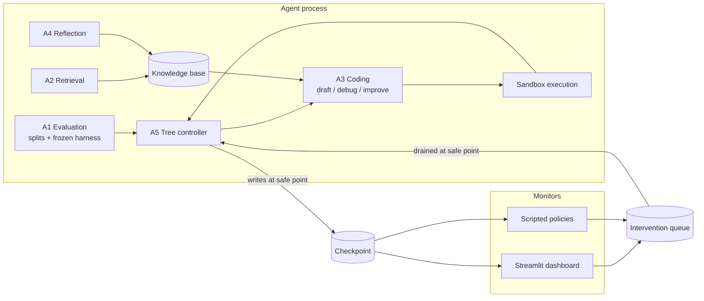

# Interruptible MLE Agent

An LLM agent for machine learning engineering that you can watch and steer while it runs.

MLE agents run for hours, steering on a validation score they compute themselves, and that score drifts away from true test performance the longer they run. The agent can't see this from inside its own loop. A human watching can. This project builds a tree-search MLE agent that exposes its progress in real time, pauses at safe points, and accepts structured human interventions, then measures which interventions are actually worth making.

DSA4213 (Natural Language Processing for Data Science), NUS, Semester 1 AY2026/2027.

> **Status:** complete. 118 four-hour runs on six MLE-bench Lite tasks, plus five live human sessions. The final report is [`docs/report/final_report.pdf`](docs/report/final_report.pdf); every result is under [`docs/results/`](docs/results/full-plan.md).

## Research question

**Which human interventions into a tree-search MLE agent improve its outcomes, and at what interaction cost?**

We compare interventions that change the agent's next *action* (prune, redirect, override) against interventions that change its *beliefs* (inject knowledge, correct a stored finding). See [`docs/proposal/proposal.pdf`](docs/proposal/proposal.pdf) for the full proposal.

## Results

The short answer: **none of the interventions we tested improved the agent, and the reason is instructive.** From the [final report](docs/report/final_report.pdf):

- **The agent is reliable.** All 63 runs on the three text tasks made a valid submission above the leaderboard median (insults gold on 21 of 21), for about $21 in total.
- **No condition beat the autonomous baseline** (C1). A Friedman test across the text tasks finds no difference between C1, C4 and C5 (p = 0.55), and no task separates them.
- **Separating evaluation from optimisation is what mattered.** With A1's frozen harness, the validation-test drift the interventions were built to catch barely occurred. Without it, validation was more optimistic and one spooky run leaked (validation 0.152, test 0.408).
- **The size of the held-out splits explains most of the differences between tasks.** Where they are large, validation and probe agree and the monitors have nothing to do; where they are small, both are noisy and the monitors act on noise.
- **People helped most through task knowledge and a direct instruction channel**, not by watching scores: in the live sessions, redirects and injected ideas did not change what the agent did.

| Where | What |
|---|---|
| [`docs/report/`](docs/report/final_report.pdf) | The final report (LaTeX source and PDF) |
| [`docs/results/full-plan.md`](docs/results/full-plan.md) | Results of the full plan, task by task, with links to every write-up |
| [`docs/results/analysis/`](docs/results/analysis/README.md) | Cross-task analysis of the 63 text-task runs, with tables, charts and scripts |
| `docs/results/<task>/` | One folder per task: runs, grades, live sessions (C6) and analysis |

## How it works



Key design rules:

- **The agent is the only writer to live state.** The dashboard and scripted policies read the checkpoint and append to the queue. Nothing else.
- **Interventions apply at safe points only**, meaning node boundaries, after a script has been scored and before the next node is selected.
- **The evaluation harness is frozen.** A1 builds it once; A3 cannot modify it.
- **A probe split** is hidden from the agent and shown only to the monitor, giving the human a signal the agent never optimises against.

Details: [`docs/architecture.md`](docs/architecture.md) and [`docs/intervention-protocol.md`](docs/intervention-protocol.md).

## Repository layout

```
configs/              base settings and one file per experimental condition
dashboard/            Streamlit monitor (reads checkpoint, writes queue)
docs/                 architecture, protocol, experiment plan, proposal
  results/            every result, one folder per task, plus the cross-task analysis
  report/             the final report (LaTeX source and PDF)
scripts/              data preparation, run launchers, grading and analysis
src/imle/
  agents/             A1 evaluation, A2 retrieval, A3 coding, A4 reflection
  policies/           scripted intervention policies (C4, C5)
  controller.py       A5 tree controller and main loop
  tree.py             node and search-tree data model
  intervention.py     intervention schema and queue
  checkpoint.py       atomic checkpoint read/write
  apply.py            applies queued interventions at a safe point
  monitor.py          read-only views of a run for the dashboard and reports
  sandbox.py          isolated script execution
  llm_log.py          prompt, completion, and cost logging
tests/
```

## Setup


```bash
git clone https://github.com/nabilrakaiza/interruptible-mle-agent.git
cd interruptible-mle-agent
python -m venv .venv && source .venv/bin/activate
pip install -e .
cp .env.example .env        # then fill in your keys
bash scripts/prepare_data.sh
```

MLE-bench data preparation needs Kaggle API credentials and acceptance of each competition's rules on Kaggle. Install MLE-bench in its own virtual environment, not the agent's, and set `MLEBENCH_PYTHON` in `.env` to its interpreter (used for grading).

### Keys and credentials

Only one secret is needed to run the agent: `OPENROUTER_API_KEY`. Everything else is optional or lives outside `.env`.

| Where | Name | Needed for |
|---|---|---|
| `.env` | `OPENROUTER_API_KEY` | **Required.** Every run calls the LLM through OpenRouter (DeepSeek V4 Flash for experiments; the free Nemotron model for tests). The team can share one key, so all spending shows in one account. |
| `.env` | `GEMINI_API_KEY` | Optional: cheap local tests with `llm.provider: gemini` or `scripts/smoke_run.py --provider gemini`. Not used by the grid. |
| `.env` | `LLM_MODEL` | Optional, not secret. Leave empty for experiments (the default model). For free tests set `nvidia/nemotron-3-ultra-550b-a55b:free` and use `llm.routing: null`, since the fp8 routing excludes the free endpoint. |
| `.env` | `MLEBENCH_DATA_DIR` | Optional, not secret: only if the datasets are not in MLE-bench's default cache folder. |
| `.env` | `MLEBENCH_PYTHON` | Optional, not secret: MLE-bench's interpreter, for `scripts/grade.py` (or pass `--mlebench-python`). |
| `~/.kaggle/kaggle.json` | Kaggle API token | Once per machine, to download and prepare the six datasets. Each person uses their own Kaggle account, with every competition's rules accepted. |
| Colab or Kaggle secrets | GitHub token | Only for the cloud notebooks, and only while the repository is private (`docs/cloud-runs.md`). |

A machine that runs grid shards needs `OPENROUTER_API_KEY`, the prepared datasets, and Docker with the sandbox image (or `--sandbox subprocess` on Colab and Kaggle). Grading can happen on any one machine that has MLE-bench installed.

The sandbox image, needed for `sandbox.backend: docker` (the default):

```bash
docker build -t imle-sandbox:latest .
```

On a Mac without Docker Desktop, `brew install colima docker`, then `colima start --cpus 2 --memory 5`. Colima mounts only your home folder into its VM, so keep run folders under it (the repo's `runs/` is fine; `/tmp` is not).

## Running the agent

Run these from the repository root with the venv active. Start Docker (or Colima) first, unless you pass `--sandbox subprocess`.

**1. Check the install, with no key, data or Docker.** This runs the controller on a toy task with canned LLM replies, in a few seconds:

```bash
python scripts/smoke_run.py --dry-run
```

**2. A free test run on a real task.** Every agent is on and the free Nemotron model is used, so a 2-hour run costs nothing. It checks the key, the data, Docker and grading together:

```bash
python scripts/cloud_run.py --config configs/conditions/test_free.yaml \
    --task spooky-author-identification --seed 0 --budget-hours 2 \
    --sandbox docker --runs-root runs/test
```

Use `--budget-hours 0.25` for a quick check. OpenRouter caps free-model requests per day, and a 2-hour run makes about 70 to 110 requests.

**3. One experiment run.** This uses DeepSeek V4 Flash and costs a few cents. Any file in `configs/conditions/` works: `c1_autonomous`, `c4_divergence_prune`, `c5_finding_correction`, `ablation_a1_off`, `ablation_a4_off`, or `c6_live` for a C6 session (`docs/c6-protocol.md`).

```bash
python scripts/cloud_run.py --config configs/conditions/c1_autonomous.yaml \
    --task spooky-author-identification --seed 0 --sandbox docker
```

- The run goes to `runs/<condition>_<task>_seed<seed>/` (or under `--runs-root`).
- Running the same command again resumes a run that was cut off. A finished run is skipped, or, with a larger `--budget-hours`, continued.
- On Colab and Kaggle, use `--sandbox subprocess` and the notebooks in `notebooks/` (`docs/cloud-runs.md`).
- `cloud_run.py` wraps `python -m imle.controller` and retries after crashes; the controller can also be called directly.

**4. The experiment grid.** `configs/schedule.yaml` holds the half plan used for the slides (`docs/experiments.md`): 13 runs per task at 2 hours, each person running one task on their own machine. The full plan is 21 runs per task at 4 hours (C1, C4 and C5 on seeds 0 to 4; A1-off and A4-off on seeds 0 to 2); `configs/schedule_nomad_full.yaml` is an example for one task, and `configs/kaggle_sessions.yaml` with `notebooks/kaggle_run.ipynb` ran insults and pizza on Kaggle (`docs/cloud-runs.md`). Running the same command again resumes a grid:

```bash
python scripts/launch_grid.py --status                         # the whole grid: done, unfinished, to do
python scripts/launch_grid.py --only <task> --dry-run          # the runs for your task, without starting them
python scripts/launch_grid.py --only <task> --seed 0           # run seed 0 of every condition (one night); then --seed 1, --seed 2
```

`--shard i/N` instead splits the whole grid across N machines by position.

**5. Watch and intervene.** Open the dashboard in another terminal, while a run goes or afterwards:

```bash
streamlit run dashboard/app.py
```

In Live mode, the chart, tree and findings refresh every 5 seconds, and queued actions apply at the agent's next safe point. Replay mode steps through the checkpoints of any run. Test scores show only for finished runs.

**What a run leaves behind.** Everything is in the run folder, and every analysis script reads only that:

```
runs/<run>/
  config.yaml          the merged settings the run used
  checkpoints/<step>/  tree.json, findings.json, status.json (status.final_node is the submitted node)
  nodes/<node>/        solution.py, stdout and stderr, output/predictions.csv, submission.csv
  llm_calls.jsonl      every LLM call with tokens and cost
  queue.jsonl, applied.jsonl   interventions queued, and what happened to each
  grade.json           MLE-bench's grade of the final submission, after scripts/grade.py
```

**6. Analysis.** These scripts read saved run folders only:

```bash
python scripts/grade.py runs/grid               # MLE-bench grades into each run's grade.json
python scripts/outcomes.py runs/grid            # valid / above-median / medal rates with CIs, C2 and C3 post hoc
python scripts/cost_report.py runs/grid --project configs/schedule.yaml
python scripts/interaction_cost.py runs/grid    # interventions, timing, human time
python scripts/replay_policy.py runs/grid       # where C4's rule would have pruned in other runs
python scripts/error_taxonomy.py runs/grid
python scripts/trajectory.py runs/grid/<run>
python scripts/analyze_val_test_gap.py --runs-dir runs/grid     # validation-test gap per node, run and condition
python scripts/analyze_probe_fidelity.py --runs-dir runs/grid   # probe-test agreement
python scripts/finding_accuracy.py runs/grid/*                  # A4 findings: unsupported and replicated
python scripts/leakage_stress_test.py --execute                 # A1's leakage screen on planted leaks
```

## Experimental conditions

| ID | Condition | Needs runs |
|---|---|---|
| C1 | Autonomous baseline | yes |
| C2 | Oracle final-node selection | post hoc from C1 |
| C3 | Top-k submission (k=3) | post hoc from C1 |
| C4 | Scripted: divergence pruning (action) | yes |
| C5 | Scripted: finding correction (belief) | yes |
| C6 | Live human sessions | one 2-hour session per task (five; none on pizza) |
| A1-off / A4-off | Ablations: no evaluation agent / no reflection | yes |
| A2-off | Ablation: no retrieval | not run (optional in the proposal) |

Tasks: six MLE-bench Lite competitions, all CPU-feasible: `spooky-author-identification`, `detecting-insults-in-social-commentary` and `random-acts-of-pizza` (text), `nomad2018-predict-transparent-conductors` (tabular), `leaf-classification` and `aerial-cactus-identification` (image). Cactus ran 13 runs (the half plan's seeds) at 4 hours; the other five ran the full 21. See [`docs/experiments.md`](docs/experiments.md).

## Data and secrets

- **Never commit competition data.** It's covered by Kaggle's terms. Commit the preparation script only.
- **Never commit keys.** They live in `.env`, which is gitignored.
- Run folders (`runs/`) are gitignored: they are large and contain copies of the competition data. Each member keeps the runs they made, and they are available on request. Grades, outcomes, intervention logs and analysis tables for every run are in `docs/results/`.

## Team

| Member | Role | Tasks run |
|---|---|---|
| Nabil Rakaiza Abror | Core agent (A3, A5), A2 retrieval, integration, cross-task analysis | spooky, insults, pizza |
| Dziand Dafi Ginandjar | Evaluation and memory (A1, A4, C5) | cactus |
| Medhini Karthikeyan | Infrastructure (sandbox, logging) | leaf |
| Sahishnav Kritin Karamarathur Senthil Kumar | Interaction layer (C4, dashboard) | nomad |

Each member's contributions in detail: [`docs/contributions.md`](docs/contributions.md) and the contribution statement in the report.

## Built on

- [MLE-bench](https://github.com/openai/mle-bench): tasks, grading, medal thresholds
- [AIDE](https://github.com/WecoAI/aideml): design of the tree search and the draft, debug and improve operators (our own implementation)
- [Streamlit](https://streamlit.io): monitoring dashboard

Key references: MLE-bench (arXiv:2410.07095), AIDE (arXiv:2502.13138), AIRA-dojo (arXiv:2507.02554), MLE-STAR (arXiv:2506.15692), ML-Master 2.0 (arXiv:2601.10402). Full list in the proposal and the final report.
