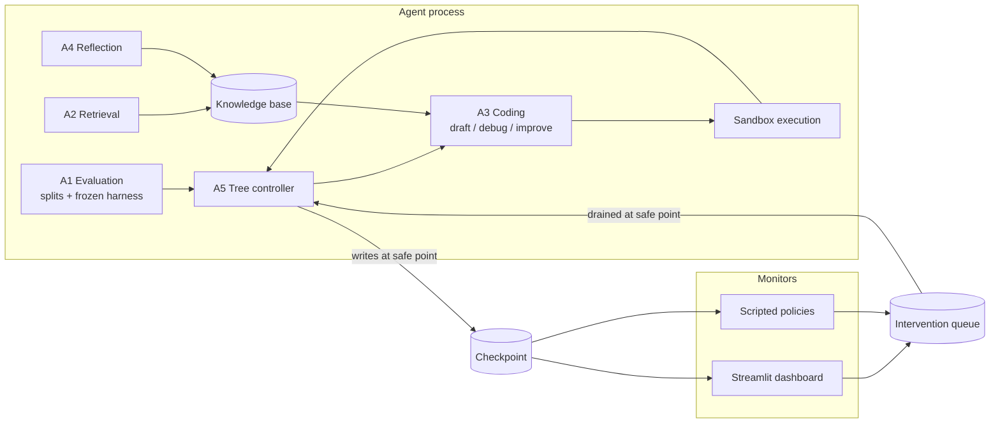

# Interruptible MLE Agent

An LLM agent for machine learning engineering that you can watch and steer while it runs.

MLE agents run for hours, steering on a validation score they compute themselves, and that score drifts away from true test performance the longer they run. The agent can't see this from inside its own loop. A human watching can. This project builds a tree-search MLE agent that exposes its progress in real time, pauses at safe points, and accepts structured human interventions, then measures which interventions are actually worth making.

DSA4213 (Natural Language Processing for Data Science), NUS, Semester 1 AY2026/2027.

> **Status:** all agents and policies are built and tested end to end; the experiment grid (the half plan in [`docs/experiments.md`](docs/experiments.md)) is next.

## Research question

**Which human interventions into a tree-search MLE agent improve its outcomes, and at what interaction cost?**

We compare interventions that change the agent's next *action* (prune, redirect, override) against interventions that change its *beliefs* (inject knowledge, correct a stored finding). See [`docs/proposal/proposal.pdf`](docs/proposal/proposal.pdf) for the full proposal.

## How it works



Key design rules:

- **The agent is the only writer to live state.** The dashboard and scripted policies read the checkpoint and append to the queue. Nothing else.
- **Interventions apply at safe points only**, meaning node boundaries, after a script has been scored and before the next node is selected.
- **The evaluation harness is frozen.** A1 builds it once; A3 cannot modify it.
- **A probe split** is hidden from the agent and shown only to the monitor, giving the human a signal the agent never optimises against.

Details: [`docs/architecture.md`](docs/architecture.md) and [`docs/intervention-protocol.md`](docs/intervention-protocol.md).

## Repository layout

```
configs/              base settings and one file per experimental condition
dashboard/            Streamlit monitor (reads checkpoint, writes queue)
docs/                 architecture, protocol, experiment plan, proposal
scripts/              data preparation, run launchers, grading and analysis
src/imle/
  agents/             A1 evaluation, A2 retrieval, A3 coding, A4 reflection
  policies/           scripted intervention policies (C4, C5)
  controller.py       A5 tree controller and main loop
  tree.py             node and search-tree data model
  intervention.py     intervention schema and queue
  checkpoint.py       atomic checkpoint read/write
  apply.py            applies queued interventions at a safe point
  monitor.py          read-only views of a run for the dashboard and reports
  sandbox.py          isolated script execution
  llm_log.py          prompt, completion, and cost logging
tests/
```

## Setup


```bash
git clone https://github.com/nabilrakaiza/interruptible-mle-agent.git
cd interruptible-mle-agent
python -m venv .venv && source .venv/bin/activate
pip install -e .
cp .env.example .env        # then fill in your keys
bash scripts/prepare_data.sh
```

MLE-bench data preparation needs Kaggle API credentials and acceptance of each competition's rules on Kaggle. Install MLE-bench in its own virtual environment, not the agent's, and set `MLEBENCH_PYTHON` in `.env` to its interpreter (used for grading).

### Keys and credentials

Only one secret is needed to run the agent: `OPENROUTER_API_KEY`. Everything else is optional or lives outside `.env`.

| Where | Name | Needed for |
|---|---|---|
| `.env` | `OPENROUTER_API_KEY` | **Required.** Every run calls the LLM through OpenRouter (DeepSeek V4 Flash for experiments; the free Nemotron model for tests). The team can share one key, so all spending shows in one account. |
| `.env` | `GEMINI_API_KEY` | Optional: cheap local tests with `llm.provider: gemini` or `scripts/smoke_run.py --provider gemini`. Not used by the grid. |
| `.env` | `LLM_MODEL` | Optional, not secret. Leave empty for experiments (the default model). For free tests set `nvidia/nemotron-3-ultra-550b-a55b:free` and use `llm.routing: null`, since the fp8 routing excludes the free endpoint. |
| `.env` | `MLEBENCH_DATA_DIR` | Optional, not secret: only if the datasets are not in MLE-bench's default cache folder. |
| `.env` | `MLEBENCH_PYTHON` | Optional, not secret: MLE-bench's interpreter, for `scripts/grade.py` (or pass `--mlebench-python`). |
| `~/.kaggle/kaggle.json` | Kaggle API token | Once per machine, to download and prepare the six datasets. Each person uses their own Kaggle account, with every competition's rules accepted. |
| Colab or Kaggle secrets | GitHub token | Only for the cloud notebooks, and only while the repository is private (`docs/cloud-runs.md`). |

A machine that runs grid shards needs `OPENROUTER_API_KEY`, the prepared datasets, and Docker with the sandbox image (or `--sandbox subprocess` on Colab and Kaggle). Grading can happen on any one machine that has MLE-bench installed.

The sandbox image, needed for `sandbox.backend: docker` (the default):

```bash
docker build -t imle-sandbox:latest .
```

On a Mac without Docker Desktop, `brew install colima docker`, then `colima start --cpus 2 --memory 5`. Colima mounts only your home folder into its VM, so keep run folders under it (the repo's `runs/` is fine; `/tmp` is not).

Running:

```bash
# one run (starts, or resumes if it was cut off)
python scripts/cloud_run.py --config configs/conditions/c1_autonomous.yaml \
    --task spooky-author-identification --seed 0 --sandbox docker

# the experiment grid (configs/schedule.yaml), split over N machines; run again to resume
python scripts/launch_grid.py --status
python scripts/launch_grid.py --shard 0/3

# watch and intervene
streamlit run dashboard/app.py
```

Analysis, from saved run folders only:

```bash
python scripts/grade.py runs/grid               # MLE-bench grades into each run's grade.json
python scripts/outcomes.py runs/grid            # valid / above-median / medal rates with CIs, C2 and C3 post hoc
python scripts/cost_report.py runs/grid --project configs/schedule.yaml
python scripts/interaction_cost.py runs/grid    # interventions, timing, human time
python scripts/replay_policy.py runs/grid       # where C4's rule would have pruned in other runs
python scripts/error_taxonomy.py runs/grid
python scripts/trajectory.py runs/grid/<run>
```

## Experimental conditions

| ID | Condition | Needs runs |
|---|---|---|
| C1 | Autonomous baseline | yes |
| C2 | Oracle final-node selection | post hoc from C1 |
| C3 | Top-k submission (k=3) | post hoc from C1 |
| C4 | Scripted: divergence pruning (action) | yes |
| C5 | Scripted: finding correction (belief) | yes |
| C6 | Live human sessions | a few |
| A1-off / A4-off / A2-off | Ablations | yes |

Tasks: six MLE-bench Lite competitions, all CPU-feasible. See [`docs/experiments.md`](docs/experiments.md).

## Data and secrets

- **Never commit competition data.** It's covered by Kaggle's terms. Commit the preparation script only.
- **Never commit keys.** They live in `.env`, which is gitignored.
- Large run artefacts (`runs/`) are gitignored. Share them via cloud storage.

## Team

| Member | Role |
|---|---|
| TBD | Infrastructure and experiments |
| TBD | Core agent (A3, A5) |
| TBD | Evaluation and memory (A1, A4) |
| TBD | Interaction layer (checkpoint, queue, dashboard) |

## Built on

- [MLE-bench](https://github.com/openai/mle-bench): tasks, grading, medal thresholds
- [AIDE](https://github.com/WecoAI/aideml): starting point for the tree search and operators
- [Streamlit](https://streamlit.io): monitoring dashboard

Key references: MLE-bench (arXiv:2410.07095), AIDE (arXiv:2502.13138), AIRA-dojo (arXiv:2507.02554), MLE-STAR (arXiv:2506.15692), ML-Master 2.0 (arXiv:2601.10402). Full list in the proposal.
