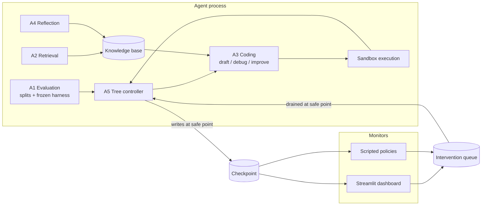

# Interruptible MLE Agent

An LLM agent for machine learning engineering that you can watch and steer while it runs.

MLE agents run for hours, steering on a validation score they compute themselves, and that score drifts away from true test performance the longer they run. The agent can't see this from inside its own loop. A human watching can. This project builds a tree-search MLE agent that exposes its progress in real time, pauses at safe points, and accepts structured human interventions, then measures which interventions are actually worth making.

DSA4213 (Natural Language Processing for Data Science), NUS, Semester 1 AY2026/2027.

> **Status:** proposal stage. Interfaces are defined; agents are stubs.

## Research question

**Which human interventions into a tree-search MLE agent improve its outcomes, and at what interaction cost?**

We compare interventions that change the agent's next *action* (prune, redirect, override) against interventions that change its *beliefs* (inject knowledge, correct a stored finding). See [`docs/proposal/proposal.pdf`](docs/proposal/proposal.pdf) for the full proposal.

## How it works



Key design rules:

- **The agent is the only writer to live state.** The dashboard and scripted policies read the checkpoint and append to the queue. Nothing else.
- **Interventions apply at safe points only**, meaning node boundaries, after a script has been scored and before the next node is selected.
- **The evaluation harness is frozen.** A1 builds it once; A3 cannot modify it.
- **A probe split** is hidden from the agent and shown only to the monitor, giving the human a signal the agent never optimises against.

Details: [`docs/architecture.md`](docs/architecture.md) and [`docs/intervention-protocol.md`](docs/intervention-protocol.md).

## Repository layout

```
configs/              base settings and one file per experimental condition
dashboard/            Streamlit monitor (reads checkpoint, writes queue)
docs/                 architecture, protocol, experiment plan, proposal
scripts/              data preparation and run launchers
src/imle/
  agents/             A1 evaluation, A2 retrieval, A3 coding, A4 reflection
  policies/           scripted intervention policies (C4, C5)
  controller.py       A5 tree controller and main loop
  tree.py             node and search-tree data model
  intervention.py     intervention schema and queue
  checkpoint.py       atomic checkpoint read/write
  sandbox.py          isolated script execution
  llm_log.py          prompt, completion, and cost logging
tests/
```

## Setup

> Setup will be finalised after the pilot run. Current plan:

```bash
git clone https://github.com/nabilrakaiza/interruptible-mle-agent.git
cd interruptible-mle-agent
python -m venv .venv && source .venv/bin/activate
pip install -e .
cp .env.example .env        # then fill in your keys
bash scripts/prepare_data.sh
```

MLE-bench data preparation needs Kaggle API credentials and acceptance of each competition's rules on Kaggle.

Running (planned):

```bash
python -m imle.controller --config configs/conditions/c1_autonomous.yaml --task spooky-author-identification --seed 0
streamlit run dashboard/app.py
```

## Experimental conditions

| ID | Condition | Needs runs |
|---|---|---|
| C1 | Autonomous baseline | yes |
| C2 | Oracle final-node selection | post hoc from C1 |
| C3 | Top-k submission (k=3) | post hoc from C1 |
| C4 | Scripted: divergence pruning (action) | yes |
| C5 | Scripted: finding correction (belief) | yes |
| C6 | Live human sessions | a few |
| A1-off / A4-off / A2-off | Ablations | yes |

Tasks: six MLE-bench Lite competitions, all CPU-feasible. See [`docs/experiments.md`](docs/experiments.md).

## Data and secrets

- **Never commit competition data.** It's covered by Kaggle's terms. Commit the preparation script only.
- **Never commit keys.** They live in `.env`, which is gitignored.
- Large run artefacts (`runs/`) are gitignored. Share them via cloud storage.

## Team

| Member | Role |
|---|---|
| TBD | Infrastructure and experiments |
| TBD | Core agent (A3, A5) |
| TBD | Evaluation and memory (A1, A4) |
| TBD | Interaction layer (checkpoint, queue, dashboard) |

## Built on

- [MLE-bench](https://github.com/openai/mle-bench): tasks, grading, medal thresholds
- [AIDE](https://github.com/WecoAI/aideml): starting point for the tree search and operators
- [Streamlit](https://streamlit.io): monitoring dashboard

Key references: MLE-bench (arXiv:2410.07095), AIDE (arXiv:2502.13138), AIRA-dojo (arXiv:2507.02554), MLE-STAR (arXiv:2506.15692), ML-Master 2.0 (arXiv:2601.10402). Full list in the proposal.
