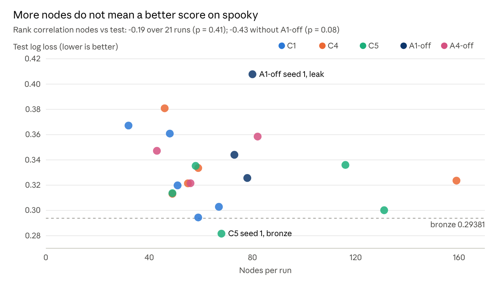
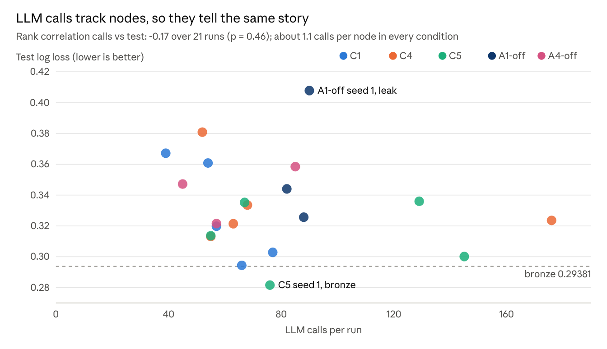
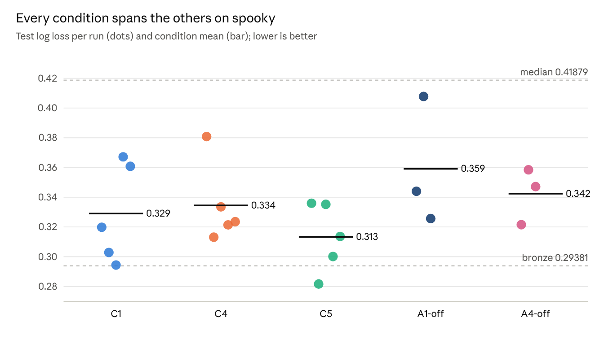
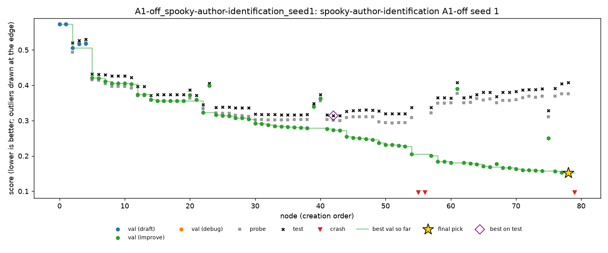
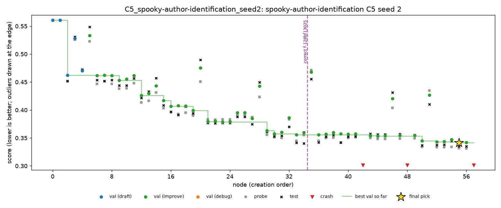

# Spooky

> Exported 9 Nov 2026 from Nabil's analysis doc, [Full-plan results](https://claude.ai/artifact/1AHcCcSLLuLfqSGPkTFe5W), tab “Spooky”. Charts are images of the doc's live charts. Paths under `runs/` are on Nabil's Mac; the data and scripts used are copied next to this file.

8 Nov 2026 · Nabil Rakaiza Abror

## Spooky: all 21 runs

All 21 runs are valid and above the median (0.4188); one medalled, C5 seed 1 (bronze, 0.2816 against a 0.2938 line). Spooky is multiclass log loss, so lower is better. Each run had 4 hours, DeepSeek V4 Flash 0731 (fp8) and Docker with 2 CPUs on a MacBook Pro M1.

| Condition | Seed | Nodes | LLM calls | Calls/node | Test | Medal | Pick | Validation | Probe | Test − val | C2 (oracle) | C3 (top 3) | Pick loss | Live interventions | C4 rule replayed | Cost ($) | Cut-off calls |
| --- | --- | --- | --- | --- | --- | --- | --- | --- | --- | --- | --- | --- | --- | --- | --- | --- | --- |
| C1 | 0 | 51 | 57 | 1.12 | 0.3198 |  | n45 | 0.3070 | 0.3170 | +0.0128 | 0.3186 | 0.3186 | 0.0012 | – | no prune | 0.10 | 0 |
| C1 | 1 | 67 | 77 | 1.15 | 0.3029 |  | n54 | 0.3041 | 0.2945 | −0.0013 | 0.3010 | 0.3029 | 0.0019 | – | no prune | 0.19 | 1 |
| C1 | 2 | 59 | 66 | 1.12 | 0.2944 |  | n46 | 0.2953 | 0.2914 | −0.0009 | 0.2944 | 0.2944 | 0 | – | no prune | 0.16 | 0 |
| C1 | 3 | 32 | 39 | 1.22 | 0.3672 |  | n30 | 0.3650 | 0.3810 | +0.0022 | 0.3672 | 0.3672 | 0 | – | no prune | 0.14 | 3 |
| C1 | 4 | 48 | 54 | 1.12 | 0.3608 |  | n45 | 0.3587 | 0.3782 | +0.0021 | 0.3608 | 0.3608 | 0 | – | no prune | 0.15 | 0 |
| C4 | 0 | 46 | 52 | 1.13 | 0.3808 |  | n26 | 0.3690 | 0.3759 | +0.0118 | 0.3785 | 0.3785 | 0.0024 | none fired | – | 0.09 | 0 |
| C4 | 1 | 49 | 55 | 1.12 | 0.3131 |  | n46 | 0.3017 | 0.3023 | +0.0114 | 0.3131 | 0.3131 | 0 | none fired | – | 0.09 | 0 |
| C4 | 2 | 59 | 68 | 1.15 | 0.3336 |  | n56 | 0.3269 | 0.3378 | +0.0066 | 0.3247 | 0.3247 | 0.0089 | none fired | – | 0.18 | 2 |
| C4 | 3 | 55 | 63 | 1.15 | 0.3214 |  | n53 | 0.3161 | 0.3192 | +0.0053 | 0.3214 | 0.3214 | 0 | none fired | – | 0.21 | 1 |
| C4 | 4 | 159 | 176 | 1.11 | 0.3236 |  | n150 | 0.3082 | 0.3088 | +0.0154 | 0.3236 | 0.3236 | 0 | none fired | – | 0.35 | 0 |
| C5 | 0 | 116 | 129 | 1.11 | 0.3360 |  | n104 | 0.3216 | 0.3128 | +0.0144 | 0.3358 | 0.3358 | 0.0001 | 1 correction | no prune | 0.20 | 0 |
| C5 | 1 | 68 | 76 | 1.12 | 0.2816 | bronze | n66 | 0.2755 | 0.2898 | +0.0061 | 0.2810 | 0.2814 | 0.0006 | none fired | worse by 0.0035, still bronze | 0.13 | 0 |
| C5 | 2 | 58 | 67 | 1.16 | 0.3352 |  | n55 | 0.3415 | 0.3315 | −0.0063 | 0.3352 | 0.3352 | 0 | 1 correction | no prune | 0.20 | 3 |
| C5 | 3 | 131 | 145 | 1.11 | 0.3001 |  | n128 | 0.2969 | 0.2973 | +0.0033 | 0.3001 | 0.3001 | 0 | none fired | no prune | 0.25 | 0 |
| C5 | 4 | 49 | 55 | 1.12 | 0.3136 |  | n46 | 0.3006 | 0.3028 | +0.0130 | 0.3136 | 0.3136 | 0 | none fired | no prune | 0.10 | 0 |
| A1-off | 0 | 73 | 82 | 1.12 | 0.3440 |  | n70 | 0.2563 | 0.3252 | +0.0878 | 0.3230 | 0.3418 | 0.0211 | – | worse by 0.0025 | 0.16 | 0 |
| A1-off | 1 | 80 | 90 | 1.12 | 0.4078 |  | n78 | 0.1518 | 0.3758 | +0.2560 | 0.3140 | 0.3915 | 0.0938 | – | better by 0.0934 | 0.22 | 2 |
| A1-off | 2 | 78 | 88 | 1.13 | 0.3257 |  | n75 | 0.3145 | 0.3049 | +0.0112 | 0.3257 | 0.3257 | 0 | – | no prune | 0.28 | 2 |
| A4-off | 0 | 56 | 57 | 1.02 | 0.3215 |  | n54 | 0.3127 | 0.3224 | +0.0089 | 0.3215 | 0.3215 | 0 | – | no prune | 0.11 | 0 |
| A4-off | 1 | 82 | 85 | 1.04 | 0.3584 |  | n78 | 0.3594 | 0.3604 | −0.0009 | 0.3568 | 0.3568 | 0.0016 | – | no prune | 0.24 | 2 |
| A4-off | 2 | 43 | 45 | 1.05 | 0.3472 |  | n41 | 0.3428 | 0.3390 | +0.0044 | 0.3471 | 0.3471 | 0 | – | no prune | 0.13 | 1 |

## Spooky by condition

C5 has the best mean (0.3133) and the only medal, but each condition's seeds vary more (0.04 to 0.08) than the gaps between means (at most 0.046). Without A1, validation is far more optimistic (median gap +0.088 against +0.002 to +0.011).

| Condition | Runs | Mean test | SD | Best | Worst | Medals | Median test − val | Median pick loss | Mean nodes | Mean calls/node | Mean cost ($) |
| --- | --- | --- | --- | --- | --- | --- | --- | --- | --- | --- | --- |
| C1 | 5 | 0.3290 | 0.033 | 0.2944 | 0.3672 | 0 | +0.002 | 0 | 51 | 1.15 | 0.15 |
| C4 | 5 | 0.3345 | 0.027 | 0.3131 | 0.3808 | 0 | +0.011 | 0 | 74 | 1.13 | 0.18 |
| C5 | 5 | 0.3133 | 0.023 | 0.2816 | 0.3360 | 1 | +0.006 | 0 | 84 | 1.12 | 0.17 |
| A1-off | 3 | 0.3592 | 0.043 | 0.3257 | 0.4078 | 0 | +0.088 | 0.021 | 77 | 1.12 | 0.22 |
| A4-off | 3 | 0.3424 | 0.019 | 0.3215 | 0.3584 | 0 | +0.004 | 0 | 60 | 1.04 | 0.16 |

Calls per node are about 1.1 everywhere: one coding call per node plus the retrieval agent once per run and the A4 reflection agent every few nodes. A4-off has no reflection calls, hence 1.04.

## Spooky: search size against test

Runs that made more nodes, or more LLM calls, did not score clearly better: the trend is weak and not significant at 21 runs.

The two charts look alike because calls are about 1.1 per node in every condition. What a run tries matters more than how much it tries: C1 seed 2 reached 0.294 in 59 nodes, while C4 seed 4 stayed at 0.324 after 159.

## Spooky final models

Every submitted model is built on TF-IDF or count features, almost always with linear classifiers, naive Bayes, or both. Only two include tree models: C1 seed 2 (ExtraTrees on stylometric features) and A1-off seed 0 (gradient boosting, random forest, ExtraTrees and an MLP inside its stack). The 9 best runs all combine naive Bayes with a linear model; the three weakest runs with A1 (C4 seed 0, C1 seeds 3 and 4) have no naive Bayes.

| Condition | Seed | Test | Final model |
| --- | --- | --- | --- |
| C1 | 0 | 0.3198 | Voting ensemble of logistic regression, ComplementNB and SGD on word, word+punctuation (1–3) and character TF-IDF |
| C1 | 1 | 0.3029 | Soft vote of a calibrated SGD classifier on a word, character, shape, function-word and punctuation-sequence TF-IDF union, and ComplementNB |
| C1 | 2 | 0.2944 | Stack of ComplementNB, MultinomialNB and logistic regression on word and character TF-IDF and counts, plus ExtraTrees on stylometric features |
| C1 | 3 | 0.3672 | Stacked logistic regressions over several TF-IDF views (function words, content words, full words, char\_wb); no naive Bayes |
| C1 | 4 | 0.3608 | One logistic regression on word (1–3), character and char\_wb TF-IDF plus a proper-noun view; no naive Bayes |
| C4 | 0 | 0.3808 | Logistic regression on a word and character TF-IDF union with chi-square selection (300k features), isotonic-calibrated; no naive Bayes |
| C4 | 1 | 0.3131 | Per-class logit blend of logistic regression and ComplementNB on character TF-IDF, temperature-scaled |
| C4 | 2 | 0.3336 | LinearSVC and ComplementNB on hybrid character TF-IDF, combined with stylometric features by a logistic calibrator |
| C4 | 3 | 0.3214 | Stack of logistic regression, ComplementNB and BernoulliNB specialists on word, character and char\_wb TF-IDF |
| C4 | 4 | 0.3236 | ComplementNB alone on char\_wb and word TF-IDF plus stylometric tokens; no linear model |
| C5 | 0 | 0.3360 | Calibrated ComplementNB on word and char\_wb TF-IDF (max\_df 0.6) |
| C5 | 1 | 0.2816 | Fold-averaged stack of LinearSVC, logistic regression, ComplementNB, MultinomialNB and BernoulliNB on TF-IDF and counts, with a logistic calibrator |
| C5 | 2 | 0.3352 | Calibrated BernoulliNB on word 1–2-gram counts with a custom stylometric tokenizer |
| C5 | 3 | 0.3001 | Blend of calibrated ComplementNB and SGD on word and char\_wb TF-IDF; blend weight and temperature tuned jointly |
| C5 | 4 | 0.3136 | Stack of logistic regression, ComplementNB, MultinomialNB and BernoulliNB on word, character and punctuation-shape TF-IDF |
| A1-off | 0 | 0.3440 | Logit-space stack of logistic regression, ComplementNB, MultinomialNB, SGD, gradient boosting, random forest, ExtraTrees and an MLP on many TF-IDF views, including stopword sequences |
| A1-off | 1 | 0.4078 | Stack of logistic regression and SGD on TF-IDF and hashed counts; the meta-model is fitted and scored on its own validation split (the leak) |
| A1-off | 2 | 0.3257 | Calibrated MultinomialNB on word (with punctuation tokens) and character TF-IDF |
| A4-off | 0 | 0.3215 | Stack of logistic regression, ComplementNB, MultinomialNB and BernoulliNB, including a raw word-count NB, temperature-scaled |
| A4-off | 1 | 0.3584 | Calibrated SGD classifier on character and char\_wb TF-IDF plus sentence statistics |
| A4-off | 2 | 0.3472 | Stack of five calibrated base models: logistic regression on TF-IDF and on SVD components, ComplementNB and BernoulliNB |

## Reading the spooky tables

- **Test − val:** positive means validation looked better than test turned out (optimistic), since lower is better.
- **Pick loss:** the pick's test minus the run's best node on test (C2). Zero means the pick was the best node.
- **C3 (top 3):** the best test score among the three best nodes on validation.
- **C4 rule replayed:** the pick's test if the C4 rule had been applied after the run (`scripts/replay_policy.py`); only for runs that are not C4.
- **Live interventions:** only C4 and C5 have a live rule; “–” means the condition has none.
- **Cut-off calls:** LLM replies stopped at the 64k-token cap, each losing several minutes.

Footnotes for the report:

- Seeds 0–2 began as 2-hour half-plan runs and were resumed to 4 hours; seeds 3–4 ran 4 hours in one go.
- All cut-off calls but one came before StreamLake was excluded on 2 Nov.
- Seed 0 ran before the 26 Oct sandbox fix (PR #7), which cost A4-off seed 0 two crashed nodes.
- A1-off gets the validation rows as training data and makes its own split, so its validation scores are not comparable with the other conditions'.
- Source: `runs/_analysis/full_plan/` (copied to [`spooky/data/`](spooky/tables/)) (outcomes, val\_test\_gap, replay, cost) and `spooky_runs.csv`.

# Spooky report draft

## Summary

On spooky, every run made a valid submission above the median, one reached bronze, and no condition is clearly better than another.

1. **The conditions overlap.** Mean test log loss ranges from 0.313 (C5) to 0.359 (A1-off), but each condition's own seeds spread 0.04 to 0.08 and every 95% interval overlaps C1's.
2. **A1 is what keeps validation honest.** Without it one run leaked (validation 0.152, test 0.408); with it, test stays within 0.016 of validation on all 18 runs.
3. **The scripted interventions had nothing to fix.** C4 never fired in its 5 runs and C5 made 2 corrections that changed nothing, because validation and the 1,762-row probe agreed.
4. **What the agent built decides the score.** The 9 best runs all combine naive Bayes with a linear model; the three weakest runs with A1 have no naive Bayes. Search size barely matters (rank correlation −0.19).
5. **Selection is not the bottleneck.** The pick is the run's best node on test in 12 of 21 runs and at most 0.009 behind it with A1.

## Setup

- **Task:** `spooky-author-identification`, identify which of three authors (Poe, Lovecraft, Shelley) wrote a sentence. Multiclass log loss, lower is better; MLE-bench thresholds: median 0.4188, bronze 0.2938, silver 0.2700, gold 0.1651.
- **Data split (A1, fixed seed 0 for every run):** 12,335 training rows, 3,524 validation, 1,762 probe (never shown to the agent), 1,958 test (MLE-bench's held-out answers). A1-off runs get the validation rows as extra training data and make their own split.
- **Conditions:** C1 (autonomous), C4 (divergence prune), C5 (finding correction) with seeds 0–4; ablations A1-off and A4-off with seeds 0–2. C2 (oracle pick) and C3 (best of top 3 on validation) are computed from the C1 runs after the fact.
- **Budget and machine:** 4 hours per run, DeepSeek V4 Flash 0731 (fp8) through OpenRouter, Docker sandbox with 2 CPUs and 4 GB on a MacBook Pro M1, 20-minute limit per script, at most 200 nodes.
- **History:** seeds 0–2 ran as 2-hour runs (25–28 Oct) and were resumed to 4 hours; seeds 3–4 and A1-off/A4-off seed 2 ran 4 hours in one go (31 Oct–5 Nov). From 2 Nov, StreamLake was excluded from routing.

## Results by condition

All 21 runs are valid and above the median; the only medal is C5 seed 1 (bronze, 0.2816). The means rank C5 (0.313), C1 (0.329), C4 (0.335), A4-off (0.342) and A1-off (0.359), but no gap is larger than the spread of a single condition (table “Spooky by condition” above).

Bootstrap 95% intervals of the mean (2,000 resamples over runs):

| Condition | Mean | 95% interval |
| --- | --- | --- |
| C5 | 0.3133 | 0.2954 – 0.3312 |
| C1 | 0.3290 | 0.3029 – 0.3552 |
| C4 | 0.3345 | 0.3185 – 0.3578 |
| A4-off | 0.3424 | 0.3215 – 0.3584 |
| A1-off | 0.3592 | 0.3257 – 0.4078 |

Every interval overlaps C1's, so no ranking is claimed. With five seeds (three for the ablations), differences below about 0.03 cannot be told from seed noise.

C2 (the best node on test) and C3 (best of the top 3 on validation) improve C1 by only 0.0006 and 0.0002 on average: C1 almost always submitted its best node.

## A1 and validation honesty

A1 is the component that matters most on spooky: it holds the validation split and scores every node itself, and with it no run leaked.

- **Without A1, validation can lie.** A1-off seed 1 stacked models with a meta-model fitted and scored on its own validation split: validation 0.152, test 0.408, a gap of 0.256. A1-off seed 0's gap is 0.088. With A1 the median gap is +0.002 to +0.011 per condition and never above 0.016.
- **The leak gets worse with time.** Extending A1-off seed 1 from 2 to 4 hours took its test from 0.337 to 0.408: the agent kept optimising a validation score that rewarded the leak. The other 11 runs extended with A1 improved or held.
- **A1's leakage check fired twice** (C1 seed 2, n15 and n38: models evaluated on validation rows they were fitted on); both were debugged into clean nodes.
- **The split is fixed.** Every run with A1 sees byte-identical training, prediction and label files (split seed 0), so all conditions and seeds face the same validation, probe and test rows.
- **No script read outside its input.** All 1,456 node scripts of the 21 runs were scanned: none touched the harness labels or MLE-bench's answers.
- **No overlap between splits:** none of the 7,244 validation, probe and test sentences also appears in the agent's training rows (exact match after lower-casing and whitespace normalisation), and the training rows contain no duplicates.

A person therefore does not need to check spooky runs for validation leakage: A1 already prevents it. What A1 cannot catch is a leak built into the data itself (pizza has one); spooky's data has none.

## Final selection and the probe

On spooky both the validation split and the probe track test closely, so picking by validation loses almost nothing.

- **Pick loss:** with A1, the pick is a median 0.000 behind the run's best node on test, at most 0.009 (C4 seed 2). Without A1 it reaches 0.094 (the leaking run).
- **Probe fidelity:** across each run's nodes, the probe's ranking correlates 0.97 with test and validation's 0.98 (median rank correlation, runs with A1). The probe's top 5 nodes share 4 with test's top 5.
- **Why it works here:** the probe has 1,762 rows and validation 3,524, large enough for their scores to rank nodes the way test does. On insults (395 probe rows) and pizza (288) the same measure falls to 0.59 and 0.28.

## Interventions: C4 (divergence prune)

C4 never fired in its 5 live runs, because the situation it watches for did not happen with A1 on.

- **The rule:** at each safe point, prune a branch when, since the lineage's best-probe node, validation has improved by at least 1% and the probe has worsened by at least 1% (relative) over 2 or more nodes, and the loss holds in 95% of paired bootstrap resamples of the probe.
- **Live:** 0 prunes in 5 runs. C4's runs are therefore C1's agent on other random paths; their mean (0.335) is within C1's interval.
- **Replayed after the fact** on the 16 runs that are not C4 (`scripts/replay_policy.py`): it fires on 3. It catches A1-off seed 1's leak (the pick would improve from 0.408 to 0.314) and makes the pick slightly worse on A1-off seed 0 (+0.0025) and C5 seed 1 (+0.0035, still bronze).
- **Reading:** C4 helps exactly where the agent's own validation is broken, which A1 already prevents. With A1 on, it has nothing to do.

## Interventions: C5 (finding correction)

C5 made 2 corrections in its 5 runs and neither changed what the agent submitted.

- **The rule:** at each safe point, every finding A4 has written is checked against the nodes it cites. A cited node fails if it was pruned or crashed (unless the finding says the change hurts), or if its gain over its parent does not replicate on the probe: validation gain minus probe gain above 0.02 for a “helps” finding, or the reverse for “hurts”. A finding is deleted from the agent's memory once half or more of its checked nodes fail.
- **Seed 0:** deleted a finding whose only cited node (n51) had crashed. Harmless; the pick was unaffected.
- **Seed 2:** deleted “character n-grams hurt” at safe point 35. The probe agreed they hurt, just by less (−0.036 against −0.058 on validation), a gap of 0.022 against the 0.02 limit: a false positive. Afterwards the agent tried character n-grams once more (n46, of 58 nodes); the pick (n55) does not use them.
- **Seeds 1, 3, 4:** no correction.
- **Why so little:** on spooky the probe agrees with validation, so A4's findings that are consistent with their own numbers also replicate (81% of them). C5 only acts when a finding fails on the probe, and with a large probe that rarely happens.
- **When it would matter:** a wrong finding that steers the agent away from a good idea, on a task whose probe is large enough to expose it. The closest case on spooky is outside the grid: in the C6 session the agent kept “prefer TF-IDF over naive Bayes”, true for the two drafts it compared but wrong for what mattered later. It was true for the two drafts it cited, so a replication check like C5's would not have caught it.

## C6: the live session

The C6 session scored 0.368 because the agent never discovered the naive Bayes plus linear combination, and the monitor had neither the expertise nor the internet access to point it there.

- **Run:** one 2-hour session (seed 100, 28 Oct), oversight by a team member who is not an ML expert. 12 interventions, all applied: 9 prunes, 2 redirects, 1 finding correction. Details: `docs/results/spooky-c6.md`.
- **Result:** test 0.3684, within the range of C1 at the 2-hour mark (0.295 to 0.390, mean 0.344, read from the five C1 runs' checkpoints). Not better than the autonomous agent.
- **Why it stalled:** the final model is SGD only, with no naive Bayes. From checkpoint 5 to 49 the agent's memory held its own finding “prefer explicit TF-IDF features over hashing and NB for this task”, true for the two drafts it compared but wrong for what mattered later. The agent tried naive Bayes again only at the last node.
- **The check:** adding one ComplementNB component to C6's submitted script, tuned only on that script's own internal split, takes test from 0.368 to 0.336 (`docs/results/spooky-drops.md`). That is about as large as anything a condition did on spooky.
- **What it shows:** the signal that mattered (a finding that closes off a family that usually wins on text) is visible to an ML expert in this field, or to an agent that can search for how others solved the task. We had neither. We have no such experts, and we did not let the agent or the monitor search online, because spooky is an old public competition and a search could simply return the known solution. A scripted rule like C5 cannot supply this either: the finding's evidence did replicate.

## What the agent built

On spooky the score depends on which model family a run lands on, more than on its condition or how many nodes it tries.

- **Model families:** every submitted model uses TF-IDF or count features, almost always with linear classifiers, naive Bayes, or both. Only two picks contain tree models (C1 seed 2, A1-off seed 0) and none a neural network (table “Spooky final models” above).
- **Naive Bayes plus a linear model:** the 9 best runs all combine the two. The three weakest runs with A1 (C4 seed 0, C1 seeds 3 and 4) have no naive Bayes. Naive Bayes alone is not enough: the three runs that use only naive Bayes land mid-table (0.324 to 0.336).
- **The information was available, the recipe was not:** the retrieval agent's model cards mentioned naive Bayes 35 times across the 21 runs and many nodes tried it. What the agent lacked is competition-specific know-how (that a naive Bayes and logistic-regression ensemble wins here), which a person or web search could supply.
- **Search size:** nodes per run range from 32 to 159, with no clear link to test (rank correlation −0.19, p = 0.41; charts above). C1 seed 2 reached 0.294 in 59 nodes; C4 seed 4 stayed at 0.324 after 159.
- **2 hours versus 4:** of the 13 half-plan runs resumed to 4 hours, 10 improved, 2 held and 1 got worse; the median change was −0.007. The worse one is the leaking A1-off seed 1 (+0.070). C1's mean went from 0.344 at 2 hours (read from the checkpoints of all five seeds) to 0.329 at 4.

## Annotated trajectories

Two runs show what an intervention can and cannot do: one where a rule would have helped (a leak), one where a rule fired on nothing (a false positive).

### A1-off seed 1: a leak the C4 rule would have caught

- **n0 to n43, honest progress.** The agent builds a stacked ensemble of naive Bayes and linear models, one base model per node. Validation and the probe fall together, to 0.272 and 0.300 at n43 (test 0.314).
- **n44, the leak starts.** The agent changes what its logistic meta-model sees and fits it on the same holdout split it scores on. Validation drops to 0.254 while the probe rises to 0.309 and test to 0.326.
- **n54, n58: it gets worse.** Each new batch of meta-features (“uncertainty”, “cross-model agreement”) lowers validation further (0.205, then 0.184) and raises the probe (0.309, then 0.349).
- **n78, the pick:** validation 0.152, probe 0.376, test 0.408. The agent picked its most leaked node, because validation was the only signal it had.
- **What a rule does:** replayed, C4 fires after n45 (validation +7.6%, probe −3.5% since n43) and prunes the leaking branch; the pick becomes n43 at 0.314, which would rank 7th of the 21 spooky runs. A1 prevents this leak in the first place.

### C5 seed 2: a correction that changed nothing

- **The path:** a single family all run: word counts into ComplementNB, later BernoulliNB, with calibration and a custom tokenizer adding style pseudo-tokens (capitalisation, contractions, British spelling). No linear model ever joins it.
- **n34, the correction.** C5 deletes the finding “character n-grams hurt” (n28 against n27): validation said −0.058, the probe −0.036, a gap 0.002 over the limit. The probe agreed the change hurt, so the finding was right.
- **Afterwards:** the agent tries character n-grams once more (n46), keeps improving the naive Bayes path, and picks n55 (test 0.335), which is also its best node on test.
- **What it shows:** the correction neither helped nor harmed. The run's limit was the model family: naive Bayes alone stays mid-table (0.335 against 0.282 for the best combined run).

Charts from `scripts/trajectory.py` on the saved runs (`runs/grid/<run>/trajectory/`); each run's `timeline.md` lists every event.

## Search behaviour, errors, findings and cost

The agent is reliable but most of its improvement attempts do not improve.

- **Node outcomes:** of 1,459 nodes, 96.0% worked; 37 timed out (20-minute limit), 17 crashed, 3 had an unusable LLM reply and 2 were stopped by A1's leakage check.
- **Improvements:** half of the working improve attempts (638 of 1,268) did not beat their parent, and 50 changed nothing in the predictions. 18 working nodes were labelled validation overfitting.
- **A4's findings:** 321 findings in the runs with A4, 291 of which claim that a change helps or hurts. 62% are supported by the validation scores they cite, and 50% also hold on the probe; most unsupported ones contradict their own cited numbers.
- **LLM use:** about 1.1 calls per node (one coding call per node, one retrieval call per run, a reflection call every 8–10 nodes); 1,626 calls in all. 17 calls were cut off at the 64k-token cap, all but one before StreamLake was excluded on 2 Nov.
- **Cost:** about $3.70 for the 21 runs, $0.09 to $0.35 per run (mean $0.17).

## Comparison with other agents

Our spooky mean matches AIDE with o1-preview and beats AIDE with GPT-4o, but recent agents are clearly better. The numbers come from MLE-bench's official grading reports; those runs mostly had 24 hours, a GPU and frontier models, so the comparison is indicative only.

| Agent | Model | Seeds | Mean log loss | Best | Medals |
| --- | --- | --- | --- | --- | --- |
| Ours (all conditions) | DeepSeek V4 Flash, 4 h, 2 CPUs | 21 | 0.333 | 0.282 | 1 |
| AIDE, CPU only | GPT-4o | 12 | 0.498 | 0.382 | 0 |
| AIDE | GPT-4o | 38 | 0.577 | 0.283 | 1 |
| AIDE | o1-preview | 20 | 0.321 | 0.258 | 5 |
| ML-Master | DeepSeek-R1 | 3 | 0.279 | 0.260 | 2 |
| AIRA-dojo | o3 | 20 | 0.247 | 0.197 | 17 |
| MLEvolve | Gemini-3-Pro | 3 | 0.214 | 0.197 | 3 |

Means are over valid submissions. Source: `runs/*/…grading_report.json` in the [MLE-bench repository](https://github.com/openai/mle-bench), extracted to `runs/_analysis/mlebench_compare/per_task.csv`.

## Limitations

- **Few seeds:** five per main condition and three per ablation; differences below about 0.03 in log loss are within seed noise.
- **Resumed runs:** seeds 0–2 ran 2 hours and were resumed to 4, a day or more later; the others ran 4 hours in one go. Resuming continues the same tree, but the two halves ran on different days, with whichever providers OpenRouter routed to then.
- **Seed 0 is older:** it ran before the 26 Oct sandbox fix (PR #7), which cost A4-off seed 0 two crashed nodes, and seeds 0–2 used StreamLake, whose cut-off calls cost some runs up to 30 minutes.
- **No outside knowledge:** the agent saw only library documentation (scikit-learn pages) and its own model's knowledge, with no web search. Spooky is an old public competition, so search could also find the known answer; a fair test of search needs a task whose solution is not online.
- **One small model:** every run used DeepSeek V4 Flash; stronger models may behave differently, as the comparison table suggests.
- **One machine:** all spooky runs ran on a MacBook Pro M1 in Docker with 2 CPUs and 4 GB; insults and pizza ran on Kaggle, so cross-task differences mix task and platform.
- **Interventions untested in their target case:** C4 and C5 are designed for validation that diverges from a reliable probe. With A1 on, spooky never produced that case, so the grid cannot show whether they help when it happens.

## Scope against the proposal

For spooky the design matches the proposal (4-hour runs, 5 seeds for C1/C4/C5, 3 for the ablations); the differences are in how it ran and in what was dropped.

- **Budget reached in two steps:** seeds 0–2 first ran 2 hours (the half plan for the slides, 25–28 Oct) and were resumed to 4.
- **Tasks:** the proposal had six tasks at the full plan. Spooky, insults and pizza have it; leaf has 21 runs; cactus and nomad stayed at the half plan (13 runs, 2 hours).
- **A2-off not run:** the optional retrieval ablation was dropped first, as the proposal allowed.
- **CPU only, small sandbox:** no GPU; 2 CPUs and 4 GB per script. The proposal's sandbox stack listed LightGBM; the image we used has scikit-learn and PyTorch (CPU) but not LightGBM or XGBoost.
- **Interventions:** prune, correct, override and redirect work; abandoning a running script was not implemented.
- **C6:** one 2-hour session per task, run by the task's owner alone, with no separate observer; on spooky it was shorter than the 4-hour grid runs.
- **Reliability checks:** both checks were run: A1's screen caught 4 of 4 planted leaks with no false alarm, and a planted instruction never reached code (tab “Reliability checks”). A1's optional LLM review was not tested.
- **Model:** one low-cost model, DeepSeek V4 Flash 0731 (fp8), for every run, chosen on 22 Oct for cost.

## Reproducibility

A single run cannot be reproduced exactly, so our claims are about distributions over seeds, not about individual runs.

- **Why runs are not reproducible:** the agent's code comes from an LLM whose outputs are not deterministic, even with a fixed seed sent to the API, and OpenRouter routes each call to whichever provider is available. The same seed can therefore produce a different tree on another day.
- **What we do instead:** five seeds per main condition and three per ablation, reported with bootstrap intervals, and no ranking where intervals overlap (the proposal's rule).
- **What is fixed:** the data split (seed 0, byte-identical in every run with A1), the evaluation code (unchanged since 26 Oct), the model version (DeepSeek V4 Flash 0731, fp8 only), and the condition configs in `configs/`.
- **What is reproducible exactly:** every number in this report. Each run saves its checkpoints, node scripts, predictions and every LLM call (`llm_calls.jsonl`), and grading and analysis rerun from those files (`scripts/grade.py`, `outcomes.py`, `replay_policy.py`, and the others). Rerunning a saved node script reproduces its score: in the insults model check, all nine reruns matched their nodes within 0.0015.
