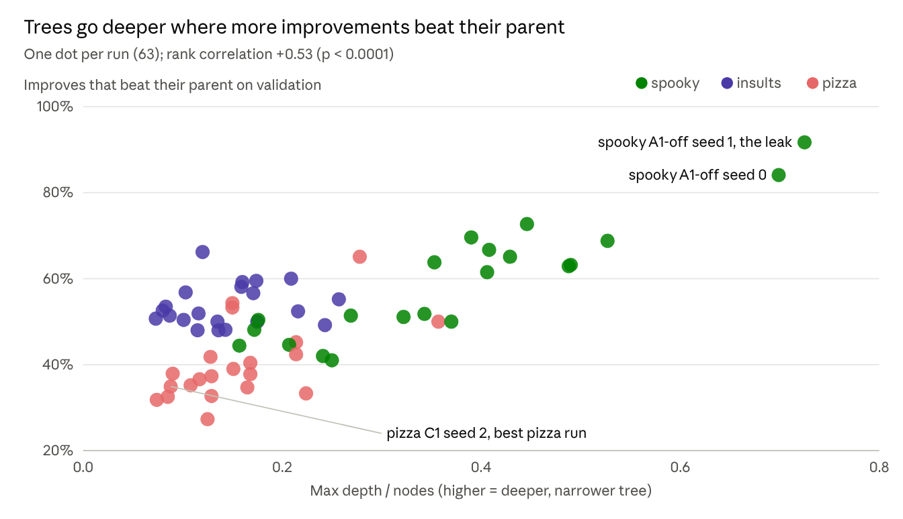

# Tree shape: deep and wide runs

> Exported 9 Nov 2026 from Nabil's analysis doc, [Full-plan results](https://claude.ai/artifact/1AHcCcSLLuLfqSGPkTFe5W), tab “Tree shape”. Charts are images of the doc's live charts. Paths under `runs/` are on Nabil's Mac; the data and scripts used are copied next to this file.

A run's tree goes deep when validation keeps rewarding the agent's next change and wide when its improvement chains stall; within a task, the shape does not predict the test score. Measured on the 63 full-plan runs (spooky, insults, pizza), 8 Nov 2026.

## Why trees go deep or wide

- **The search improves the best open node.** A child that beats its parent on validation becomes the new best, so the next step builds on it: the tree goes deeper.
- **A chain stalls after 3 weak attempts.** Three improve attempts that each gain less than 0.1% (relative) exhaust the chain, and the agent moves to the next-best open node elsewhere: the tree goes wider.
- **15% of improve steps explore** a random other node, which adds some width to every run.

## Shape by task

| Task | Median nodes | Median max depth | Max depth / nodes | Children per expanded node | Improves that beat their parent |
| --- | --- | --- | --- | --- | --- |
| Spooky | 59 | 21 | 0.37 | 1.7 | 62% |
| Insults | 82 | 12 | 0.14 | 2.0 | 52% |
| Pizza | 95 | 13 | 0.15 | 2.5 | 38% |

Spooky goes deep: a large validation split (3,524 rows) and steady small gains, such as one more naive Bayes variant or n-gram view, keep clearing the 0.1% bar. Pizza goes wide: a 576-row validation split is noisy, so fewer changes clear the bar and chains stall.

## Does shape predict the score?

No, within a task.

- **Depth relative to size against test:** rank correlation about −0.1 on each task, not significant.
- **Wide runs can be the best:** pizza's best run (C1 seed 2, 0.709) and the bronze C5 seed 0 are among its widest.
- **Insults:** max depth correlates with test (+0.53, p = 0.01), but so does the number of nodes (+0.45): runs that searched more scored a little higher, whatever the shape.
- **The deepest runs are the leaking ones:** spooky A1-off seeds 0 and 1 reached depth 51 and 58, with 84% and 92% of improvements beating their parent on validation. Seed 1 is the leak (test 0.408, the worst spooky run): its validation kept rewarding the leak, so the agent kept going deeper.

## Reading

- **“Wide means stuck” holds for how the tree is built:** a wide tree is a run whose improvement chains kept stalling.
- **It does not hold for the outcome:** on pizza, stalling mostly reflects validation noise, and wide runs score as well as deep ones.
- **“Deep means the task needs a lot of feature engineering” is partly true:** spooky's depth comes from many small, real feature and ensemble gains. But depth also appears when validation is broken (the A1-off leaks), so depth shows that validation kept rewarding steps, not that the steps were good. Whether that reward is real depends on A1 and on the size of the validation split.

## Caveats

- Max depth / nodes penalises runs with many nodes.
- The 0.1% threshold and the patience of 3 decide where a chain stops; other settings would change every shape.
- Source: `runs/_analysis/full_plan/tree_shape.csv` and `tree_shape.py`.
