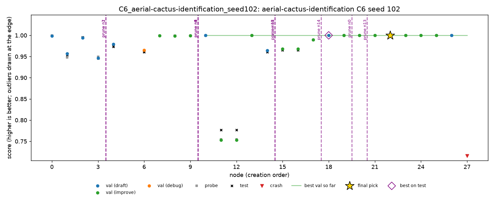

# Cactus, C6 at 4 hours: Claude as the monitor

11 Nov 2026, 11:26 to 15:26, Dziand's Mac. One C6 run on `aerial-cactus-identification`, seed 102, with a 4 hour budget to match the 4 hour grid in `runs/grid4h`. **Every intervention was made by Claude (Opus 5.5), not by a person.** The participant couldn't watch the run, so Claude acted as the monitor, checking about every 15 minutes. The notes are in [`cactus-c6-4h/c6_notes.md`](cactus-c6-4h/c6_notes.md). The 2 hour C6 sessions (seeds 100 and 101) are in [`cactus-c6.md`](cactus-c6.md).

Cactus is ROC AUC, so **higher is better**. MLE-bench thresholds: median 0.9991, and bronze, silver and gold are all 1.0.

## Setup

- **Run:** `c6_live.yaml` (`monitors: [human]`), 4 hours, DeepSeek V4 Flash 0731, A1, Docker, `--retries 0`. The same as the 4 hour grid's C1 runs apart from the monitor.
- **Machine:** the same 13-inch MacBook Pro as seed 101 (Apple M2, 8 cores, 8 GB of memory, macOS 14.1.1; `machine.jsonl`: arm64, 8 CPUs, 8.6 GB), kept awake with `caffeinate`. Docker ran in Colima with a 2-CPU, 5 GB VM. **Training was on CPU only:** Docker on macOS can't reach the M2's GPU, none of the 28 scripts asked for CUDA or MPS, and some set `torch.device("cpu")` explicitly. Nodes took 4.4 minutes at the median (23.0 at most).
- **Power:** on AC at launch, then **on battery from about 12:20 to 14:05** (down to 38%), and the display slept briefly at about 13:10. The power log shows no system sleep, and no node failed or timed out because of it.
- **Monitor:** Claude, through the same channel as the dashboard: it appended prune lines to `queue.jsonl` (`source: human`, every note starting `[Claude]`) and checked `applied.jsonl` afterwards. It read the node tree's validation scores, plans and scripts at each check. It did not read test scores until the run had ended. The participant opened the dashboard once (11:31, viewing n0 at 11:46).
- **Criteria,** taken from seed 101's session: prune non-CNN models, broken branches, and regressions; focus on the best branches. During the run Claude settled on a cutoff: prune a child only if it is at least about 0.0001 below its parent, and keep smaller dips as noise.
- **Cost:** about $0.10, 32 LLM calls, 28 nodes, 35 steps.

## Result

| | Validation | Probe | **Test** |
|---|---|---|---|
| **n22 (submitted)**, depthwise-separable CNN | 0.99998 | 0.99997 | **0.99995** (6th of 10 working nodes) |
| n18 (best on test, joint), residual CNN | 0.99997 | 1.00000 | 0.99999 |
| n20 (best on test, joint; same predictions as n18) | 0.99997 | 1.00000 | 0.99999 |

- Valid and above the median, no medal: every medal needs a perfect AUC of 1.0.
- C2 (oracle) and C3 (top 3) are both 0.99999 (n18 is third by validation), so the pick lost 0.00004 from near-ties on validation.
- **Against the 4 hour grid** (test, seeds 0 to 2): C1 0.99953, 0.99970, 0.99987; C4 0.99998, 0.99968, 0.99989; C5 0.99948, 0.99988, 0.99967; A1-off 0.99997, 0.99998; A4-off 0.99981, 0.99974. C6's 0.99995 is above every C1 seed, but with one run on another seed, the interventions' effect can't be separated from seed noise. Every working node is within 0.00013 of a perfect AUC.

## Interventions

10 queued, 9 applied, 1 dropped (already pruned), all prunes. The first applied at 11:57, 31 minutes in, after 3.5 of 28 nodes; the last at 13:42. Prunes applied between 14 seconds and 7 minutes after they were queued, at the next safe point.

| Queued | Action | Why | What it did, judged on test afterwards |
|---|---|---|---|
| 11:54 | prune n1, n2 | not CNN models: PCA + sklearn MLP (val 0.957) and colour/texture features + gradient boosting (0.9938) | nothing measurable: test 0.954 and 0.995 |
| 12:09 | prune n3, n4 (and n6) | not CNN models: logistic regression (0.946) and Extra-Trees (0.979) on raw pixels. n6 (sklearn MLP, 0.965) was already gone with n3's subtree, so its prune was dropped | nothing measurable: best of them 0.973 on test |
| 12:24 | prune n11 | broken: EMA on n10 dropped val to 0.7528, and its debug n12 gave the same predictions | removed a dead branch (test 0.776) |
| 12:24 | prune n8 | regression: test-time augmentation 0.99878 below its parent n7's 0.99905 | nothing measurable: n8 was 0.99909 on test, and its line was later pruned |
| 12:39 | prune n14 | not a CNN model: a soft-voting sklearn ensemble on PCA features, 0.964 to 0.968 over three steps | the in-flight child n17 (the ensemble plus a small CNN, 0.990) finished under a pruned parent; the branch's best on test was 0.989 |
| 13:24 | prune n0 | weakest CNN line: best 0.99934 (n9) against n18 0.99997 and n10 0.99995 | nothing measurable: the line's best on test was 0.99934 |
| 13:39 | prune n13 | regression: translation augmentation 0.99972 below its parent n10's 0.99995 | nothing measurable: test 0.99976, below n10's 0.99989 |

Claude also chose **not** to act on four small dips under its 0.0001 cutoff: n21 (mixup, 0.00003 below n19), n23 (cutout, 0.00006 below n22), n24 (photometric, 0.00001) and n25 (pooled features, 0.00006). On test, n23 and n24 both beat their parent n22, so pruning them would have been wrong for the right reasons: the dips were noise.

## Against the C4 rule

`scripts/replay_policy.py` runs the C4 rule over the run's checkpoints. It fires **0 times**, as on every cactus run so far, and picks the same n22.

| | C4 prunes | C4 does not prune |
|---|---|---|
| **Claude prunes** | 0 | 9 (n1, n2, n3, n4, n14: wrong model family; n11: broken; n8, n13: regressions against the parent; n0: a weaker line) |
| **Claude does not prune** | 0 | the rest |

The largest gap between validation and probe on a working node was 0.0004 (n10), well below the rule's threshold.

## What the run suggests

1. **The pattern from seed 101 repeats with an AI monitor.** In a healthy run the monitor's work is pruning waste: wrong model families, a broken branch and small regressions. None of the pruned nodes beat the pick on test, and none of the prunes changed it.
2. **The agent keeps drafting non-CNN models on purpose.** Its drafts said "instead of a CNN…" or "avoiding deep learning", so diversity, not a bug, produced 5 of the 9 prunes. A rule against them would save steps, but seed 100 showed a non-CNN draft can turn into a CNN at its first improve step.
3. **Prunes still act late.** n17 ran under n16 after n14's prune had been queued, and n11's prune took 5.5 minutes to apply. A monitor checking every 15 minutes is a node or two behind.
4. **A noise cutoff matters at the ceiling.** Two of the four dips Claude kept (n23, n24) were better than their parent on test. Pruning every child that scored lower on validation, as for n8 and n13, would have pruned on noise.
5. **The pick was a near-tie.** n22, n19, n18 and n20 are within 0.00001 on validation; picking by validation lost 0.00004 on test. With C3's top 3, it would have been 0.99999.

## Limitations

- **The monitor was Claude, not a person.** This run measures an AI monitor following a human's earlier criteria, not C6 as the protocol defines it, and can't be pooled with seeds 100 and 101 as a human session.
- **No human debrief.** The participant asked for this report straight after the run, so there was no review of Claude's decisions before grading.
- **Claude checked every 15 minutes,** a fixed schedule, not a person's attention, and couldn't use the dashboard's views.
- **One run, seed 102,** against a 3-seed grid at seeds 0 to 2.
- **A ceiling task.** Every working CNN node is within 0.00013 of a perfect AUC, so no intervention could move the outcome beyond noise, and medals need 1.0.
- **On battery for 1 h 45 m,** which can slow CPU training. Node times were not compared with the grid's.
- `interaction_cost.py` reports 0 human minutes, because the prunes were written to the queue directly, not from a dashboard session.

## Files

- **`cactus-c6-4h/c6_notes.md`:** Claude's notes, one row per check, with every decision and its reason.
- **`cactus-c6-4h/queue.jsonl`, `applied.jsonl`, `dashboard_log.jsonl`:** every intervention and dashboard event, with timestamps.
- **`cactus-c6-4h/grade.json`:** MLE-bench's grade.
- **`cactus-c6-4h/timeline.md`, `trajectory.png`:** the run's timeline and chart.
- **`cactus-c6-4h/interaction_cost.md`, `replay_policy.csv`:** the outputs of `scripts/interaction_cost.py` and `scripts/replay_policy.py`.
- **On Dziand's Mac only:** `runs/grid4h/C6_aerial-cactus-identification_seed102/` and its log.
