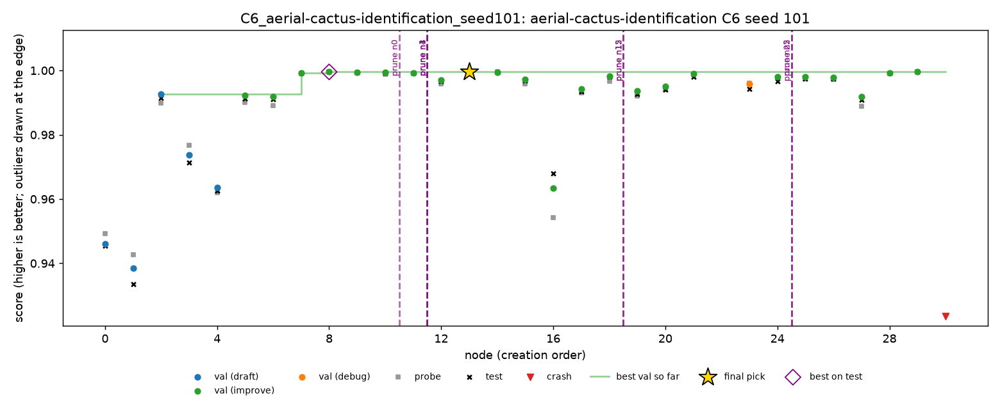

# Cactus, C6: live session

28 Oct 2026, 19:14 to 21:15, Dziand's Mac. One C6 session on `aerial-cactus-identification`, seed 101, following `docs/c6-protocol.md`. An earlier C6 run on seed 100 (14:23 to 16:23) was not watched and is reported separately below. The participant's full notes, with the debrief, are in [`cactus-c6/c6_notes.md`](cactus-c6/c6_notes.md).

Cactus is ROC AUC, so **higher is better**. MLE-bench thresholds: median 0.9991, and bronze, silver and gold are all 1.0.

## Setup

- **Run:** `c6_live.yaml` (`monitors: [human]`), 2 hours, DeepSeek V4 Flash 0731, A1, Docker. The same as the grid's C1 runs apart from the monitor.
- **Machine:** a 13-inch MacBook Pro (2022, Apple M2, 8 cores, 8 GB of memory), macOS 14.1.1, on power and kept awake with `caffeinate`. Docker ran in Colima (conda-forge build) with a 2-CPU, 5 GB VM, and each script's sandbox was capped at 2 CPUs and 4 GB inside it. **Training was on CPU only:** Docker on macOS can't reach the M2's GPU, and none of the 27 PyTorch scripts asked for CUDA or MPS. Nodes took 2.3 minutes at the median (13.3 at most). The run records its machine in `machine.jsonl`.
- **Participant:** Dziand, who owns cactus, had seen the 13 grid runs and the result of the unwatched seed 100 run (test 0.99989), not this one.
- **Rules:** oversight only (prune, final pick, correct a finding). Redirect only on what the dashboard shows. No injected ideas and no outside lookups. The participant watched throughout and asked about the dashboard every 10 to 20 minutes.
- **Assistant:** Claude explained the dashboard and node scripts during the session and, **unlike spooky's session, suggested interventions** when asked "what should I intervene?". Every prune made was one it had suggested; the participant chose which to take, when, and typed the reasons. It did not read test scores until the run ended.
- **Cost:** $0.152, 38 LLM calls, 31 nodes. Seed 100: $0.095, 36 calls, 31 nodes.

## Result

| | Validation | Probe | **Test** |
|---|---|---|---|
| **n13 (submitted)** | 0.99965 | 0.99967 | **0.99953** (3rd of 14 working nodes) |
| n8 (best on test, joint) | 0.99963 | 0.99956 | 0.99956 |
| n29 (best on test, joint; a rebuild of n8) | 0.99963 | 0.99956 | 0.99956 |

- Valid and above the median, no medal: every medal needs a perfect AUC of 1.0.
- C2 (oracle) and C3 (top 3) are both 0.99956, so the pick lost 0.00003, from a tie on validation (0.99965 against 0.99963).
- C6's 0.99953 is within C1's seed range (0.99917 to 0.99994) and below its mean (0.99963). The unwatched seed 100 scored 0.99989. With one session on another seed, this can't separate the interventions' effect from seed noise.

## Interventions

8 queued, all applied, all prunes. The first came at 35% of the run's nodes, 50 minutes in.

| Time | Action | Why | What it did, judged on test afterwards |
|---|---|---|---|
| 20:03 to 20:05 | prune n0, n1, n3, n4 | "not a CNN model": logistic regression, PCA + logistic regression, ExtraTrees and an sklearn MLP on flattened pixels, 0.94 to 0.97 against the CNN line's 0.9996 | nothing measurable: none of them was being extended, and the best of them scored 0.971 on test |
| ~20:15 | none: keep n8 | the participant first wanted to prune n8 because its children n9 and n10 scored lower; kept it on Claude's advice that a prune removes n8 itself, the best node | right: n8 is joint best on test (0.99956). The pick would have stayed n13 either way |
| 20:27 | prune n15, n12 | "it is a regression, not worth extending": n12 (mixup, 0.9970) and n15 (input normalisation, 0.9972) against n7 and n11's 0.9992 | nothing measurable: n15's children n16 and n18 had already run, and the branch's best on test was 0.9981. n15 improved on its own parent n2; it was a regression only against its BatchNorm siblings |
| ~20:33 | none: n5 and n6 left | Claude suggested pruning the n5 branch (0.994) and n6 (0.9918); the participant waited | n5's branch climbed to 0.9990 (n21) before it was pruned; n6 was never pruned and took the last five nodes |
| 20:44 | prune n22, n5 | n22 crashed on `GroupNorm(8, …)` over the 3-channel input ("debug the weak branch": don't spend a debug step on it); n5's branch was still behind with 33 minutes left ("focus on n8 and n13") | the debug (n23) had already run; the prune moved the last five nodes to n6, which rebuilt n7 and n8 exactly (n28, n29). The pruned branch's best on test was 0.9980 |
| 21:00 | none: keep n13 rather than override to n8 | looked at n8's and n13's children, then no override; n13 and n8 were tied on validation (0.99965 against 0.99963) | n8 was 0.00003 better on test: noise either way |

The participant also chose **not** to act on two things:

- **n11 repeating n7 exactly** (both added BatchNorm to n2, 0.9992118 on validation). A duplicate wastes a step but harms nothing, and there was nothing to undo.
- **The plateau at about 0.9996** from n8 (19:47) to the end. Claude suggested ending the run early twice (at about 19:56 and 20:21); the participant let it run its budget.

## Against the C4 rule

`scripts/replay_policy.py` runs the C4 rule over the session's checkpoints. It fires **0 times**, as on seed 100 and on all 13 grid runs.

| | C4 prunes | C4 does not prune |
|---|---|---|
| **Person prunes** | 0 | 8 (n0, n1, n3, n4: wrong model family, far behind; n12, n15: regressions against the best line; n22: a crash on a weak branch; n5: a branch behind with little time left) |
| **Person does not prune** | 0 | the rest |

- **Where they agree:** nowhere the rule acts, because validation and probe never diverged. The largest gap on any working node was 0.0031 (n27).
- **What the person adds:** budget and model-family cues the rule does not look at, the same kind as 8 of spooky's 9 prunes.
- **The rule never fires on noise** in this run.

## What the session suggests

1. **With a healthy run, a monitor's work is pruning waste, not fixing errors.** No node leaked or diverged, and every prune targeted a branch far behind or a regression. None changed the pick, and none of the 16 pruned nodes beat it on test.
2. **Prunes act late.** They apply between nodes, so a branch keeps growing while a prune waits: n15's children and n22's debug ran before their prunes applied. A person acting every 10 to 20 minutes is always a node or two behind the search.
3. **A prune chooses where the search doesn't go, not where it goes.** After n5's branch was pruned, the search moved to n6, another weak node, and spent its last 25 minutes rebuilding n7 and n8 from it. The same lesson as spooky's redirects, from the other side.
4. **"Children worse than the parent" is a tempting wrong cue.** The participant's first instinct was to prune n8, the best node, because its two children scored lower. A worse child says that one change didn't help, not that the parent is bad.
5. **The dashboard could show more.** The participant wanted to see:
   - progress before the first node (13 minutes of "Tree is empty" and 0 min elapsed looked like a stuck run);
   - what the search will extend next;
   - duplicates (n11 = n7, n29 = n8).

## The unwatched run (seed 100)

- **Why:** started at 14:23 with the dashboard opened once (14:31, on n0), then left: the participant thought the run took 4 hours and didn't know to watch it. It was kept as it is rather than rerun on the same seed.
- **Result:** 31 nodes, 0 interventions. The pick, n19 (a residual CNN with a cosine learning-rate schedule), scored val 0.99985 and **test 0.99989**, first on test of 29 working nodes, so C2 = C3 = 0.99989. The C4 rule fires 0 times.
- **What it shows for this session:** the agent turned the sklearn MLP draft n1 (0.941) into a CNN at its first improve step (n5, 0.9991). So a "not a CNN" draft is not always a dead end; pruning seed 101's non-CNN drafts removed that route, which cost nothing because its CNN draft n2 was already strong.
- **Files:** `cactus-c6/seed100-grade.json`, `seed100-timeline.md`, `seed100-trajectory.png`, `seed100-dashboard_log.jsonl`.

## Limitations

- One watched session, by a team member who knows the agent and had seen the other cactus runs, with no separate observer.
- **The assistant suggested every intervention.** The session measures a person with an AI adviser at the dashboard, not a person alone, and can't be compared directly with spooky's, where the assistant gave no intervention ideas.
- **Seed 101, not 100.** The protocol's seed 100 ran unwatched, and its result was known before this session.
- **The session started before the drafts were done** (19:20, before the first node), against the protocol's "after the drafts".
- **A ceiling task.** Every working CNN node is within 0.001 of a perfect AUC, so no intervention could move the outcome by more than noise, and medals need 1.0.
- **No online search, by choice,** to stay in the same position as the offline agent. Cactus is public, so its winning approaches are online and may be in the model's training data.
- The script's 84 "human minutes" is the span from opening the dashboard (19:20) to the last action (20:44). The participant watched for the whole run, 2 hours.

## Files

- **`cactus-c6/c6_notes.md`:** the participant's notes, debrief and post-session results.
- **`cactus-c6/queue.jsonl`, `cactus-c6/applied.jsonl`, `cactus-c6/dashboard_log.jsonl`:** every intervention and dashboard event, with timestamps.
- **`cactus-c6/grade.json`:** MLE-bench's grade.
- **`cactus-c6/timeline.md`, `cactus-c6/trajectory.png`:** the run's timeline and chart.
- **`cactus-c6/seed100-*`:** the same for the unwatched seed 100 run.
- **On Dziand's Mac only:** the run folders (`runs/C6_aerial-cactus-identification_seed100/`, `runs/C6_aerial-cactus-identification_seed101/`) and their logs (`runs/c6_cactus_seed100.log`, `runs/c6_cactus_seed101.log`).
