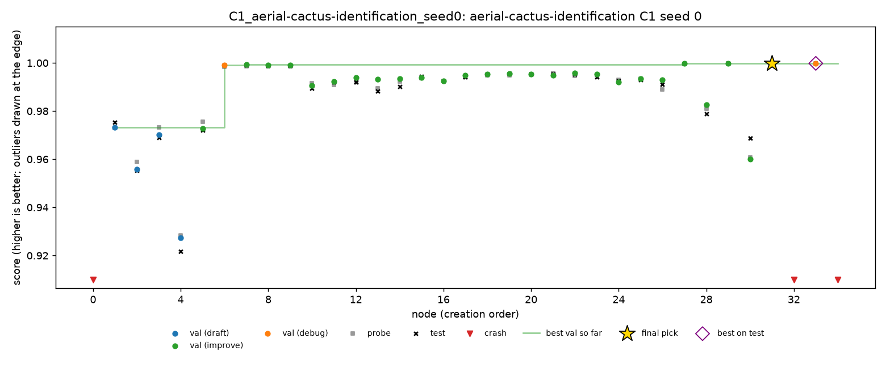

# Cactus, seed 0: first night of the half plan

Nights of 26 to 27 and 27 to 28 Oct 2026, Dziand's Mac (Apple M2, 8 GB). Seed 0 of every condition on `aerial-cactus-identification`. C1, C4 and C5 ran on the first night; the two ablations ran on the second, after seeds 1 and 2 of C1, C4 and C5.

Cactus is ROC AUC, so **higher is better**. MLE-bench thresholds: median 0.9991, and bronze, silver and gold are all 1.0, so only a perfect score medals.

## Setup

- **Command:** `scripts/cloud_run.py --config configs/conditions/<condition>.yaml --task aerial-cactus-identification --seed 0 --budget-hours 2 --sandbox docker --runs-root runs/grid --evaluator a1 --retries 0`, one run at a time, from a local loop under `caffeinate -dimsu`, with Colima at 2 CPUs and 5 GB. The sandbox memory limit is 4 GB.
- **Model:** DeepSeek V4 Flash 0731 through OpenRouter, fp8 (the `base.yaml` default).
- **Evaluator:** A1, Docker sandbox, a 2-hour budget per run. Code: `main` at 92cff79, so PR #7 is in every run.
- **Data:** prepared from the Kaggle zip with MLE-bench's own prepare function, since there is no Kaggle API key on this Mac. The public and private checksums match MLE-bench's.
- **Gate:** a paid 20-minute, 3-node smoke run of C1 (`runs/test/`, $0.018), which had to finish with a working node, a submission and a valid grade before C1 started.
- **Order and times (SGT):**

  | Run | Start | End |
  |---|---|---|
  | C1 | 26 Oct 23:30 | 01:30 |
  | C4 | 27 Oct 01:47 | 03:47 |
  | C5 | 03:47 | 05:47 |
  | A1-off | 27 Oct 23:02 | 01:02 |
  | A4-off | 28 Oct 01:02 | 03:02 |

- **Health:** no restarts by `cloud_run.py` or the loop, 0 failed LLM calls out of 167.
- **Cost:** $0.249 for the five runs, $0.03 to $0.06 per run.

## Results

Graded with `scripts/grade.py` (MLE-bench's grader). Validation and probe are for the final pick. The A1 test score of each pick equals MLE-bench's score.

| Run | Nodes | Working | LLM calls | Cost | Final pick | Validation | Probe | **Test** | Pick's test rank in run | Best test in run |
|---|---|---|---|---|---|---|---|---|---|---|
| C1 | 35 | 91% | 40 | $0.061 | n31 | 0.99984 | 0.99980 | **0.99977** | 2nd of 32 | 0.99982 |
| C4 | 39 | 95% | 44 | $0.063 | n16 | 0.99962 | 0.99937 | **0.99936** | 4th of 37 | 0.99965 |
| C5 | 27 | 89% | 31 | $0.052 | n24 | 0.99999 | 0.99999 | **0.99999** | 3rd of 24 | 0.99999 |
| A1-off | 22 | 91% | 25 | $0.045 | n15 | 0.99990 | 0.99986 | **0.99972** | 2nd of 20 | 0.99973 |
| A4-off | 26 | 92% | 27 | $0.028 | n8 | 0.99983 | 0.99984 | **0.99961** | 3rd of 24 | 0.99970 |

- All five submissions are valid and above the median. None medalled: no node in any run reached 1.0.
- **C2 (oracle)** is 0.99982 (n33) and **C3 (top 3)** is 0.99977, the same as C1's pick.

## Findings

### 1. C4 and C5 never intervened, and their rules would not have fired elsewhere either

Neither run wrote a `queue.jsonl`, and every trajectory reports 0 interventions applied and 0 dropped. Replaying both rules over every saved checkpoint of all thirteen cactus runs (`scripts/replay_policy.py`, with `--policy divergence_prune` and `--policy finding_correction`):

- **C4 (prune on divergence)** fires nowhere. Validation and probe moved together within about 0.002 for every pick.
- **C5 (delete findings that do not replicate)** fires once in this seed, in C1 after n34. It would have deleted a finding citing n32, which crashed. That deletes no node and leaves the pick unchanged.

So on cactus with seed 0, C4 and C5 behaved as C1 with a different random path, as on spooky.

### 2. Cactus is at the ceiling

The five test scores span 0.99936 to 0.99999. Every run of this seed passed 0.999 on test by n8, and from there the search moves only the fourth decimal. Medals need exactly 1.0, which no node reached, so "any medal" is 0% for every condition by construction. On this task only the raw score, and the validation-to-test gap, can show differences between conditions.

### 3. Without A1, the agent's validation is not optimistic here

On spooky seed 0, A1-off's validation was 0.023 better than test. On cactus the final picks' gaps are all tiny (validation minus test; positive means optimistic):

| Run | Validation-to-test gap |
|---|---|
| C1 | +0.00007 |
| C4 | +0.00026 |
| C5 | 0.00000 |
| A1-off | +0.00018 |
| A4-off | +0.00022 |

Over every working node, A1-off's mean gap is +0.0010, against +0.0005 for C1. The largest gaps (about 0.006) sit on the early, weak nodes of every run, with A1 or without it. With every model near 0.999 AUC, there is little room for an own-split leak to show.

### 4. Final-node selection costs at most 0.0003

Every pick was 2nd to 4th on test in its run, and the regret was at most 0.0003 (C4: n16 at 0.99936, n23 at 0.99965). The near-ties on validation are within the grader's noise.

### 5. Crashes

Each run ends with a node killed by the budget, as on spooky. The real crashes:

| Run | Node | Error | Cause |
|---|---|---|---|
| C1 | n0 | `RuntimeError: view size is not compatible` | `.view` on a non-contiguous tensor |
| C4 | n24 | `result type Float can't be cast to ... Long` | a dtype mismatch in PyTorch |
| C5 | n4 | `'HistGradientBoostingClassifier' object has no attribute 'best_iteration_'` | an attribute from another library |
| C5 | n15 | `ValueError: object too deep for desired array` | array shapes |
| A1-off | n12 | exit code 137 | out of memory at the 4 GB sandbox limit |
| A4-off | n19 | `BCEWithLogitsLoss got an unexpected keyword argument 'label_smoothing'` | a PyTorch API that does not exist |

None is a sandbox or `OUTPUT_DIR` problem.

## Problems on the machine side

- **No Homebrew.** It is broken on this Mac, so Colima, the Docker CLI and git-lfs come from conda-forge (a `tools` conda env). Colima's VZ driver needed `limactl` signed with the virtualization entitlement (`codesign --sign - --entitlements ...`).
- **Disk.** The disk was full when setup began. Even after cleanup, macOS swap grows by up to about 1 GB per run, because Colima takes 5 of the 8 GB of RAM. See seed 1.
- **Free model quota.** A first smoke run on the free Nemotron model hit OpenRouter's daily limit (429, 1,000 requests). Every run here uses the paid default.
- **A lost 17 minutes.** The first loop checked its runs only every 15 minutes; it was replaced between C1 and C4, hence C4's 01:47 start.
- **A morning cutoff.** That loop also stopped at 08:00, which is why seed 1's C5 and both ablations ran on later days.

## Trajectories

Each chart shows every node's validation (dots), probe (grey squares) and test (black crosses) scores, the best validation so far (line), and the final pick (star). The matching event list for each run is in `cactus-seed0/trajectories/<run>.md`.

| Run | Chart | Timeline |
|---|---|---|
| C1 | [C1.png](cactus-seed0/trajectories/C1.png) | [C1.md](cactus-seed0/trajectories/C1.md) |
| C4 | [C4.png](cactus-seed0/trajectories/C4.png) | [C4.md](cactus-seed0/trajectories/C4.md) |
| C5 | [C5.png](cactus-seed0/trajectories/C5.png) | [C5.md](cactus-seed0/trajectories/C5.md) |
| A1-off | [A1-off.png](cactus-seed0/trajectories/A1-off.png) | [A1-off.md](cactus-seed0/trajectories/A1-off.md) |
| A4-off | [A4-off.png](cactus-seed0/trajectories/A4-off.png) | [A4-off.md](cactus-seed0/trajectories/A4-off.md) |

## Files

In this folder (`docs/results/cactus-seed0/`), copied from the run folders:

- **`grades/<run>.json`:** MLE-bench's grade of each run's final submission.
- **`outcomes/`:** the output of `scripts/outcomes.py --out` over the seed 0 runs, with `runs.csv` (one row per run, plus C2 and C3), `conditions.csv`, `tasks.csv` and `summary.md`.
- **`trajectories/`:** the chart and timeline of each run, from `scripts/trajectory.py`. The "Annotations" section of each timeline is still empty.

On Dziand's Mac only (`runs/` is not in git):

- **Run folders:** `runs/grid/<condition>_aerial-cactus-identification_seed0/`.
- **Launcher log:** `runs/grid_cactus.log`.

## Next

- **Seed 1** of all five conditions: [`cactus-seed1.md`](cactus-seed1.md).
- **What to check after seed 1:** whether C4 and C5 stay silent, and whether A1-off ever drifts from test on cactus.
