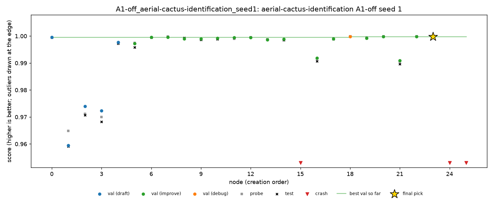

# Cactus, seed 1: second night of the half plan

27 to 28 Oct 2026, Dziand's Mac. Seed 1 of every condition on `aerial-cactus-identification`. Seed 0 is in [`cactus-seed0.md`](cactus-seed0.md).

Cactus is ROC AUC, so **higher is better**. MLE-bench thresholds: median 0.9991, and bronze, silver and gold are all 1.0.

## Setup

- **Same as seed 0** (DeepSeek V4 Flash 0731, fp8, A1, Docker, 2 hours per run, `main` at 92cff79).
- **Order and times (SGT):**

  | Run | Start | End |
  |---|---|---|
  | C1 | 27 Oct 05:48 | 07:48 |
  | C4 | 07:48 | 09:48 |
  | C5 | 12:43 | 14:43 |
  | A1-off | 28 Oct 03:03 | 05:03 |
  | A4-off | 05:03 | 07:03 |

- **Health:** no restarts, 0 failed LLM calls out of 164.
- **Cost:** $0.397 for the five runs. C5 alone was $0.158: it made 44 nodes.

## Results

| Run | Nodes | Working | LLM calls | Cost | Final pick | Validation | Probe | **Test** | Pick's test rank in run | Best test in run |
|---|---|---|---|---|---|---|---|---|---|---|
| C1 | 18 | 94% | 21 | $0.030 | n14 | 0.99989 | 0.99994 | **0.99994** | 1st of 17 | 0.99994 |
| C4 | 22 | 77% | 26 | $0.095 | n15 | 0.99998 | 0.99998 | **0.99992** | 1st of 17 | 0.99992 |
| C5 | 44 | 91% | 50 | $0.158 | n34 | 0.99931 | 0.99902 | **0.99927** | 1st of 40 | 0.99927 |
| A1-off | 26 | 88% | 30 | $0.054 | n23 | 0.99983 | 0.99993 | **0.99993** | 1st of 23 | 0.99993 |
| A4-off | 36 | 92% | 37 | $0.060 | n16 | 0.99978 | 0.99962 | **0.99940** | 1st of 33 | 0.99940 |

- All five are valid and above the median. None medalled.
- **Every pick was the best node on test in its run**, so C2 and C3 equal the agent's pick in all five.

### Both seeds so far

| Condition | Seed 0 | Seed 1 | Mean |
|---|---|---|---|
| C1 | 0.99977 | 0.99994 | 0.99986 |
| C4 | 0.99936 | 0.99992 | 0.99964 |
| C5 | 0.99999 | 0.99927 | 0.99963 |
| A1-off | 0.99972 | 0.99993 | 0.99982 |
| A4-off | 0.99961 | 0.99940 | 0.99950 |

### C2 and C3

| | Seed 0 | Seed 1 | Mean |
|---|---|---|---|
| C1 (agent's pick) | 0.99977 | 0.99994 | 0.99986 |
| C2 (oracle, from C1) | 0.99982 | 0.99994 | 0.99988 |
| C3 (top 3, from C1) | 0.99977 | 0.99994 | 0.99986 |

The same calculation on every run:

| Run | Seed | Agent's pick | C2 (oracle) | C3 (top 3) |
|---|---|---|---|---|
| C4 | 0 | 0.99936 | 0.99965 (n23) | 0.99965 (n23) |
| C4 | 1 | 0.99992 | 0.99992 | 0.99992 |
| C5 | 0 | 0.99999 | 0.99999 | 0.99999 |
| C5 | 1 | 0.99927 | 0.99927 | 0.99927 |
| A1-off | 0 | 0.99972 | 0.99973 (n16) | 0.99973 (n16) |
| A1-off | 1 | 0.99993 | 0.99993 | 0.99993 |
| A4-off | 0 | 0.99961 | 0.99970 (n24) | 0.99970 (n24) |
| A4-off | 1 | 0.99940 | 0.99940 | 0.99940 |

Selection gains at most 0.0003 anywhere (C4 seed 0). In the three runs above where the oracle gains, the top-3 hedge gets all of it.

## Findings

### 1. Still no interventions, and A1-off still honest

C4 and C5 wrote no queue again. Replayed, the C4 rule fires in no run. The C5 rule fires in one run outside C5: A1-off, after n24 and n25, on a finding citing n15, which is buggy. It deletes a finding only, so the pick would not change.

A1-off's pick had a validation-to-test gap of -0.00010: its own validation was slightly *pessimistic*. On spooky seed 1, the same condition drifted 0.13 from test through a stacker fitted on its own validation split. Nothing comparable happened on cactus: across all of A1-off's working nodes the mean gap is +0.0005, the same as C1's. The A1 runs' gaps were -0.00005 (C1), +0.00006 (C4) and +0.00004 (C5); A4-off's was the largest, +0.00038.

### 2. Seed noise is larger than the gaps between conditions

C5 went from 0.99999 (seed 0) to 0.99927 (seed 1), and C4 from 0.99936 to 0.99992. The condition means are within 0.0004 of each other, smaller than either swing. With two seeds, no condition is better than another, and none of them ever intervened, so no difference is expected.

### 3. Nodes per run vary from 18 to 44

C1 made 18 nodes in 2 hours, C5 44, with the same model and code. More nodes did not help: C5 had the most nodes and the lowest score of the seed, and it was the last run of the seed to pass 0.999 on test (at n25).

### 4. Crashes

| Run | Node | Error | Cause |
|---|---|---|---|
| C4 | n2 | `SyntaxError: invalid syntax` | malformed generated code |
| C4 | n3 | `generation_error: empty reply` | the model returned no code (the call itself succeeded) |
| C4 | n4 | `'tuple' object has no attribute 'predict_proba'` | an unpacking mistake |
| C4 | n14 | `BCEWithLogitsLoss got an unexpected keyword argument 'label_smoothing'` | a PyTorch API that does not exist |
| C5 | n2 | `'MLPClassifier' object has no attribute 'best_iter_'` | an invented attribute |
| C5 | n30 | `could not broadcast input array from shape (10,) into shape (9,)` | array shapes |
| C5 | n42 | `zero-dimensional arrays cannot be concatenated` | array shapes |
| A1-off | n24 | `expected input[512, 32, 3, 32] to have 3 channels` | wrong axis order for the CNN |
| A4-off | n17 | `could not broadcast input array from shape (256,) into shape (59,)` | a batch-size mismatch |
| A4-off | n27 | `BCEWithLogitsLoss got an unexpected keyword argument 'label_smoothing'` | the same invented API as C4's n14 |

`label_smoothing` on `BCEWithLogitsLoss` (it exists only on `CrossEntropyLoss`) appears in three runs across both seeds, a repeatable A3 mistake. C4's four crashes are why its working share is only 77%.

## Problems on the machine side

- **Disk, again.** The loop stopped at 14:44 on 27 Oct after C5, with 423 MB free, under its 500 MB floor. The run folders are under 100 MB each; the space went to macOS swap, which reached 6 of 7 GB because Colima holds 5 GB of the 8 GB of RAM. Stopping Colima gave some back, and freeing files gave the rest. The loop resumed at 16:06 with seed 2; no run was cut short.
- **Keep the Mac awake.** `caffeinate -dimsu` stops idle sleep on AC power, but closing the lid or choosing Sleep still pauses a run while its 2-hour clock keeps counting. It never happened here.

## Trajectories

| Run | Chart | Timeline |
|---|---|---|
| C1 | [C1.png](cactus-seed1/trajectories/C1.png) | [C1.md](cactus-seed1/trajectories/C1.md) |
| C4 | [C4.png](cactus-seed1/trajectories/C4.png) | [C4.md](cactus-seed1/trajectories/C4.md) |
| C5 | [C5.png](cactus-seed1/trajectories/C5.png) | [C5.md](cactus-seed1/trajectories/C5.md) |
| A1-off | [A1-off.png](cactus-seed1/trajectories/A1-off.png) | [A1-off.md](cactus-seed1/trajectories/A1-off.md) |
| A4-off | [A4-off.png](cactus-seed1/trajectories/A4-off.png) | [A4-off.md](cactus-seed1/trajectories/A4-off.md) |

## Files

- **`cactus-seed1/grades/`:** MLE-bench's grade of each run.
- **`cactus-seed1/outcomes/`:** `scripts/outcomes.py` over both seeds (ten runs).
- **`cactus-seed1/trajectories/`:** the chart and timeline of each run.
- **On Dziand's Mac only:** the run folders (`runs/grid/*_seed1/`) and the launcher log (`runs/grid_cactus.log`).

## Next

- **Seed 2** of C1, C4 and C5: [`cactus-seed2.md`](cactus-seed2.md).
