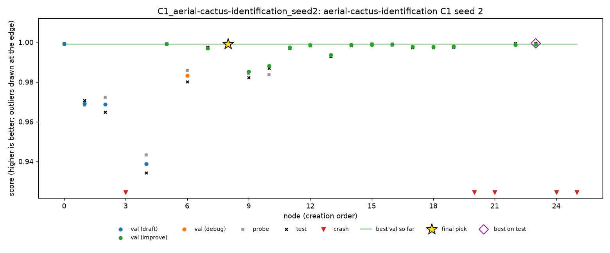

# Cactus, seed 2: the last runs of the half plan

27 Oct 2026, Dziand's Mac. Seed 2 of C1, C4 and C5 on `aerial-cactus-identification`, which completes cactus's 13 half-plan runs. Seeds 0 and 1 are in [`cactus-seed0.md`](cactus-seed0.md) and [`cactus-seed1.md`](cactus-seed1.md).

Cactus is ROC AUC, so **higher is better**. MLE-bench thresholds: median 0.9991, and bronze, silver and gold are all 1.0.

## Setup

- **Same as seeds 0 and 1** (DeepSeek V4 Flash 0731, fp8, A1, Docker, 2 hours per run, `main` at 92cff79).
- **Order and times (SGT):**

  | Run | Start | End |
  |---|---|---|
  | C1 | 16:06 | 18:06 |
  | C4 | 18:06 | 20:08 |
  | C5 | 20:09 | 22:09 |

- **Health:** no restarts, 0 failed LLM calls out of 144.
- **Cost:** $0.479 for the three runs. C4 was the most expensive cactus run, at $0.232 for 50 nodes.

## Results

| Run | Nodes | Working | LLM calls | Cost | Final pick | Validation | Probe | **Test** | Pick's test rank in run | Best test in run |
|---|---|---|---|---|---|---|---|---|---|---|
| C1 | 26 | 81% | 32 | $0.129 | n8 | 0.99912 | 0.99889 | **0.99917** | 5th of 21 | 0.99942 |
| C4 | 50 | 94% | 60 | $0.232 | n28 | 0.99958 | 0.99935 | **0.99979** | 1st of 47 | 0.99979 |
| C5 | 45 | 91% | 52 | $0.118 | n26 | 0.99991 | 0.99836 | **0.99984** | 2nd of 41 | 0.99986 |

- All three are valid and above the median. None medalled.
- **C1's pick was 5th of 21 on test.** Its top three on validation were within 0.00004 of each other (n8, n5, n0). The best node on test, n23 at 0.99942, was not among them. C3 recovers half the gap (n0, 0.99929).

### All three seeds

| Condition | Seed 0 | Seed 1 | Seed 2 | Mean |
|---|---|---|---|---|
| C1 | 0.99977 | 0.99994 | 0.99917 | 0.99963 |
| C2 (oracle, from C1) | 0.99982 | 0.99994 | 0.99942 | 0.99973 |
| C3 (top 3, from C1) | 0.99977 | 0.99994 | 0.99929 | 0.99967 |
| C4 | 0.99936 | 0.99992 | 0.99979 | 0.99969 |
| C5 | 0.99999 | 0.99927 | 0.99984 | 0.99970 |
| A1-off | 0.99972 | 0.99993 | | 0.99982 |
| A4-off | 0.99961 | 0.99940 | | 0.99950 |

All thirteen runs are valid and above the median, and none medalled. Total cost: $1.12 for the runs, $1.14 with the smoke run.

## Findings

### 1. On cactus, no condition differs from C1

The spread between seeds of one condition (up to 0.0008, C1 and C5) is larger than any gap between condition means (at most 0.0003). Across all thirteen runs, C4 and C5 never intervened, and replaying their rules over every checkpoint shows C4's never fires and C5's fires only twice, in non-C5 runs, on findings citing crashed nodes. The interventions found nothing to fix: validation and probe never diverged for long, and the agent's findings replicated.

### 2. A probe disagreement that C4 does not catch

C5's pick, n26, had validation 0.99991 but probe 0.99836, a gap of 0.0016, about ten times the usual. Test (0.99984) sided with validation. The C4 rule only fires when validation improves while probe worsens over several steps, and this was a single node, so the rule stays silent by design. Here test agreed with validation, so a prune would not have helped.

### 3. Final-node selection gains at most 0.0003

Over all thirteen runs, the oracle gains at most 0.00029 (C4 seed 0, where C3 recovers all of it); in C1 seed 2 it gains 0.00025, and C3 recovers half. In eleven runs the pick is first on test or within 0.0001 of it; the exceptions are C1 seed 2 and C4 seed 0 (0.00029). On cactus, validation near-ties are smaller than the differences test can show, so better selection is not a lever.

### 4. Without A1, nothing leaked on cactus

Validation minus test, over every working node:

| Run | Mean gap | Largest gap |
|---|---|---|
| A1-off seed 0 | +0.0010 | +0.0059 (n3) |
| A1-off seed 1 | +0.0005 | +0.0041 (n3) |
| A4-off seed 0 | +0.0009 | +0.0058 (n2) |
| A4-off seed 1 | +0.0028 | +0.0077 (n2) |
| C1, C4, C5 (9 runs) | -0.0003 to +0.0008 | +0.0027 to +0.0085 |

The largest gaps are on early, weak nodes in every condition. Spooky's A1-off seed 1 drifted 0.13 from test; nothing on cactus comes close. The likely reason is the ceiling: with every model near 0.999 AUC, fitting to one's own split has nothing to gain. Cactus is a task where A1 is not needed, which is itself a useful contrast for the slides.

### 5. Crashes

| Run | Node | Error | Cause |
|---|---|---|---|
| C1 | n3 | `HistGradientBoostingClassifier got an unexpected keyword argument 'n_jobs'` | an argument the class does not take |
| C1 | n20 | `weights.ndim (2) must match len(axes) (3)` | array shapes |
| C1 | n21 | `generation_error: empty reply` | the model returned no code |
| C4 | n39 | `cannot reshape array of size 575 into shape (16,32)` | array shapes |
| C4 | n47 | `SyntaxError: invalid decimal literal` | prose left in the generated code |
| C5 | n0 | `Input type (double) and bias type (float) should be the same` | a dtype mismatch in PyTorch |
| C5 | n2 | `predictions.csv not found` | the script wrote no predictions |

## Trajectories

| Run | Chart | Timeline |
|---|---|---|
| C1 | [C1.png](cactus-seed2/trajectories/C1.png) | [C1.md](cactus-seed2/trajectories/C1.md) |
| C4 | [C4.png](cactus-seed2/trajectories/C4.png) | [C4.md](cactus-seed2/trajectories/C4.md) |
| C5 | [C5.png](cactus-seed2/trajectories/C5.png) | [C5.md](cactus-seed2/trajectories/C5.md) |

## Files

- **`cactus-seed2/grades/`:** MLE-bench's grade of each run.
- **`cactus-seed2/outcomes/`:** `scripts/outcomes.py` over all three seeds (thirteen runs).
- **`cactus-seed2/trajectories/`:** the chart and timeline of each run.
- **On Dziand's Mac only:** the run folders (`runs/grid/*_seed2/`) and the launcher log (`runs/grid_cactus.log`).

## Next

- **The C6 session on cactus**, with a person at the dashboard.
- **For the slides:** cactus is the control task. Every condition, with or without A1, lands within 0.0008 of 1.0, and nothing intervenes. Set against spooky's A1-off leak, it shows that the interventions and A1 matter where the agent's own signal can mislead it, not everywhere.
