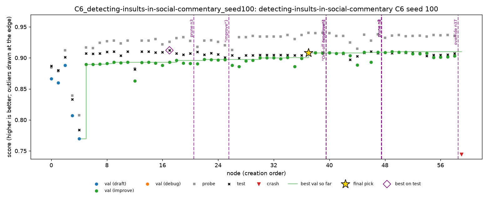

# Insults, C6: live session

8 Nov 2026, 14:07 to 16:07, Nabil's Mac. One C6 session on `detecting-insults-in-social-commentary`, seed 100, following `docs/c6-protocol.md`. The participant's full notes, with the debrief, are in [`insults-c6/c6_notes.md`](insults-c6/c6_notes.md).

Insults is binary AUC, so **higher is better**. MLE-bench thresholds: median 0.7784, bronze 0.7911, silver 0.8231, gold 0.8332.

## Setup

- **Run:** `c6_live.yaml` (`monitors: [human]`), 2 hours, DeepSeek V4 Flash 0731, A1, Docker on the Mac. Launched with `runs/_c6_insults/start_c6.sh` from `result-insults`, whose agent code is main's.
- **Platform difference:** insults' 21 grid runs ran on Kaggle CPU with the subprocess sandbox; this session ran on the Mac in Docker. Same agent and model.
- **Participant:** Nabil, who owns insults, had seen the task's 21 grid runs (all gold), not this one.
- **Rules:** oversight only (prune, final pick, correct a finding); steer or add-idea only to stop or undo something seen on the dashboard. The participant made two deliberate exceptions (a redirect and an injected idea), both recorded as such.
- **Assistant:** Claude explained node scripts and signals on request and kept the notes from the participant's words. It gave no modelling ideas. It saw one test score by accident at about 15:41 (`scripts/replay_policy.py` prints the pick's test score) and did not share it.
- **Cost:** $0.116, 67 LLM calls, 60 nodes.

## Result

| | Validation | Probe | **Test** |
|---|---|---|---|
| **n37 (submitted, by override)** | 0.9079 | **0.9402** (best probe) | **0.9087 (gold)**, 14th of 52 working nodes |
| n49 (best on validation, the pick without the override) | **0.9101** | 0.9356 | 0.9077 |
| n17 (best on test) | 0.8930 | 0.9258 | 0.9122 |

- **Gold, valid, above the median.**
- **The override gained 0.001** over the validation pick, within noise. C3 (top 3 by validation) would have given 0.9086.
- **The best node on test, n17, was on neither the validation nor the probe frontier,** so no selection rule here would have found it.
- **Against C1 at the 2-hour mark** (its five Kaggle runs, read from their checkpoints: 0.9008 to 0.9091, mean 0.9055): above the mean and within C1's range. One session on another seed and platform can't separate the interventions from seed noise.

## Interventions

8 queued, all applied: 4 prunes, 2 redirects, 1 inject, 1 override. The first came at 40 minutes (33% of the budget).

| Time | Action | Why | What it did, judged on test afterwards |
|---|---|---|---|
| 14:47 | prune n3 | raw counts + ComplementNB, 0.09 behind the best on validation | nothing lost: n3 scored 0.833 |
| 14:59 | redirect: improve n2 (exception) | validation looked stuck; try the untouched best draft once, "just to try to see" | nothing: n26 rebuilt n5's word + char recipe, val identical to n2 |
| 15:21 | inject: one-off card (exception) | keep n37's features, replace logistic regression with gradient boosting or a random forest | ignored: the card was in every later coding prompt, as a model card; no node used a tree model |
| 15:22 | redirect: improve n37 | apply the card to the best node | the agent chose negation features instead (n40, a tie with n37) |
| 15:35 | prune n0, n1, n2 | separate draft branches, 0.02 to 0.04 behind with 35 minutes left | nothing lost: their best on test was 0.904 (n26), below the pick |
| 16:01 | override: n37 | since n37, validation crept up (+0.002) while the probe fell (−0.005); late gains could be noise, so pick by the probe | +0.001 over the validation pick (0.9087 vs 0.9077), within noise |

n4 and n8 were left alone: they looked weak, but both are ancestors of the whole best line, and a prune removes the subtree.

## Against the C4 rule

`scripts/replay_policy.py` over the session's checkpoints: **the C4 rule never fires.** Validation and the probe moved together until n37. After it, the divergence was between two branches (n37's, best on the probe; the SVD branch n41 → n49, best on validation), and within the SVD branch the probe fell only 0.002 from its own best, below the rule's 1% threshold.

| | C4 prunes | C4 does not prune |
|---|---|---|
| **Person prunes** | 0 | 4 (n0, n1, n2, n3) |
| **Person does not prune** | 0 | the rest |

As on spooky, the person's prunes followed a budget cue the rule doesn't have: a branch far behind the best with little time left. Insults' 21 grid runs never triggered the rule either.

## What the session suggests

1. **A person can choose which node is worked on, but not what the agent changes.** Neither redirect nor the inject produced the intended change. A redirect sets only the next node and operator, and its reason never reaches the agent. An inject enters every later prompt as one more model card, which the coding agent ignored for 20 nodes. This is the participant's main wish: a way to ask for one specific change and have the agent do it.
2. **The agent repeats itself.** n9 and n11 (on n8), and n30 and n34 (on n29), are the same change made twice on the same parent; n26 rebuilt n5. Neither rule looks for duplicates; a person sees them on the dashboard.
3. **The interesting gains came from the agent, not the interventions.** The largest later gains were the agent's own: hand-written "you + insult word" features (n28–n30) and date features (n37, where undated comments are much less often insults, 11.8% vs 29.9%, in train and test alike).
4. **On insults, the probe and validation agree until the gains are tiny.** The participant's override and the C4 rule both face the same problem: a 0.002–0.005 gap on about 790 validation and 395 probe rows is noise. The override happened to gain 0.001.
5. **Prunes are cheap and safe, but save little.** Every pruned branch scored below the pick on test; with 15% exploration over 17 open nodes, cutting 6 of them saved about one node.

## Limitations

- One session, by a team member who knows the agent and had seen the 21 grid runs, with no separate observer.
- The participant is not an ML expert and chose not to judge implementation details, so C6 shows what a non-expert monitor does.
- An assistant explained nodes during the session and kept the notes; it saw one test score by accident and did not share it.
- The session ran on the Mac in Docker, the grid on Kaggle with the subprocess sandbox. The comparison with C1 is at the 2-hour mark of 4-hour Kaggle runs.
- No online search, as on spooky: insults is an old public competition whose solutions may be in the model's training data.

## Files

- **`insults-c6/c6_notes.md`:** the participant's notes (kept by Claude from the participant's words), debrief and post-session result.
- **`insults-c6/queue.jsonl`, `insults-c6/applied.jsonl`, `insults-c6/dashboard_log.jsonl`:** every intervention and dashboard event, with timestamps.
- **`insults-c6/grade.json`:** MLE-bench's grade.
- **`insults-c6/timeline.md`, `insults-c6/trajectory.png`:** the run's timeline and chart.
- **On Nabil's Mac only:** the run folder (`runs/C6_detecting-insults-in-social-commentary_seed100/`), its log (`runs/C6_insults_seed100.log`) and the launcher (`runs/_c6_insults/start_c6.sh`).
