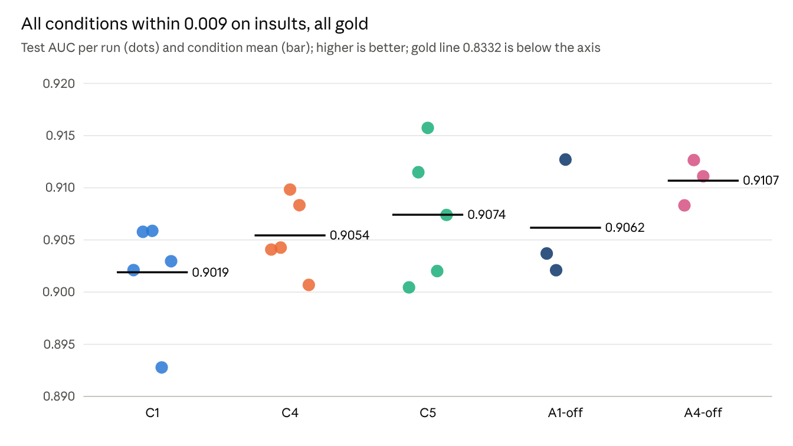
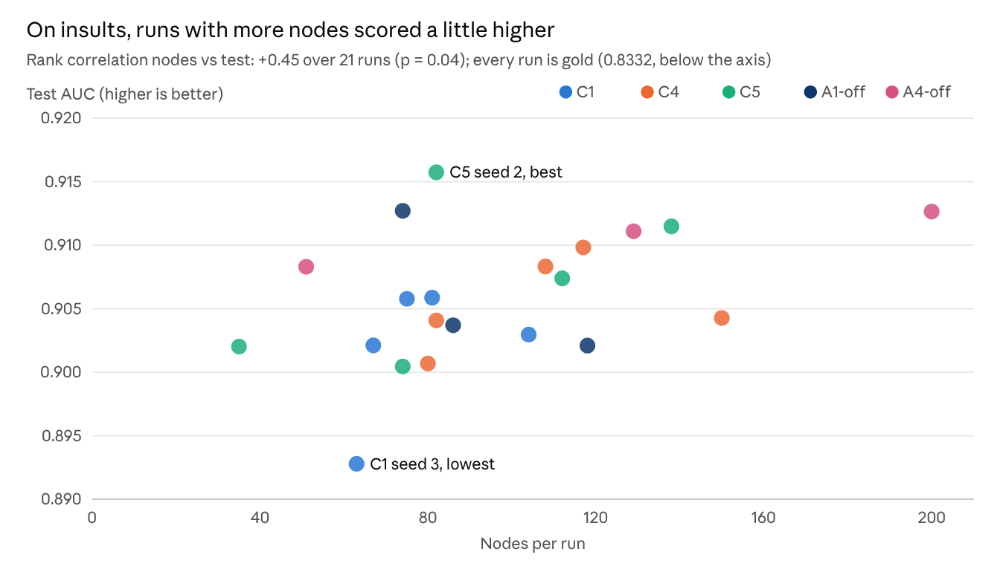
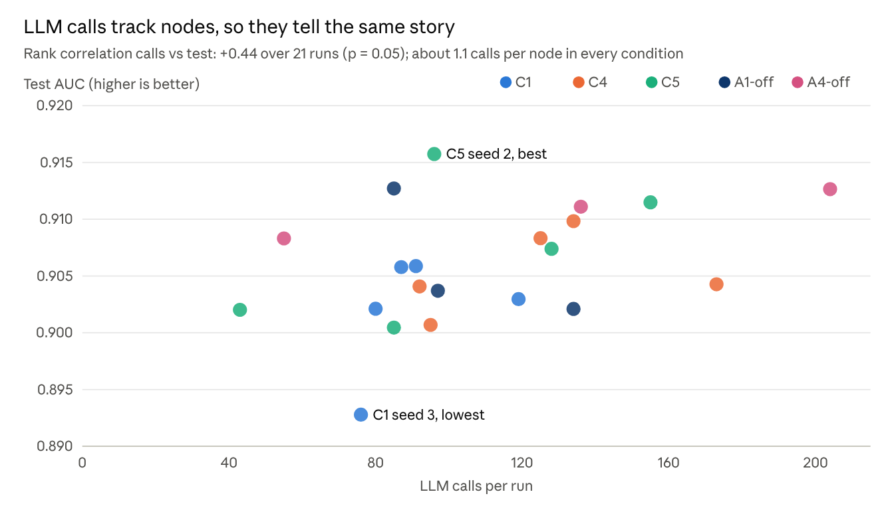
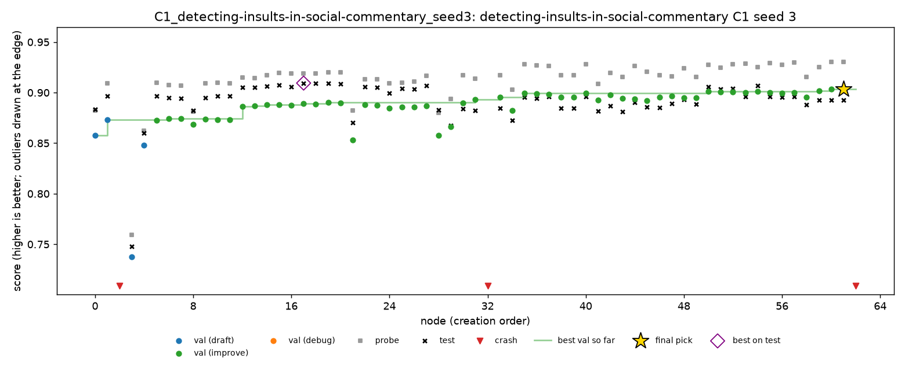
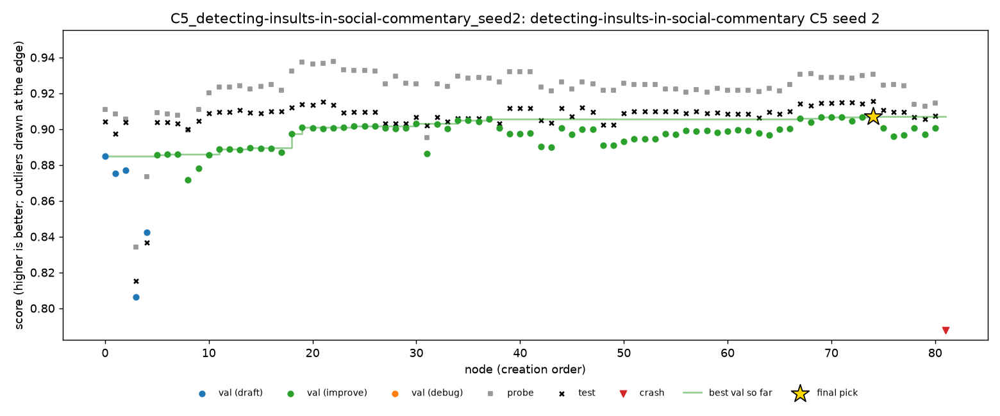

# Insults

> Exported 9 Nov 2026 from Nabil's analysis doc, [Full-plan results](https://claude.ai/artifact/1AHcCcSLLuLfqSGPkTFe5W), tab “Insults”. Charts are images of the doc's live charts. Paths under `runs/` are on Nabil's Mac; the data and scripts used are copied next to this file.

## Insults: all 21 runs

All 21 runs are valid and gold (AUC above 0.8332); test ranges from 0.8928 to 0.9157. Insults is ROC AUC, so higher is better. Each run had 4 hours, DeepSeek V4 Flash 0731 (fp8), 2 threads, on Kaggle CPU with the subprocess sandbox.

| Condition | Seed | Nodes | LLM calls | Calls/node | Test | Medal | Pick | Validation | Probe | Test − val | C2 (oracle) | C3 (top 3) | Pick loss | Live interventions | C4 rule replayed | Cost ($) | Cut-off calls |
| --- | --- | --- | --- | --- | --- | --- | --- | --- | --- | --- | --- | --- | --- | --- | --- | --- | --- |
| C1 | 0 | 67 | 80 | 1.19 | 0.9021 | gold | n44 | 0.9018 | 0.9246 | +0.0003 | 0.9070 | 0.9021 | 0.0048 | – | no prune | 0.28 | 5 |
| C1 | 1 | 75 | 87 | 1.16 | 0.9058 | gold | n55 | 0.9043 | 0.9303 | +0.0015 | 0.9076 | 0.9058 | 0.0018 | – | no prune | 0.35 | 3 |
| C1 | 2 | 81 | 91 | 1.12 | 0.9059 | gold | n58 | 0.9032 | 0.9125 | +0.0027 | 0.9084 | 0.9059 | 0.0026 | – | no prune | 0.31 | 0 |
| C1 | 3 | 63 | 76 | 1.21 | 0.8928 | gold | n61 | 0.9037 | 0.9303 | −0.0109 | 0.9094 | 0.8928 | 0.0166 | – | no prune | 0.37 | 8 |
| C1 | 4 | 104 | 119 | 1.14 | 0.9030 | gold | n90 | 0.9053 | 0.9224 | −0.0023 | 0.9067 | 0.9030 | 0.0038 | – | no prune | 0.49 | 4 |
| C4 | 0 | 82 | 92 | 1.12 | 0.9041 | gold | n61 | 0.9094 | 0.9252 | −0.0053 | 0.9132 | 0.9045 | 0.0091 | none fired | – | 0.26 | 1 |
| C4 | 1 | 150 | 173 | 1.15 | 0.9043 | gold | n138 | 0.9017 | 0.9226 | +0.0025 | 0.9082 | 0.9043 | 0.0039 | none fired | – | 0.68 | 7 |
| C4 | 2 | 117 | 134 | 1.15 | 0.9098 | gold | n115 | 0.9142 | 0.9367 | −0.0044 | 0.9115 | 0.9098 | 0.0017 | none fired | – | 0.48 | 3 |
| C4 | 3 | 108 | 125 | 1.16 | 0.9083 | gold | n84 | 0.9111 | 0.9224 | −0.0028 | 0.9087 | 0.9083 | 0.0004 | none fired | – | 0.46 | 4 |
| C4 | 4 | 80 | 95 | 1.19 | 0.9007 | gold | n78 | 0.8991 | 0.9217 | +0.0016 | 0.9059 | 0.9008 | 0.0052 | none fired | – | 0.44 | 6 |
| C5 | 0 | 74 | 85 | 1.15 | 0.9004 | gold | n27 | 0.9016 | 0.9295 | −0.0012 | 0.9083 | 0.9004 | 0.0079 | none fired | no prune | 0.28 | 2 |
| C5 | 1 | 138 | 155 | 1.12 | 0.9115 | gold | n88 | 0.9142 | 0.9254 | −0.0027 | 0.9139 | 0.9123 | 0.0024 | none fired | no prune | 0.72 | 1 |
| C5 | 2 | 82 | 96 | 1.17 | 0.9157 | gold | n74 | 0.9069 | 0.9305 | +0.0088 | 0.9157 | 0.9157 | 0 | none fired | no prune | 0.41 | 4 |
| C5 | 3 | 35 | 43 | 1.23 | 0.9020 | gold | n33 | 0.9035 | 0.9268 | −0.0015 | 0.9069 | 0.9040 | 0.0048 | none fired | no prune | 0.21 | 3 |
| C5 | 4 | 112 | 128 | 1.14 | 0.9074 | gold | n106 | 0.9127 | 0.9224 | −0.0053 | 0.9095 | 0.9074 | 0.0021 | none fired | no prune | 0.46 | 2 |
| A1-off | 0 | 86 | 97 | 1.13 | 0.9037 | gold | n80 | 0.9184 | 0.9234 | −0.0147 | 0.9083 | 0.9037 | 0.0046 | – | no prune | 0.24 | 1 |
| A1-off | 1 | 118 | 134 | 1.14 | 0.9021 | gold | n115 | 0.9192 | 0.9156 | −0.0171 | 0.9073 | 0.9072 | 0.0052 | – | no prune | 0.49 | 4 |
| A1-off | 2 | 74 | 85 | 1.15 | 0.9127 | gold | n65 | 0.9118 | 0.9263 | +0.0009 | 0.9143 | 0.9127 | 0.0016 | – | no prune | 0.34 | 2 |
| A4-off | 0 | 51 | 55 | 1.08 | 0.9083 | gold | n40 | 0.9072 | 0.9243 | +0.0011 | 0.9095 | 0.9089 | 0.0012 | – | no prune | 0.17 | 3 |
| A4-off | 1 | 200 | 204 | 1.02 | 0.9126 | gold | n199 | 0.9108 | 0.9267 | +0.0019 | 0.9127 | 0.9127 | 0 | – | no prune | 0.65 | 4 |
| A4-off | 2 | 129 | 136 | 1.05 | 0.9111 | gold | n75 | 0.9139 | 0.9343 | −0.0028 | 0.9133 | 0.9111 | 0.0022 | – | no prune | 0.63 | 8 |

## Insults by condition

Every condition is gold on every seed and the means sit within 0.009 of each other, from C1 (0.9019) to A4-off (0.9107). Bootstrap 95% intervals are over runs (2,000 resamples).

| Condition | Runs | Mean test | 95% interval | SD | Best | Worst | Golds | Median test − val | Median pick loss | Mean nodes | Mean calls/node | Mean cost ($) |
| --- | --- | --- | --- | --- | --- | --- | --- | --- | --- | --- | --- | --- |
| C1 | 5 | 0.9019 | 0.8974 – 0.9052 | 0.0054 | 0.9059 | 0.8928 | 5 | +0.000 | 0.004 | 78 | 1.17 | 0.36 |
| C4 | 5 | 0.9054 | 0.9028 – 0.9084 | 0.0037 | 0.9098 | 0.9007 | 5 | −0.003 | 0.004 | 107 | 1.15 | 0.46 |
| C5 | 5 | 0.9074 | 0.9025 – 0.9124 | 0.0064 | 0.9157 | 0.9004 | 5 | −0.002 | 0.002 | 88 | 1.16 | 0.42 |
| A1-off | 3 | 0.9062 | 0.9021 – 0.9127 | 0.0057 | 0.9127 | 0.9021 | 3 | −0.015 | 0.005 | 93 | 1.14 | 0.36 |
| A4-off | 3 | 0.9107 | 0.9083 – 0.9126 | 0.0022 | 0.9126 | 0.9083 | 3 | +0.001 | 0.001 | 127 | 1.05 | 0.48 |

Only C1's and A4-off's intervals do not overlap, and A4-off has three runs, whose bootstrap interval is too narrow to trust. The 21 runs cost about $8.70 in all.

## Insults: charts

The conditions overlap, and unlike spooky, runs that searched more scored a little higher.

Part of the node trend may be seed 0: its runs still used StreamLake, made fewer nodes (51 to 86) and scored on the low side. Calls are about 1.1 per node, so the two scatter plots look alike.

## Insults final models

Every pick is word and character TF-IDF (or counts) with a linear model, plus hand-written “insult aimed at you” features in most runs. Seven picks use naive Bayes (as a model, a blend member or NB weighting of the features). Six of them rank in the top 9; the seventh, C1 seed 3, is the lowest run, because its pick was a poor node (the selection section). Mean 0.9087 against 0.9045 for the other 14 (one-sided Mann–Whitney p = 0.015). Four picks include tree models; none a neural network.

| Condition | Seed | Test | Final model |
| --- | --- | --- | --- |
| C1 | 0 | 0.9021 | Calibrated LinearSVC and logistic regression on word and character TF-IDF plus insult-lexicon and shouting features |
| C1 | 1 | 0.9058 | Logistic regression on word and character TF-IDF plus a “you near profanity” feature |
| C1 | 2 | 0.9059 | Rank ensemble of 12 models: logistic regressions on TF-IDF and RBF SVMs on SVD-reduced TF-IDF |
| C1 | 3 | 0.8928 | Grid-searched logistic regression on NB-weighted word and character counts, character TF-IDF and date features with a time trend |
| C1 | 4 | 0.9030 | Logistic SGD on word 1–4-gram and character TF-IDF |
| C4 | 0 | 0.9041 | Logistic regression on word and character TF-IDF and SVD features, with elongated letters normalised (“fuuuck”) |
| C4 | 1 | 0.9043 | Logistic regression on TF-IDF plus a profanity × second-person interaction feature |
| C4 | 2 | 0.9098 | NB-SVM: logistic regression on naive-Bayes-weighted word and character TF-IDF, with date and style features |
| C4 | 3 | 0.9083 | Cross-validated logistic regression on TF-IDF plus discourse features (insult word followed by “you”) |
| C4 | 4 | 0.9007 | Calibrated ridge classifier on TF-IDF plus an expanded profanity lexicon |
| C5 | 0 | 0.9004 | Calibrated LinearSVC on word and character TF-IDF with one-hot date features |
| C5 | 1 | 0.9115 | Logistic regression on word and character TF-IDF (146k features) blended with ComplementNB and ExtraTrees |
| C5 | 2 | 0.9157 | Rank average of logistic regression and ComplementNB models on TF-IDF and counts |
| C5 | 3 | 0.9020 | Logistic regression on hashed and count features plus metadata (id prefix, date) |
| C5 | 4 | 0.9074 | Out-of-fold stack of logistic regressions, an RBF SVM, ComplementNB and ExtraTrees on TF-IDF, SVD and date features |
| A1-off | 0 | 0.9037 | Calibrated LinearSVC on TF-IDF plus profanity features |
| A1-off | 1 | 0.9021 | Logistic regression on hashed features plus insulting-phrase features (“shut up”, “you suck”) |
| A1-off | 2 | 0.9127 | Calibrated blend of logistic regression and BernoulliNB on TF-IDF and counts, with date harmonics |
| A4-off | 0 | 0.9083 | Rank blend of logistic regression, LinearSVC, random forest and ExtraTrees on TF-IDF and SVD features |
| A4-off | 1 | 0.9126 | Blend of logistic regression, random forest and gradient boosting on TF-IDF, SVD and surface features |
| A4-off | 2 | 0.9111 | NB-SVM ensemble on words and characters, with NB smoothing and C tuned together |

## Reading the insults tables

- **Test − val:** negative means validation looked better than test turned out (optimistic), since higher is better.
- **Pick loss:** the run's best node on test (C2) minus the pick's test. Zero means the pick was the best node.
- **C3 (top 3):** the best test score among the three best nodes on validation.
- **C4 rule replayed:** the pick's test if the C4 rule had been applied after the run; it never fires on insults.
- **Live interventions:** C4 and C5 never fired on insults.
- **Cut-off calls:** LLM replies stopped at the 64k-token cap; 75 of 2,290 calls (3.3%).

Footnotes for the report:

- All 21 runs ran 4 hours in one go on Kaggle CPU, in rounds of up to 5 sessions (1 to 4 Nov), two runs per session (insults, then pizza).
- Kaggle has no Docker, so scripts ran with the subprocess sandbox (no isolation, network access), capped at 2 threads.
- Seed 0 (round 1) still used StreamLake, which cut off more calls and slowed runs; from seed 1 it was excluded.
- A1-off gets the validation rows as training data and makes its own split, so its validation scores are not comparable.
- Source: `runs/_analysis/full_plan/` (copied to [`insults/data/`](analysis/tables/)) (outcomes, val\_test\_gap, replay, cost) and `insults_runs.csv`.

# Insults report draft

## Summary

On insults the agent is gold on all 21 runs, and no condition is clearly better than another.

1. **All gold, conditions within 0.009.** Means range from 0.9019 (C1) to 0.9107 (A4-off); one condition's seeds spread up to 0.015.
2. **No leak, even without A1.** A1-off's validation is more optimistic (median gap −0.015 against −0.003 to +0.001 with A1), but no run leaked and A1's leakage check never fired.
3. **The interventions had nothing to do.** C4 and C5 never fired, and the C4 rule replayed on every other run never fired either: validation and the probe moved together throughout.
4. **Naive Bayes again separates the best runs.** Seven picks have a naive Bayes component; six of them rank in the top 9, the seventh is the lowest run (C1 seed 3, lost to selection). Mean 0.9087 against 0.9045 (one-sided Mann–Whitney p = 0.015).
5. **More complex models do not help.** Refitting gradient boosting, random forests and ExtraTrees on the best nodes' exact features never beat the agent's linear models on test by more than noise.

## Setup

- **Task:** `detecting-insults-in-social-commentary` (Impermium, 2012): predict whether a forum or news comment insults another participant in the conversation. Insults at public figures, or profanity that insults no one, do not count. ROC AUC, higher is better; MLE-bench thresholds: median 0.7784, bronze 0.7911, silver 0.8231, gold 0.8332.
- **Data split (A1, fixed seed 0):** 2,763 training rows (26.6% insults), 789 validation, 395 probe, 2,647 test. Comments are short (median 99 characters), with an optional timestamp that is often empty.
- **Conditions:** C1, C4, C5 with seeds 0–4; A1-off and A4-off with seeds 0–2; C2 and C3 computed from C1 after the fact.
- **Budget and machine:** 4 hours per run, DeepSeek V4 Flash 0731 (fp8), Kaggle CPU sessions with Python 3.13 and the sandbox image's packages, scripts run with the subprocess sandbox capped at 2 threads, 20-minute limit per script, at most 200 nodes.
- **Schedule:** all 21 runs ran 4 hours in one go, 1 to 4 Nov 2026, two per Kaggle session (insults, then pizza). StreamLake was excluded from routing from seed 1.

## Results by condition

All 21 runs are valid and gold. The means rank A4-off (0.9107), C5 (0.9074), A1-off (0.9062), C4 (0.9054) and C1 (0.9019), within 0.009 (table “Insults by condition” and the strip chart above).

- **No ranking is claimed.** Only C1's and A4-off's bootstrap intervals fail to overlap, and A4-off has three runs, too few for a reliable interval.
- **Medals cannot separate the conditions:** every run is 0.06 or more above the gold line.
- **C2 and C3:** the oracle pick would raise C1's mean from 0.9019 to 0.9078; the top-3 hedge leaves it at 0.9019. The gap to the best node is small but real on insults (next section).
- **The lowest run,** C1 seed 3 (0.8928), lost the most to selection (0.017) and to cut-off calls (8 calls).

## A1 and validation honesty

On insults no run leaked, with or without A1, but validation is clearly more optimistic without it.

- **Gap between pick test and validation:** median −0.015 for A1-off (worst −0.017), against −0.003 to +0.001 per condition with A1 (never worse than −0.011). A1-off's own split makes its validation look better, but not by a leak's margin: spooky's leaking run was off by 0.256.
- **A1's leakage check never fired** on insults, and its static screen calls no A1-on insults script a leak.
- **The split is fixed:** all 18 runs with A1 see byte-identical files; A1-off gets the validation rows as training data and the same probe and test.
- **No overlap to exploit:** 12 short comments in validation or probe (“you are right!”, “you're an idiot”) also appear in the training rows, 92% with the same label; none in test. No script read outside its input.
- **Reading:** A1's value on insults is keeping validation honest by construction. A person does not need to check for validation leakage here.

## Final selection and the probe

On insults, validation and the probe are both only moderately good at ranking nodes, so the pick is close to the best node but rarely is it.

- **Pick loss:** with A1, a median 0.0025 below the run's best node on test, at most 0.017 (C1 seed 3). The pick was the best node in 2 of 21 runs.
- **Probe fidelity:** across each run's nodes, the probe's ranking correlates 0.59 with test and validation's 0.55 (median, runs with A1); the probe's top 5 share 1 node with test's top 5, validation's none.
- **Why:** the probe has 395 rows and validation 789, and the late nodes of a run differ by 0.001 to 0.003 in AUC, likely below what either split can resolve.
- **The probe is consistently easier:** the median node's probe sits 0.01 to 0.03 above its validation in every run, a property of the split, not of the agent. Rules that compare changes (C4, C5) are unaffected; a rule that compared levels would be.

## Interventions: C4 and C5

Neither rule fired in any insults run, live or replayed, because validation and the probe never disagreed in the way the rules look for.

- **C4 (divergence prune), live:** 0 prunes in 5 runs. Its runs are C1's agent on other random paths; their mean (0.9054) is within 0.004 of C1's.
- **C4 rule, replayed** on the 16 runs that are not C4: it never fires.
- **C5 (finding correction), live:** 0 corrections in 5 runs. A4's findings did fail on the probe often (only 25% replicate, see below), but no finding met the deletion rule: half or more of its cited nodes failing by more than 0.02.
- **Reading:** on a task this easy for the agent (all gold), with validation and probe in step, there is nothing for a divergence or correction rule to act on. The case these rules are built for never arose.

## C6: the live session

The C6 session reached gold (0.9087), within C1's 2-hour range, and showed that a person can choose which node the agent works on but not what it changes.

- **Run:** one 2-hour session (seed 100, 8 Nov) on the Mac in Docker, oversight by the task's owner, who is not an ML expert. 8 interventions, all applied: 4 prunes, 2 redirects, 1 injected idea, 1 final-pick override. Details: `docs/results/insults/c6.md` on `result-insults`.
- **Result:** test 0.9087 from n37 by override, 0.001 above the node the run would have submitted (n49, 0.9077). C1 at the 2-hour mark of its five runs: 0.9008 to 0.9091, mean 0.9055.
- **Prunes** (n3, then the n0, n1 and n2 branches) removed branches far behind with little time left. They lost nothing: the best pruned node scored 0.904, below the pick.
- **The injected idea was ignored.** The participant asked the agent to keep the best node's features and swap logistic regression for gradient boosting or a random forest. The text reached every later prompt, but only as one more model card, and none of the next 20 nodes used a tree model. A redirect's reason never reaches the agent at all.
- **The idea itself would not have helped:** refitting those models on the best nodes' exact features, gradient boosting and random forests score lower and ExtraTrees roughly ties (next section).
- **What it shows:** the participant wanted a way to ask for one specific change and have the agent do it. The system has none; it is a limitation and a clear next step.

## What the agent built, and the complex-model check

The agent builds sparse text models with hand-written features, and that is the right family here: more complex models on the same features do not do better.

- **Model families:** every pick uses word and character TF-IDF (or counts) with a linear model; most add hand-written features that encode the task's definition (“you” near an insult word, shouting, insulting phrases). Four picks include tree models; none a neural network (table “Insults final models” above).
- **Naive Bayes:** seven picks have a naive Bayes component (ComplementNB, BernoulliNB or NB weighting of the features); six rank in the top 9 of 21, and the seventh (C1 seed 3) is the lowest run because of a poor pick, not its model family. Mean 0.9087 against 0.9045 (one-sided Mann–Whitney p = 0.015). Only one C1 pick has one, which fits C1 having the lowest mean. The same family separated the best spooky runs.
- **Search size:** more nodes went with a little more AUC (rank correlation +0.45, p = 0.04). Part of this is seed 0, which ran slower with StreamLake.
- **Complex-model check:** we took the top 3 nodes by validation, by probe and by test (pooled over the 18 runs with A1), captured the exact matrix each feeds its logistic regression (55,000 to 146,000 features; every rerun reproduced its node within 0.0015), and refitted four models with fixed settings, nothing tuned on validation, probe or test:

| Model on the same features | Test vs the original node (mean of 9) | Better on | Test vs the node's own logistic regression |
| --- | --- | --- | --- |
| LightGBM | −0.005 | 0 of 9 | +0.000 |
| XGBoost | −0.009 | 0 of 9 | −0.004 |
| Random forest | −0.004 | 1 of 9 | +0.001 |
| ExtraTrees | −0.000 | 5 of 9 | +0.005 |

- **Reading:** gradient boosting is worse on every node; ExtraTrees roughly ties, within noise on 2,647 test rows, and is usually lower on the probe, so a validation-based pick would not choose it. The agent's sandbox has scikit-learn but not LightGBM or XGBoost, and nodes with tree models timed out only 2.3% of the time, so the 20-minute limit is not what kept them rare. Files: `runs/_analysis/insults_complex/`.

## Annotated trajectories

Two insults runs: the lowest, where validation and the probe both pointed the wrong way, and the best, where everything agreed.

### C1 seed 3: both held-out splits rose while test fell

- **n0 to n19:** logistic regression on word and character TF-IDF, then chi-square feature selection. At n17 validation is 0.889, the probe 0.919 and test 0.909: the run's best node on test.
- **n31, a change of family:** the agent switches to NB-weighted word and character counts. Validation rises (0.893) but test drops to 0.882.
- **n35 to n61:** style features, a stack, then date features and a time trend lift validation to 0.904 and the probe to 0.930. Test stays near 0.89 (0.893 at the pick).
- **The pick, n61:** first of 60 on validation, 36th on test, 0.017 below n17: the largest selection loss on insults.
- **What it shows:** validation and the probe agreed, so no rule could have flagged this; both come from the competition's training data. The organisers warn the task “tends to strongly overfit” and that its test set is drawn “from a wide sample”. The run also lost 70 minutes to 8 cut-off calls.

### C5 seed 2: the best insults run

- **The path:** logistic regression on TF-IDF, blended with ComplementNB by n11; then date features (n18), counts instead of presence flags (n19), counts of “you” and insult words (n23), and “you near an insult” features (n30 to n37).
- **The pick, n74:** blending by rank instead of by raw probability. First on validation and first on test (0.9157), so selection lost nothing.
- **Along the way:** five nodes beat their parent on validation but lost on test (labelled overfitting); none of them was picked, because a later node beat them on validation.
- **What it shows:** the naive Bayes plus linear blend, with features that encode the task's definition, is what the best insults runs share. No intervention fired.

Charts from `scripts/trajectory.py` on the saved runs (`runs/kaggle/<run>/trajectory/`); each run's `timeline.md` lists every event.

## Search behaviour, errors, findings and cost

The agent is reliable on insults, but most improvement attempts change little and most of its findings do not hold on the probe.

- **Node outcomes:** of 2,026 nodes, 97.2% worked; 28 crashed (mostly type and import errors), 21 timed out and 7 had an unusable LLM reply.
- **Improvements:** 69% of working improve attempts (1,271 of 1,847) did not beat their parent, and 70 changed nothing in the predictions; 53 working nodes were labelled validation overfitting.
- **A4's findings:** 410 findings in the runs with A4, 341 claiming that a change helps or hurts. 61% are supported by the validation scores they cite; only 25% also hold on the probe (40% of the supported ones). Insults' small gains make the direction of a change easy to get wrong.
- **LLM use:** about 1.1 calls per node, 2,290 calls in all; 75 (3.3%) were cut off at the 64k-token cap, costing up to 70 minutes in one run (C1 seed 3).
- **Cost:** about $8.70 for the 21 runs, $0.17 to $0.72 per run (mean $0.41).

## Comparison with other agents

Our agent is unusually reliable on insults (21 of 21 valid and gold, where AIDE with GPT-4o produced no valid submission at all), but recent agents score higher. The numbers come from MLE-bench's official grading reports; those runs mostly had 24 hours, a GPU and frontier models.

| Agent | Model | Seeds | Valid | Mean AUC | Best | Golds |
| --- | --- | --- | --- | --- | --- | --- |
| Ours (all conditions) | DeepSeek V4 Flash, 4 h, 2 CPUs | 21 | 21 | 0.906 | 0.916 | 21 |
| AIDE, CPU only | GPT-4o | 12 | 0 | – | – | 0 |
| AIDE | GPT-4o | 37 | 0 | – | – | 0 |
| AIDE | o1-preview | 21 | 10 | 0.905 | 0.957 | 9 |
| ML-Master | DeepSeek-R1 | 3 | 3 | 0.922 | 0.948 | 3 |
| AIRA-dojo | o3 | 20 | 20 | 0.949 | 0.961 | 20 |
| Famou-Agent 2.0 | Gemini-3-Pro | 3 | 3 | 0.958 | 0.960 | 3 |

Means are over valid submissions. Source: `runs/*/…grading_report.json` in the [MLE-bench repository](https://github.com/openai/mle-bench), extracted to `runs/_analysis/mlebench_compare/per_task.csv`.

## Limitations

- **Ceiling effect:** every run is gold, so medal rates carry no information and condition differences sit within 0.009 AUC.
- **Few seeds:** five per main condition and three per ablation; the A4-off interval rests on three runs.
- **Platform:** insults ran on Kaggle CPU with the subprocess sandbox (no isolation, network access); spooky ran in Docker on a Mac. Cross-task comparisons mix task and platform.
- **Seed 0 differs:** it still used StreamLake, which cut off more calls and slowed its runs.
- **No outside knowledge:** the agent saw only library documentation and its own model's knowledge, with no web search; insults is an old public competition.
- **One small model** (DeepSeek V4 Flash) for every run.
- **Complex-model check:** fixed settings, nine nodes from correlated runs (six from C5 seed 2 and C4 seed 2), and run outside the agent; it shows what the features allow, not what the agent would have done.
