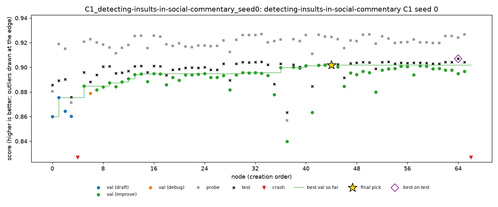

# Insults, seed 0: Kaggle round 1

Night of 1 to 2 Nov 2026, on Kaggle. Seed 0 of all five conditions on `detecting-insults-in-social-commentary`, the first round of this task's full plan (`configs/kaggle_sessions.yaml`). Pizza's half of the same sessions is on the `result-pizza` branch.

Insults is binary AUC, so **higher is better**. MLE-bench thresholds: median 0.7784, bronze 0.7911, silver 0.8231, gold 0.8332. The public train set has 3,947 comments.

## Setup

- **Kaggle CPU notebooks** `imle-slot-1` to `imle-slot-5`, one session each (sessions 1 to 5), all at once. Each session ran insults first, then pizza.
  - About 4 cores and 34 GB of RAM. Scripts are capped at 2 threads, like the Docker sandbox on the Mac.
  - Python 3.13.6 with the sandbox image's packages (`docker-requirements.txt`, torch 2.14.1 CPU).
  - `--sandbox subprocess`: no Docker on Kaggle, so scripts could reach the network and files outside their folder. A1's leakage screen is the only protection.
- **The same agent as spooky:** DeepSeek V4 Flash 0731 (fp8), A1, 4 hours per run. Code `7347b0d` on main, which has the same agent code as `result-spooky`.
- **Times (SGT):** 23:03 to 03:04.
- **Cost:** about $1.23 for the five runs.
- **`machine.jsonl` says `colab`:** Kaggle's image also sets Colab's variables. Fixed for later rounds in `b3c8ecf`.
- **Health:** A4-off restarted once, after about 2 hours (`cloud_run.py` resumed it from its last checkpoint). The cause isn't in the downloaded files.
- **Time lost to cut-off calls:** some calls used all 64,000 output tokens on reasoning and returned no script, about 10 minutes each. All of them were served by StreamLake. From round 2 on, StreamLake is excluded (`df79ace`).

## Results

| Run | Nodes | **Test** | Pick: validation / probe | C2 (oracle) | C3 (top 3) | Minutes lost to cut-off calls |
|---|---|---|---|---|---|---|
| C1 | 67 | **0.9021 (gold)** | n44: 0.9018 / 0.9246 | 0.9070 | 0.9021 | 52 |
| C4 | 82 | **0.9041 (gold)** | n61: 0.9094 / 0.9252 | 0.9132 | 0.9045 | 9 |
| C5 | 74 | **0.9004 (gold)** | n27: 0.9016 / 0.9295 | 0.9083 | 0.9004 | 21 |
| A1-off | 86 | **0.9037 (gold)** | n80: 0.9184 / 0.9234 | 0.9083 | 0.9037 | 11 |
| A4-off | 51 | **0.9083 (gold)** | n40: 0.9072 / 0.9243 | 0.9095 | 0.9089 | 35 |

- **Every run is gold.** The five are within 0.008 of each other.
- **No interventions:** neither C4 nor C5 fired. The C4 rule, replayed on the other runs (`scripts/replay_policy.py`), doesn't fire either.
- **The pick is 0.001 to 0.009 below the best node on test,** about as close as on spooky.

## Findings

### 1. Insults can't separate the conditions by medals

The first drafts already score about 0.89 on test, well above gold at 0.833. A TF-IDF model with logistic regression is enough, and every run spent its 4 hours adding features to one.
- **Every condition will probably be gold on every seed,** so medal rates say nothing here.
- **What's left is the score, within about 0.01.** With one seed, the order of the five runs is noise.

### 2. The probe scores higher than validation

In the four runs with A1, the median node's probe is 0.020 to 0.028 above its validation, and test sits between them (C1's chart below). These runs share the same split, so this comes from the split, not from the agent: the probe rows (10% of train) are easier than the validation rows. A1-off uses its own validation split, and there the gap is 0.008. It doesn't hurt the C4 rule, which compares changes in the probe, not its level.

### 3. A1-off didn't leak

A1-off's pick has validation 0.918 against test 0.904, a gap of 0.015. On spooky, seed 1 had a gap of 0.256. This run never stacked models on its own validation split.

## Trajectories

| Run | Chart | Timeline |
|---|---|---|
| C1 | [C1.png](seed0/trajectories/C1.png) | [C1.md](seed0/trajectories/C1.md) |
| C4 | [C4.png](seed0/trajectories/C4.png) | [C4.md](seed0/trajectories/C4.md) |
| C5 | [C5.png](seed0/trajectories/C5.png) | [C5.md](seed0/trajectories/C5.md) |
| A1-off | [A1-off.png](seed0/trajectories/A1-off.png) | [A1-off.md](seed0/trajectories/A1-off.md) |
| A4-off | [A4-off.png](seed0/trajectories/A4-off.png) | [A4-off.md](seed0/trajectories/A4-off.md) |

## Files

- **`seed0/grades/`:** MLE-bench's grade of each run.
- **`seed0/trajectories/`:** the chart and timeline of each run.
- **On Nabil's Mac only:** the run folders, in `runs/kaggle/*_detecting-insults-in-social-commentary_seed0/`.

## Next

Round 2 (sessions 6 to 10) runs seed 1 of every condition, without StreamLake.
