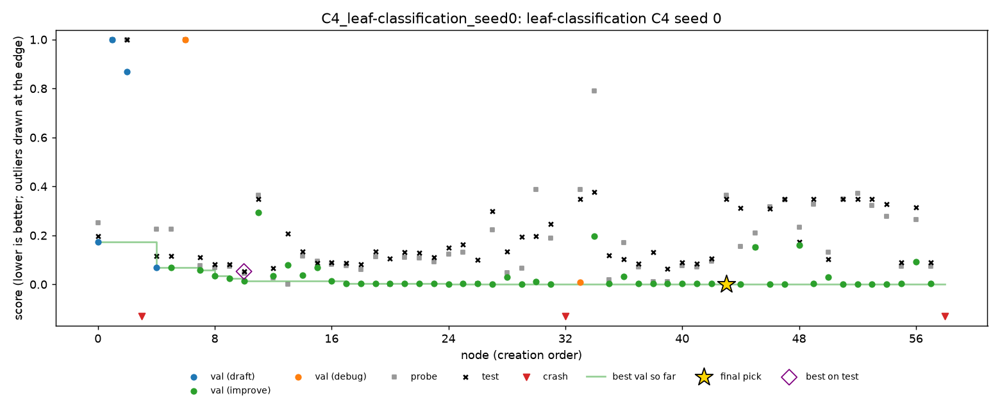

# Leaf, seed 0: two runs (C1 and C4)

Night of 28 to 29 Oct 2026, Nabil's Mac, run in place of the leaf half plan (Medhini's task) while its own runs are still to come. Only C1 and C4 of seed 0 fit into one night. Earlier there was one 4-hour MiniMax pilot on leaf (C1, stand-in evaluator); it isn't in these tables.

Leaf classifies 99 tree species from leaf images and 192 precomputed shape, margin and texture features. The metric is multiclass log loss, so **lower is better**. MLE-bench thresholds: median 0.1083, bronze 0.0153, silver 0.0079, gold 0.0.

## Setup

- **The same as spooky's grid runs:** DeepSeek V4 Flash 0731 (fp8), A1, Docker, 2 hours per run.
- **Machine:** a 13-inch MacBook Pro (2020, Apple M1, 8 GB), with Colima at 2 CPUs and 4 GB.
- **Times (SGT):** C1 from 00:32 to 02:33, C4 from 02:33 to 04:33.
- **Health:** no restarts, 0 failed LLM calls out of 109.
- **Cost:** $0.22 ($0.087 for C1, $0.132 for C4).
- **Splits:** train 624 rows, validation 178, probe 89, test 99. That is one or two rows per species in each held-out split.

## Results

| Run | Nodes | Final pick | Validation | Probe | **Test** | Pick's test rank | C2 (oracle) | C3 (top 3) |
|---|---|---|---|---|---|---|---|---|
| C1 | 38 | n33 | 0.0030 | 0.1720 | **0.1018** | 23rd of 35 | 0.0357 (n23) | 0.0956 (n32) |
| C4 | 59 | n43 | **0.0000** | 0.3639 | **0.3489** | 48th of 56 | 0.0527 (n10) | 0.2979 (n27) |

- **C1 is just above the median** (0.1018 against 0.1083). **C4 is below it.** Neither medalled.
- **Selection cost a lot.** The best node on test was 0.066 better than C1's pick, and 0.296 better than C4's. On spooky and cactus, the oracle gained at most 0.004.
- **C4 never fired,** live or when replayed. C4's run is therefore C1's agent on another random path, like on spooky and cactus.

## Findings

### 1. One confidently wrong row decides the score

Every top node gets about 99% of every held-out split right. What separates the scores is how confident each model is on the one or two rows it gets wrong:

| Node | Validation: accuracy, log loss | Probe: accuracy, log loss | Test: accuracy, log loss | Share of test loss from the worst row |
|---|---|---|---|---|
| C4 n43 (submitted) | 100%, 0.0000 | 98.9%, 0.3639 | 99.0%, 0.3489 | **100%** |
| C4 n10 (best on test) | 99.4%, 0.0149 | 98.9%, 0.0465 | 99.0%, 0.0527 | 100% |
| C1 n33 (submitted) | 100%, 0.0030 | 97.8%, 0.1720 | 99.0%, 0.1018 | 99% |
| C1 n23 (best on test) | 99.4%, 0.0300 | 97.8%, 0.0576 | 99.0%, 0.0357 | 70% |

- **C4's pick, n43, gets every validation row right with near-certainty,** so its validation loss rounds to 0. On test it gets 98 of 99 rows right. But the one it misses, it gives a probability below 10⁻⁶. With log loss that one row costs about 34.5, which is 0.349 averaged over 99 rows.
- **The better nodes are equally accurate, but less sure of themselves,** so their single mistake costs much less.
- **So on leaf, validation doesn't overfit in the usual sense.** It is too small to contain the hard row. With 178 rows for 99 species, a model can be perfect on validation and still miss one test leaf. The agent, choosing by validation, rewards the most overconfident model.

This is why the earlier MiniMax pilot showed validation 3 to 5 times better than probe and test: the same effect.

### 2. The probe saw it, and the C4 rule didn't fire

- **n43's probe was 0.364,** against n42's 0.095, while validation went from 0.0025 to 0.0000. On the dashboard this is the clearest divergence in any run so far.
- **The C4 rule checks** that the probe loss holds in 95% of paired bootstrap resamples. It held in only **64%**: the whole loss comes from one probe row, and about a third of resamples leave that row out.
- **So the rule correctly treats it as one row's noise,** which it statistically is. But here that one row is exactly what decides the test score.

A person at the dashboard could have overridden the final pick to a less confident node. In C4's run, n8 to n10 had probe scores of 0.047 to 0.073, and test scores of 0.053 to 0.082.

### 3. C5 would have acted on noise

Replayed over the two runs, C5's rule would delete 3 findings in C1 and 6 in C4, from node 14 onwards. With 89 probe rows for 99 species, a node's probe score moves by large amounts when one row changes, so "failed to replicate on the probe" mostly means "one probe row went the other way".

## What it means for the project

- **A task where a tiny held-out split decides everything** is where final selection matters most. On leaf, the oracle gains 0.07 to 0.30. On spooky and cactus it gained 0.004 or less.
- **The monitors' probe signal is right but statistically weak on leaf.** The scripted C4 rule is cautious by design and stays silent. A person might act on it, or might not.
- **A calibration-aware pick would have helped,** such as avoiding nodes with near-certain probabilities, or using the probe as a tie-breaker when validation is at 0.

## Limitations

- **Two runs, one seed, and only C1 and C4.** These aren't the leaf half plan, which has 13 runs; Medhini's runs are still to come.
- **There's no C6 session on leaf.**
- **Every held-out split has fewer than two rows per species,** so every score here is decided by one or two rows.

## Trajectories

| Run | Chart | Timeline |
|---|---|---|
| C1 | [C1.png](leaf-seed0/trajectories/C1.png) | [C1.md](leaf-seed0/trajectories/C1.md) |
| C4 | [C4.png](leaf-seed0/trajectories/C4.png) | [C4.md](leaf-seed0/trajectories/C4.md) |

## Files

- **`leaf-seed0/grades/`:** MLE-bench's grade of each run.
- **`leaf-seed0/outcomes/`:** `scripts/outcomes.py` over the two runs.
- **`leaf-seed0/trajectories/`:** the chart and timeline of each run.
- **On Nabil's Mac only:** the run folders (`runs/grid/C1_leaf-classification_seed0/`, `runs/grid/C4_leaf-classification_seed0/`) and the log (`runs/grid_leaf_seed0.log`).
