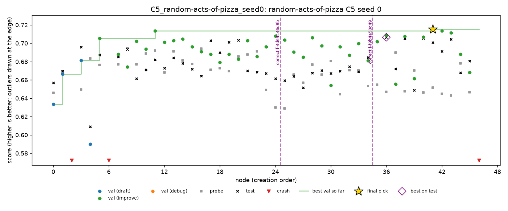

# Pizza, seed 0: Kaggle round 1

Night of 1 to 2 Nov 2026, on Kaggle. Seed 0 of all five conditions on `random-acts-of-pizza`, the first round of this task's full plan (`configs/kaggle_sessions.yaml`). Insults' half of the same sessions is on the `result-insults` branch.

Pizza is binary AUC, so **higher is better**. MLE-bench thresholds: median 0.5996, bronze 0.6921, silver 0.7648, gold 0.9791. The public train set has 2,878 requests, so validation has about 575 rows and the probe about 290.

## Setup

- **Kaggle CPU notebooks** `imle-slot-1` to `imle-slot-5`, one session each (sessions 1 to 5), all at once. Each session ran insults first, then pizza.
  - About 4 cores and 34 GB of RAM. Scripts are capped at 2 threads, like the Docker sandbox on the Mac.
  - Python 3.13.6 with the sandbox image's packages (`docker-requirements.txt`, torch 2.14.1 CPU).
  - `--sandbox subprocess`: no Docker on Kaggle, so scripts could reach the network and files outside their folder. A1's leakage screen is the only protection.
- **The same agent as spooky:** DeepSeek V4 Flash 0731 (fp8), A1, 4 hours per run. Code `7347b0d` on main, which has the same agent code as `result-spooky`.
- **Times (SGT):** 03:04 to about 07:25.
- **Cost:** about $1.36 for the five runs.
- **`machine.jsonl` says `colab`:** Kaggle's image also sets Colab's variables. Fixed for later rounds in `b3c8ecf`.
- **Health:** C1 restarted once, about 16 minutes in, and A4-off once; `cloud_run.py` resumed both from their last checkpoint. The causes aren't in the downloaded files.
- **Time lost to cut-off calls:** some calls used all 64,000 output tokens on reasoning and returned no script, about 10 minutes each. All of them were served by StreamLake. From round 2 on, StreamLake is excluded (`df79ace`).

## Results

| Run | Nodes | **Test** | Pick: validation / probe | C2 (oracle) | C3 (top 3) | Interventions | Minutes lost to cut-off calls |
|---|---|---|---|---|---|---|---|
| C1 | 42 | **0.6842** | n40: 0.7003 / 0.6685 | 0.6928 | 0.6842 | – | **112** |
| C4 | 53 | **0.6692** | n10: 0.6882 / 0.6414 | 0.6826 | 0.6692 | 1 prune | **101** |
| C5 | 47 | **0.7008 (bronze)** | n41: 0.7153 / 0.6514 | 0.7066 | 0.7008 | 2 corrections | 78 |
| A1-off | 28 | **0.6700** | n19: 0.7231 / 0.6896 | 0.6774 | 0.6700 | – | 33 |
| A4-off | 64 | **0.6553** | n21: 0.6888 / 0.6983 | 0.6695 | 0.6553 | – | 32 |

- **C5 is the only medal:** bronze at 0.7008, 0.009 above the line.
- **All five are above the median,** between 0.655 and 0.701.
- **The pick is 0.006 to 0.014 below the best node on test,** more than on insults or spooky.

## Findings

### 1. Pizza's scores are noisy

With about 575 validation rows and 290 probe rows, one node's validation and probe often move in opposite directions by 0.02 to 0.05. Test moves with neither very closely. On C5, for example, the pick n41 has the best validation (0.715) but one of the lower probes (0.651); test is 0.701.
- **One seed can't rank the conditions here.** The spread between the five runs (0.046) is about the size of a single node's noise.
- **The C4 and C5 rules see this noise too.** Both look for validation and probe disagreeing, which on pizza happens by chance.

### 2. The cut-off calls cost C1 and C4 almost half their time

C1 lost 112 of its 240 minutes and C4 lost 101, against 32 to 33 for the ablations. C1 and C4 made fewer nodes than A4-off (42 and 53 against 64). So seed 0 compares the conditions at quite different amounts of real search time. Later rounds don't have this.

### 3. C5 corrected two findings, and medalled

C5 corrected two of the agent's findings, at safe points 25 and 36 (the dashed lines in the chart below). Each had cited two nodes, and one of them didn't replicate on the probe:
- n24 against n21: validation +0.005, probe −0.058;
- n27 against n24: validation −0.023, probe +0.027.

The run's best nodes came after the second correction (n36, n41). One run can't show that the corrections caused them.

### 4. C4 pruned a branch whose probe fell

At node 33, the C4 rule pruned n29's branch. Since n6, validation had risen by 0.023 while the probe fell by 0.047. The pruned nodes scored about 0.65 on test, below the pick (n10, 0.669) from another branch, so the prune lost nothing. Replayed on the other runs, the rule fires once more, on A4-off at node 25: it prunes 28 nodes and the pick improves from 0.655 to 0.661.

### 5. A1-off's validation is the most optimistic

A1-off's pick has validation 0.723 against test 0.670, a gap of 0.053, the largest of the five. Its first script, n1 (logistic regression on TF-IDF), scored 0.677 on test, better than the pick. A1-off is also the run with the fewest nodes (28).

## Trajectories

| Run | Chart | Timeline |
|---|---|---|
| C1 | [C1.png](pizza-seed0/trajectories/C1.png) | [C1.md](pizza-seed0/trajectories/C1.md) |
| C4 | [C4.png](pizza-seed0/trajectories/C4.png) | [C4.md](pizza-seed0/trajectories/C4.md) |
| C5 | [C5.png](pizza-seed0/trajectories/C5.png) | [C5.md](pizza-seed0/trajectories/C5.md) |
| A1-off | [A1-off.png](pizza-seed0/trajectories/A1-off.png) | [A1-off.md](pizza-seed0/trajectories/A1-off.md) |
| A4-off | [A4-off.png](pizza-seed0/trajectories/A4-off.png) | [A4-off.md](pizza-seed0/trajectories/A4-off.md) |

## Files

- **`pizza-seed0/grades/`:** MLE-bench's grade of each run.
- **`pizza-seed0/trajectories/`:** the chart and timeline of each run.
- **On Nabil's Mac only:** the run folders, in `runs/kaggle/*_random-acts-of-pizza_seed0/`.

## Next

Round 2 (sessions 6 to 10) runs seed 1 of every condition, without StreamLake.
