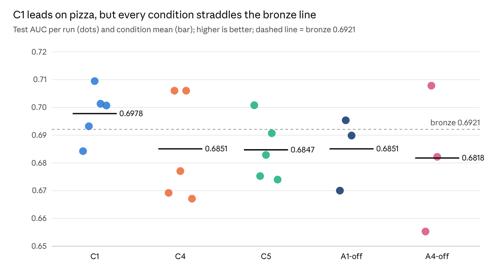
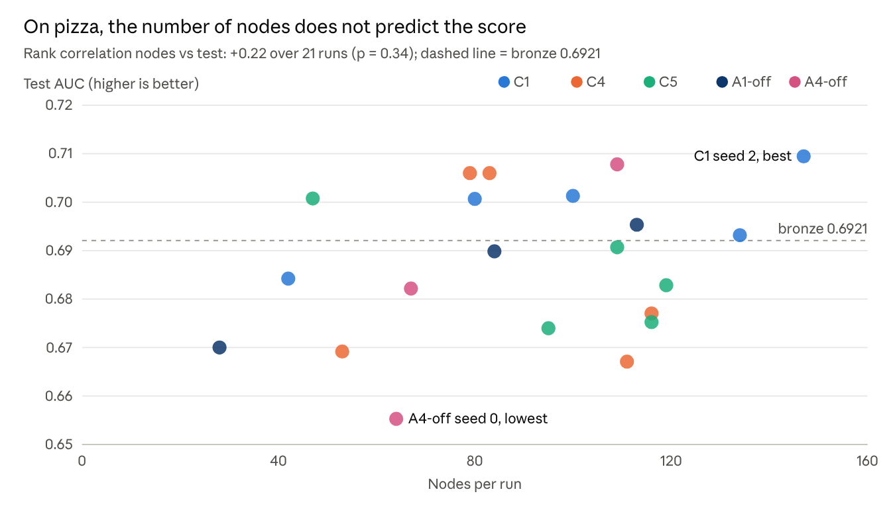
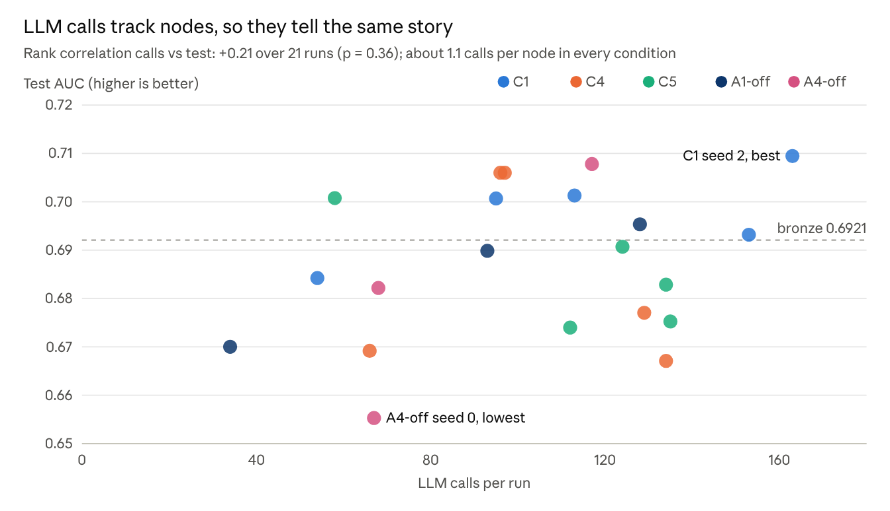
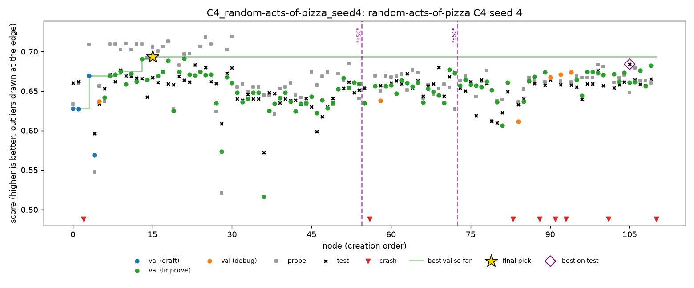
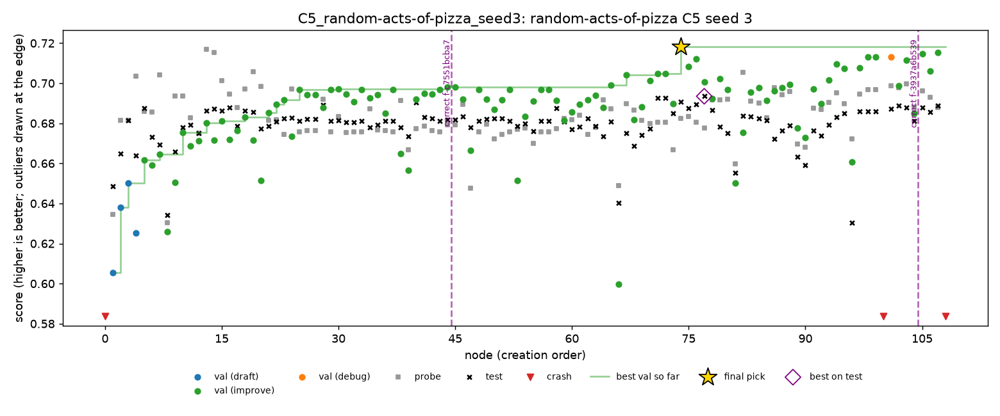

# Pizza

> Exported 9 Nov 2026 from Nabil's analysis doc, [Full-plan results](https://claude.ai/artifact/1AHcCcSLLuLfqSGPkTFe5W), tab “Pizza”. Charts are images of the doc's live charts. Paths under `runs/` are on Nabil's Mac; the data and scripts used are copied next to this file.

## Pizza: all 21 runs

All 21 runs are valid and above the median (0.5996); 9 reached bronze (0.6921), none silver (0.7648). Test ranges from 0.6553 to 0.7095. Pizza is ROC AUC, so higher is better. Each run had 4 hours, DeepSeek V4 Flash 0731 (fp8), 2 threads, on Kaggle CPU with the subprocess sandbox.

| Condition | Seed | Nodes | LLM calls | Calls/node | Test | Medal | Pick | Validation | Probe | Test − val | C2 (oracle) | C3 (top 3) | Pick loss | Live interventions | C4 rule replayed | Cost ($) | Cut-off calls |
| --- | --- | --- | --- | --- | --- | --- | --- | --- | --- | --- | --- | --- | --- | --- | --- | --- | --- |
| C1 | 0 | 42 | 54 | 1.29 | 0.6842 |  | n40 | 0.7003 | 0.6685 | −0.0161 | 0.6928 | 0.6842 | 0.0085 | – | no prune | 0.32 | 11 |
| C1 | 1 | 134 | 153 | 1.14 | 0.6932 | bronze | n112 | 0.7329 | 0.6947 | −0.0397 | 0.7099 | 0.6959 | 0.0167 | – | no prune | 0.66 | 5 |
| C1 | 2 | 147 | 163 | 1.11 | 0.7095 | bronze | n128 | 0.7235 | 0.6592 | −0.0141 | 0.7095 | 0.7095 | 0 | – | no prune | 0.31 | 0 |
| C1 | 3 | 100 | 113 | 1.13 | 0.7013 | bronze | n98 | 0.7123 | 0.6873 | −0.0110 | 0.7034 | 0.7013 | 0.0021 | – | fired, no change | 0.43 | 2 |
| C1 | 4 | 80 | 95 | 1.19 | 0.7007 | bronze | n29 | 0.7151 | 0.6838 | −0.0145 | 0.7027 | 0.7007 | 0.0021 | – | worse by 0.0010 | 0.53 | 9 |
| C4 | 0 | 53 | 66 | 1.25 | 0.6692 |  | n10 | 0.6882 | 0.6414 | −0.0190 | 0.6826 | 0.6692 | 0.0134 | 1 prune | – | 0.33 | 9 |
| C4 | 1 | 79 | 96 | 1.22 | 0.7060 | bronze | n63 | 0.7216 | 0.7008 | −0.0156 | 0.7123 | 0.7061 | 0.0063 | none fired | – | 0.54 | 13 |
| C4 | 2 | 116 | 129 | 1.11 | 0.6771 |  | n109 | 0.7176 | 0.6794 | −0.0405 | 0.7118 | 0.6936 | 0.0348 | none fired | – | 0.23 | 1 |
| C4 | 3 | 83 | 97 | 1.17 | 0.7060 | bronze | n80 | 0.7135 | 0.6775 | −0.0075 | 0.7162 | 0.7136 | 0.0102 | none fired | – | 0.45 | 6 |
| C4 | 4 | 111 | 134 | 1.21 | 0.6671 |  | n15 | 0.6936 | 0.7058 | −0.0264 | 0.6839 | 0.6671 | 0.0168 | 2 prunes | – | 0.67 | 12 |
| C5 | 0 | 47 | 58 | 1.23 | 0.7008 | bronze | n41 | 0.7153 | 0.6514 | −0.0146 | 0.7066 | 0.7008 | 0.0058 | 2 corrections | no prune | 0.29 | 7 |
| C5 | 1 | 116 | 135 | 1.16 | 0.6753 |  | n113 | 0.6977 | 0.6995 | −0.0224 | 0.6949 | 0.6798 | 0.0197 | 3 corrections | better by 0.0033 | 0.60 | 9 |
| C5 | 2 | 119 | 134 | 1.13 | 0.6829 |  | n109 | 0.7316 | 0.6960 | −0.0488 | 0.6997 | 0.6832 | 0.0168 | 1 correction | no prune | 0.30 | 1 |
| C5 | 3 | 109 | 124 | 1.14 | 0.6907 |  | n74 | 0.7181 | 0.6824 | −0.0275 | 0.6935 | 0.6907 | 0.0028 | 2 corrections | worse by 0.0046 | 0.62 | 4 |
| C5 | 4 | 95 | 112 | 1.18 | 0.6740 |  | n24 | 0.7066 | 0.6694 | −0.0326 | 0.6861 | 0.6861 | 0.0121 | 3 corrections | fired, no change | 0.47 | 5 |
| A1-off | 0 | 28 | 34 | 1.21 | 0.6700 |  | n19 | 0.7231 | 0.6896 | −0.0530 | 0.6774 | 0.6700 | 0.0074 | – | no prune | 0.18 | 4 |
| A1-off | 1 | 113 | 128 | 1.13 | 0.6954 | bronze | n110 | 0.7256 | 0.6781 | −0.0302 | 0.6988 | 0.6955 | 0.0034 | – | worse by 0.0243 | 0.50 | 2 |
| A1-off | 2 | 84 | 93 | 1.11 | 0.6899 |  | n61 | 0.7345 | 0.6937 | −0.0446 | 0.6985 | 0.6899 | 0.0086 | – | no prune | 0.23 | 0 |
| A4-off | 0 | 64 | 67 | 1.05 | 0.6553 |  | n21 | 0.6888 | 0.6983 | −0.0335 | 0.6695 | 0.6553 | 0.0142 | – | better by 0.0055 | 0.24 | 3 |
| A4-off | 1 | 109 | 117 | 1.07 | 0.7078 | bronze | n79 | 0.7070 | 0.6825 | +0.0008 | 0.7078 | 0.7078 | 0 | – | no prune | 0.57 | 9 |
| A4-off | 2 | 67 | 68 | 1.01 | 0.6822 |  | n63 | 0.7109 | 0.6833 | −0.0287 | 0.6893 | 0.6849 | 0.0071 | – | fired, no change | 0.15 | 0 |

## Pizza by condition

C1 has the best mean (0.6978) and 4 bronzes in 5; the other four conditions have 5 bronzes in 16 runs together. Bootstrap 95% intervals are over runs (2,000 resamples).

| Condition | Runs | Mean test | 95% interval | SD | Best | Worst | Bronzes | Median test − val | Median pick loss | Mean nodes | Mean calls/node | Mean cost ($) |
| --- | --- | --- | --- | --- | --- | --- | --- | --- | --- | --- | --- | --- |
| C1 | 5 | 0.6978 | 0.6908 – 0.7046 | 0.0095 | 0.7095 | 0.6842 | 4 | −0.015 | 0.002 | 101 | 1.17 | 0.45 |
| C4 | 5 | 0.6851 | 0.6703 – 0.7002 | 0.0195 | 0.7060 | 0.6671 | 2 | −0.019 | 0.013 | 88 | 1.19 | 0.44 |
| C5 | 5 | 0.6847 | 0.6765 – 0.6937 | 0.0112 | 0.7008 | 0.6740 | 1 | −0.028 | 0.012 | 97 | 1.17 | 0.46 |
| A1-off | 3 | 0.6851 | 0.6700 – 0.6954 | 0.0133 | 0.6954 | 0.6700 | 1 | −0.045 | 0.007 | 75 | 1.15 | 0.30 |
| A4-off | 3 | 0.6818 | 0.6553 – 0.7078 | 0.0263 | 0.7078 | 0.6553 | 1 | −0.029 | 0.007 | 80 | 1.05 | 0.32 |

C1's interval overlaps every other condition's, though only just with C5's (0.6908 against 0.6937). The bronze line (0.692) sits in the middle of where pizza runs land, so a medal is close to a coin toss for a single run. The 21 runs cost about $8.60 in all.

## Pizza: charts

Every condition has runs on both sides of the bronze line, and search size does not predict the score.

Calls are about 1.1 per node, so the two scatter plots look alike.

## Pizza final models

Pizza mixes text with request metadata (account age, karma, subreddits, time), and the agent treats it as tabular: 20 of 21 picks contain tree models, usually on SVD-compressed text plus the metadata. Naive Bayes does not separate runs here (4 picks use it, including NB-weighted features; mean 0.685 against 0.688). No pick uses the leaking `giver_username_if_known` field (see the report draft). Descriptions are from each pick's plan and the classes its script builds.

| Condition | Seed | Test | Final model |
| --- | --- | --- | --- |
| C1 | 0 | 0.6842 | Logistic regressions on TF-IDF and SVD text features with request metadata and the raw timestamp; the only pick without a tree model |
| C1 | 1 | 0.6932 | Calibrated blend of logistic regression on TF-IDF and ExtraTrees on SVD text components plus metadata |
| C1 | 2 | 0.7095 | Five-fold stack of random forest, gradient boosting, ExtraTrees and an MLP on SVD text and metadata, combined by logistic regression |
| C1 | 3 | 0.7013 | Stack of calibrated logistic regressions on TF-IDF views with random forest, gradient boosting, AdaBoost and an MLP on metadata |
| C1 | 4 | 0.7007 | Stack of eight base models (logistic regressions, random forest, ExtraTrees, MLP, LDA) on SVD text and numeric features |
| C4 | 0 | 0.6692 | Gradient boosting on SVD text components and metadata, with indicators for the 50 most common subreddits |
| C4 | 1 | 0.7060 | Rank blend of logistic regression on TF-IDF and a random forest on SVD text and metadata |
| C4 | 2 | 0.6771 | Stack of gradient boosting, an MLP and logistic regression on SVD text, counts and quantile-transformed metadata |
| C4 | 3 | 0.7060 | Ensemble of gradient boosting, random forest, ExtraTrees and logistic regression on word and character SVD plus metadata |
| C4 | 4 | 0.6671 | Gradient boosting on SVD text, metadata and features of the requester's username |
| C5 | 0 | 0.7008 | Gradient boosting on 60 SVD components of TF-IDF plus metadata |
| C5 | 1 | 0.6753 | Gradient boosting and an MLP on metadata, SVD components and naive Bayes and logistic-regression text meta-features |
| C5 | 2 | 0.6829 | Gradient boosting and random forest on metadata plus MultinomialNB, ComplementNB and logistic-regression text meta-features |
| C5 | 3 | 0.6907 | ExtraTrees on SVD text components, metadata and calendar features |
| C5 | 4 | 0.6740 | Random forest on SVD of word 1–4-gram TF-IDF plus metadata |
| A1-off | 0 | 0.6700 | Weighted ensemble of TF-IDF logistic regressions (title and body), gradient boosting and random forest |
| A1-off | 1 | 0.6954 | Stacking classifier of random forest, gradient boosting and logistic regression on SVD text and log-scaled metadata |
| A1-off | 2 | 0.6899 | Logistic regression and random forest with leave-one-out target encodings of title and body words |
| A4-off | 0 | 0.6553 | Gradient boosting on SVD of TF-IDF fitted on training and prediction text together, plus metadata |
| A4-off | 1 | 0.7078 | Blend of gradient boosting, random forest, ExtraTrees, an MLP, SGD and logistic regression with subreddit target encodings |
| A4-off | 2 | 0.6822 | Average of random forest, gradient boosting and ExtraTrees, with a MultinomialNB text meta-feature |

## Reading the pizza tables

- **Test − val:** negative means validation looked better than test turned out (optimistic), since higher is better.
- **Pick loss:** the run's best working node on test (C2) minus the pick's test. Zero means the pick was the best node.
- **C3 (top 3):** the best test score among the three best nodes on validation.
- **C4 rule replayed:** the pick's test if the C4 rule had been applied after the run; “fired, no change” means it pruned but the pick stayed the same.
- **Live interventions:** C4's prunes and C5's finding corrections during the run.
- **Cut-off calls:** LLM replies stopped at the 64k-token cap; 112 of 2,170 calls (5.2%).

Footnotes for the report:

- All 21 runs ran 4 hours on Kaggle CPU (1 to 4 Nov), each after its session's insults run, with the subprocess sandbox capped at 2 threads.
- Seed 0 (round 1) still used StreamLake: C1 lost 112 of its 240 minutes and C4 101 to cut-off calls, and C1 and A4-off each restarted once and resumed from a checkpoint.
- A1-off gets the validation rows as training data and makes its own split, so its validation scores are not comparable.
- The `requester_received_pizza` label leaks through `giver_username_if_known` (see the report draft); no pick used it.
- Source: `runs/_analysis/full_plan/` (copied to [`pizza/data/`](analysis/tables/)) (outcomes, val\_test\_gap, replay, cost) and `pizza_runs.csv`.

# Pizza report draft

## Summary

Pizza is the one task where validation and the probe disagree, and it shows that the scripted interventions then react to noise rather than help.

1. **C1 leads, but not conclusively.** C1 has the best mean (0.6978) and 4 bronzes in 5, against 5 in 16 for the other conditions together; its interval overlaps every other condition's.
2. **The interventions fired and did not help.** C4 pruned 3 times and never changed a pick; C5 deleted 11 findings, and of the 10 that made a claim, test agrees with 7 of the deleted findings. The C4 rule, replayed, fired on 8 of 16 other runs: better on 2, worse on 2, about the same on 4.
3. **The small probe is the reason.** With 288 probe rows, the probe ranks nodes worse than validation does (rank correlation with test 0.28 against 0.53), so rules that trust it are acting on noise.
4. **Validation is optimistic and selection costs more here.** The pick's test is below its validation in 20 of 21 runs, and the pick is a median 0.009 behind the run's best node.
5. **The data has a label leak.** `giver_username_if_known` is filled only for requests that got a pizza (about 7% of every split); MLE-bench says the task should be dropped for it. No pick used it.

## Setup

- **Task:** `random-acts-of-pizza` (Kaggle, data from Althoff et al., ICWSM 2014): predict whether a Reddit request on r/Random\_Acts\_Of\_Pizza got a pizza, from its title, text and request-time metadata (account age, karma, posting history, subreddits, timestamp). ROC AUC, higher is better; MLE-bench thresholds: median 0.5996, bronze 0.6921, silver 0.7648, gold 0.9791.
- **Data split (A1, fixed seed 0):** 2,014 training rows (about 25% successful), 576 validation, 288 probe, 1,162 test.
- **Conditions:** C1, C4, C5 with seeds 0–4; A1-off and A4-off with seeds 0–2; C2 and C3 from C1 after the fact.
- **Budget and machine:** 4 hours per run, DeepSeek V4 Flash 0731 (fp8), Kaggle CPU with the sandbox image's packages, subprocess sandbox capped at 2 threads, 20-minute limit per script, at most 200 nodes.
- **Schedule:** 1 to 4 Nov 2026, each run after its session's insults run; StreamLake excluded from seed 1.

## Results by condition

All 21 runs are valid and above the median, and 9 reached bronze. The means rank C1 (0.6978), C4 and A1-off (0.6851), C5 (0.6847) and A4-off (0.6818) (table “Pizza by condition” and the strip chart above).

- **C1 is the only condition with more bronzes than not** (4 of 5); C4 has 2 of 5, C5 1 of 5, each ablation 1 of 3.
- **No ranking is claimed.** C1's interval overlaps every other condition's, and single conditions range over 0.025 (C1) to 0.053 (A4-off) across seeds.
- **The bronze line (0.692) sits in the middle of the runs,** so whether one run medals is close to a coin toss.
- **C2 and C3:** the oracle pick would raise C1's mean from 0.6978 to 0.7037 and make all 5 C1 runs bronze; the top-3 hedge gives 0.6983.
- **Notable runs:** C4 seed 2 lost 0.035 to a near-tie on validation (its top 5 nodes within 0.003 on validation, 0.677 to 0.694 on test); A4-off seed 0 (0.6553, the lowest) fitted its TF-IDF on training and prediction text together.

## The giver-field leak in the data

Pizza's data carries the label in one field, and no submitted model used it.

- **The leak:** `giver_username_if_known` names the person who gave the pizza, so it is filled only for successful requests. In the agent's training rows, all 149 requests with a known giver got a pizza, against 18.8% of the rest.
- **It reaches test:** about 7% of every split has a known giver (41 of 576 validation, 18 of 288 probe, 79 of 1,162 test rows), all successful.
- **MLE-bench knows:** its README says the field “leaks the outcome, enabling trivial perfect prediction. This competition should be dropped” (issue #108).
- **No pick used it:** the five picks that mention the field drop it explicitly, and in every pick's predictions the known-giver rows sit around the 60th percentile, where a model that used the leak would rank them at the top.
- **A1 cannot catch it:** the field is legitimately present in the prediction rows, so it is not a validation leak. Spotting it needs someone who knows the data.
- **For the comparison:** some other agents' best pizza scores (0.78 to 0.80) may use this leak; we have not checked.

## A1, validation honesty and the small probe

On pizza, validation is optimistic even with A1, and the probe is too small to correct it.

- **Optimism:** the pick's test is below its validation in 20 of 21 runs; the median gap is −0.021 with A1 and −0.045 without (A1-off makes its own split). No run leaked: A1's leakage check stopped one script (A4-off seed 2, n10) and no other A1-on script is flagged.
- **Why, with A1:** validation has 576 rows. The pick is the best of about 100 nodes on that split, so part of its score is the luck of being the maximum.
- **Selection cost:** the pick is a median 0.009 below the run's best node on test (A1 on), at most 0.035 (C4 seed 2); it was the best node in only 2 runs.
- **Probe fidelity:** across each run's nodes, the probe's ranking correlates 0.28 with test and validation's 0.53 (median, runs with A1); neither's top 5 shares a node with test's top 5.
- **Reading:** on pizza the probe is the worse guide. Every rule that trusts the probe over validation (C4's divergence, C5's replication check) acts on the noisier signal.

## Interventions: C4 (divergence prune)

C4 fired live on pizza and never changed a pick; replayed on other runs it helps as often as it hurts.

- **The rule:** prune a branch when, since the lineage's best-probe node, validation has improved by at least 1% and the probe has worsened by at least 1% (relative) over 2 or more nodes, holding in 95% of paired bootstrap resamples of the probe.
- **Seed 0, 1 prune:** at node 33 it pruned n29's branch (validation +0.023, probe −0.047 since n6). The pruned nodes scored about 0.65 on test, below the pick (n10, 0.669): nothing lost, nothing gained.
- **Seed 4, 2 prunes:** after n54 (n51's branch, 4 nodes) and after n72 (n57's branch, 14 nodes). The pick was n15 from early in the run, which no later node beat on validation, so neither prune touched it. The run's loss was selection: n15 scored 0.694 on validation and 0.667 on test, while the best node on test (n105, 0.684) scored 0.661 on validation.
- **Replayed on the 16 runs that are not C4:** it fires on 8. The pick improves on A4-off seed 0 (+0.006) and C5 seed 1 (+0.003), stays within 0.001 on four, and gets worse on C5 seed 3 (−0.005) and A1-off seed 1 (−0.024).
- **Reading:** the divergences C4 sees on pizza are mostly probe noise (288 rows). A rule that prunes on them is as likely to cut a good branch as a bad one.

## Interventions: C5 (finding correction)

C5 deleted 11 findings on pizza, and test says most of the deleted findings were right.

- **The rule:** each finding's cited nodes are compared with their parents on validation and on the probe; a cited node fails if its validation gain exceeds its probe gain by more than 0.02 (or the reverse for “hurts”), or if it crashed or was pruned. Half or more failed: the finding is deleted from the agent's memory.
- **Counts:** 2, 3, 1, 2 and 3 corrections on seeds 0 to 4; 10 deleted a claim (“X helps” or “X hurts”), one a note citing a crashed node.
- **Checked against test:** for 7 of the 10, test agrees with the deleted finding; for 3, with the deletion. In the four seed-3 and seed-4 deletions checked by hand, the probe was the split that moved the wrong way; on seed 2 the check used the wrong pair of nodes (below).
- **Examples (seed 4):** C5 deleted “request-time temporal features help” (validation +0.043, probe −0.009, test +0.015), “fitting TF-IDF on train plus test hurts” (validation −0.027, probe +0.004, test −0.034) and “removing stop words hurts” (validation −0.057, probe +0.014, test −0.014).
- **A check on the wrong pair (seed 2):** the finding compared n13 with n11; C5 tested n11 against its parent n4 instead, which failed, and deleted a finding that test confirms.
- **Effect:** no correction changed a pick. After one deletion (seed 3, “gradient boosting hurts”), the agent went back to gradient boosting in 7 more nodes, spending search time.
- **Reading:** C5 trusts the probe to judge the agent's findings; on pizza the probe is the noisier split, so C5 mostly removes correct knowledge. It would need a probe large enough to be more reliable than validation.

## What the agent built

The agent treats pizza as a tabular problem with text features, and builds tree ensembles on them.

- **Model families:** 20 of 21 picks contain tree models (random forest, gradient boosting, ExtraTrees), usually on SVD-compressed TF-IDF of the title and text plus the metadata; many stack several models. Six picks include a small MLP.
- **Naive Bayes does not separate runs here:** the four picks with a naive Bayes component (including NB-weighted features) average 0.685 against 0.688 (not significant), unlike spooky and insults.
- **Features the agent invented:** subreddit indicators and target encodings, timestamp and calendar features, karma transforms, username features, and rank or quantile transforms before blending.
- **Search size:** the number of nodes does not predict the score (rank correlation +0.22, p = 0.34).
- **The 20-minute limit is not binding:** nodes with tree models timed out 1.2% of the time (20 of 1,716).
- **Where the score is decided:** which of the leading nodes is picked. On C4 seed 2, the top 5 on validation were within 0.003 of each other and spanned 0.677 to 0.694 on test. That is a selection problem as much as a modelling one.

## Annotated trajectories

Two pizza runs where the interventions fired: C4 pruned branches that test says were improving, and C5 deleted a correct finding.

### C4 seed 4: prunes on probe noise

- **n0 to n15:** gradient boosting on TF-IDF SVD components and metadata, then character n-grams (n13) and username features (n15). n15 reaches validation 0.694, probe 0.706, test 0.667.
- **95 nodes without a new best:** nothing after n15 beats it on validation, so it stays the pick.
- **The prunes:** from n50 the agent built a branch whose validation rose (0.653 to 0.673 at n72) while the probe fell (0.672 to 0.627). C4 pruned it twice (after n54 and after n72). On test that branch was rising: n50 0.653, n72 0.674. The probe moved the wrong way; the rule followed it.
- **The pick, n15:** 15th of 85 on test. The best node on test, n105 (0.684), was 40th on validation.
- **What it shows:** with a 288-row probe, a divergence between validation and the probe is often noise. The prunes changed nothing here only because the pick came from elsewhere.

### C5 seed 3: a correct finding deleted

- **The path:** a random forest, then ExtraTrees with a hyperparameter search, plus subreddit, activity, keyword and calendar features. Validation rises steadily, to 0.718 at n74.
- **The probe disagrees:** it peaks at n13 (0.717) and drifts down to about 0.68 while validation rises. Test sides with validation, a little: 0.686 at n13, 0.691 at the pick.
- **n44, the correction:** C5 deletes “histogram gradient boosting hurt validation in two attempts”, because one cited node's probe rose slightly (+0.001) while its validation fell (−0.032). Test agrees with the finding: that node scored 0.677 against its parent's 0.686.
- **Afterwards:** the agent tries gradient boosting in 7 more nodes (4 before the deletion); none beats the pick.
- **The pick, n74:** first on validation, 4th of 106 on test, 0.003 below the best node (n77).
- **Replayed, C4 would have made it worse:** its rule fires after n22 and the pick becomes n13 (0.686 against 0.691).

Charts from `scripts/trajectory.py` on the saved runs (`runs/kaggle/<run>/trajectory/`); each run's `timeline.md` lists every event.

## Search behaviour, errors, findings and cost

Pizza has the most failed nodes of the three tasks, and A4's findings replicate least.

- **Node outcomes:** of 1,896 nodes, 93.4% worked; 52 crashed, 28 had an unusable LLM reply, 21 timed out, 23 were pruned by C4 and 1 was stopped by A1's leakage check.
- **Improvements:** 67% of working improve attempts (1,099 of 1,648) did not beat their parent, and 38 changed nothing; 40 working nodes were labelled validation overfitting.
- **A4's findings:** 428 findings in the runs with A4, 375 claiming that a change helps or hurts. 59% are supported by the validation scores they cite; 22% also hold on the probe (36% of the supported ones).
- **LLM use:** about 1.1 calls per node, 2,170 calls in all; 112 (5.2%) were cut off at the 64k-token cap, 34 of them in seed 0 (12% of its calls), before StreamLake was excluded; later rounds ranged from 0.3% to 6%.
- **Cost:** about $8.60 for the 21 runs, $0.15 to $0.67 per run (mean $0.41).

## Comparison with other agents

Our mean is above the older agents' means (0.63 to 0.66) and close to MLEvolve's (0.701), but well below ML-Master 2.0's (0.801); our best is lower than the older agents' best runs, some of which may use the giver-field leak. The numbers come from MLE-bench's official grading reports; those runs mostly had 24 hours, a GPU and frontier models.

| Agent | Model | Seeds | Mean AUC | Best | Medals |
| --- | --- | --- | --- | --- | --- |
| Ours (all conditions) | DeepSeek V4 Flash, 4 h, 2 CPUs | 21 | 0.688 | 0.709 | 9 |
| AIDE, CPU only | GPT-4o | 12 | 0.650 | 0.784 | 1 |
| AIDE | GPT-4o | 39 | 0.645 | 0.784 | 3 |
| AIDE | o1-preview | 21 | 0.656 | 0.798 | 5 |
| AIRA-dojo | o3 | 20 | 0.629 | 0.795 | 8 |
| MLEvolve | Gemini-3-Pro | 3 | 0.701 | 0.708 | 3 |
| ML-Master 2.0 | DeepSeek-V3.2 | 3 | 0.801 | 0.803 | 3 |

Means are over valid submissions. Source: `runs/*/…grading_report.json` in the [MLE-bench repository](https://github.com/openai/mle-bench), extracted to `runs/_analysis/mlebench_compare/per_task.csv`.

## Limitations

- **The task has a known label leak** (`giver_username_if_known`), and MLE-bench recommends dropping it. Our runs did not use the leak, but scores across agents are not comparable on this task.
- **Small held-out splits:** 576 validation and 288 probe rows make both noisy; the interventions' behaviour here mostly reflects that noise.
- **Few seeds:** five per main condition and three per ablation; differences below about 0.03 AUC are within seed noise.
- **Seed 0 differs:** it used StreamLake (C1 lost 112 of 240 minutes, C4 101) and two of its runs restarted from a checkpoint.
- **Platform:** Kaggle CPU with the subprocess sandbox (no isolation, network access), unlike spooky's Docker on a Mac.
- **One small model** (DeepSeek V4 Flash) for every run; no web search.
- **C5 hand checks:** each claim-making deletion was judged on test using the pair of nodes C5 compared; on seed 2 that pair differed from the finding's, so it was judged by hand on the finding's own pair.
