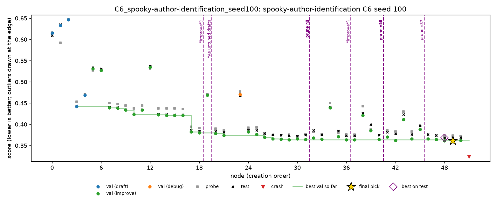

# Spooky, C6: live session

28 Oct 2026, 10:50 to 12:50, Nabil's Mac. One C6 session on `spooky-author-identification`, seed 100, following `docs/c6-protocol.md`. The participant's full notes, with the debrief, are in [`spooky-c6/c6_notes.md`](spooky-c6/c6_notes.md).

Spooky is multiclass log loss, so **lower is better**. MLE-bench thresholds: median 0.4188, bronze 0.2938.

## Setup

- **Run:** `c6_live.yaml` (`monitors: [human]`), 2 hours, DeepSeek V4 Flash 0731, A1, Docker. The same as the grid's C1 runs apart from the monitor.
- **Participant:** Nabil, who owns spooky, had seen the 13 grid runs, not this one, and knew the general approach of the competition's top solutions.
- **Rules:** oversight only (prune, final pick, correct a finding). Redirect only on what the dashboard shows. No injected ideas and no outside lookups. The participant checked the dashboard about every 10 minutes.
- **Assistant:** Claude explained the dashboard during the session (what the signals mean, node scripts on request), gave no modelling ideas and did not read test scores until the run ended.
- **Cost:** $0.125, 58 LLM calls, 52 nodes.

## Result

| | Validation | Probe | **Test** |
|---|---|---|---|
| **n49 (submitted)** | 0.3612 | 0.3732 | **0.3684** (2nd of 35 working nodes) |
| n48 (best on test) | 0.3612 | 0.3733 | 0.3683 |
| n30 (best on probe) | 0.3661 | 0.3688 | 0.3723 |

- Valid and above the median, no medal.
- C2 (oracle) and C3 (top 3) are both 0.3683, so the pick lost 0.0001.
- C6's 0.3684 is worse than every C1 seed (0.3606, 0.3087, 0.2946). With one session on another seed, this can't separate the interventions' effect from seed noise.

## Interventions

12 queued, all applied: 9 prunes, 2 redirects, 1 correction. The first came at 37% of the budget.

| Time | Action | Why | What it did, judged on test afterwards |
|---|---|---|---|
| 11:28 | redirect: improve n4 | n4 close to n3 as a draft (0.469 vs 0.442), never expanded | nothing: n19 scored exactly n4's score. The main branch had already taken n4's idea at n17 |
| 11:32 | correct `f-738ab0da36` | the finding said word+char was worse than char only; n17 showed the opposite, with the probe agreeing | the corrected finding stayed in the agent's prompt; the next reflection built on it |
| 12:00 | prune n0, n1, n2, n4 | with 60 min left, branches about 0.1 behind the best could not catch up | frees the random exploration picks for the main lineage |
| 12:11 | redirect: improve n30 | n30 had the best probe in the run, but greedy follows validation | nothing: its child n37 removed n30's change and matched n29 |
| 12:19 | prune n6, n11, n22, n34 | old side branches, 0.06 to 0.16 behind | the same as above |
| 12:33 | prune n37 | n42 was best on validation but its probe got worse (0.3829 vs n30's 0.3688) | the divergence was real (n42 test 0.3781 vs n37's 0.3730). It probably did not change the pick: n48 and n49 later beat n42 on validation |
| 12:49 | none: keep n49 rather than override to n30 | n49 first on validation and second on probe; n30's probe lead was the minimum of about 45 noisy scores | right: n30 scored 0.004 worse on test |

The participant also chose **not** to act on two things. Both were right in hindsight:

- **n0 and n1:** the probe ranked them the other way round from validation and from the agent's finding. On test, n0 beat n1, so the probe's reversal was noise.
- **The plateau around 0.36:** the participant considered injecting an idea and decided against it, as an expertise action outside the rules.

## Against the C4 rule

`scripts/replay_policy.py` runs the C4 rule over the session's checkpoints. It fires once, after n42, pruning n37: the same prune the participant made, a few minutes after n42 appeared.

| | C4 prunes | C4 does not prune |
|---|---|---|
| **Person prunes** | 1 (n37) | 8 (n0, n1, n2, n4, n6, n11, n22, n34) |
| **Person does not prune** | 0 | the rest |

- **Where they agree:** both act on a divergence between validation and probe.
- **What the person adds:** the 8 other prunes use a budget cue that the rule does not look at: a branch far behind the best with little time left.
- **The rule never fires on noise** in this run.

## What the session suggests

1. **A non-expert can act sensibly on the dashboard's signals.** The probe confirming or contradicting the agent's findings, and validation and probe diverging, were the cues behind the correction and the n37 prune.
2. **A redirect controls which node is improved, not what the agent does with it.** Both redirects produced nothing: the agent repeated n4, and undid n30's change because its findings said it hadn't helped on validation.
3. **The probe is noisy, and picking by its minimum is optimistic.** n30 (best probe) was worse on test than n49, and the n0/n1 reversal was noise. At this probe size (1,762 rows), its value is in trends and divergences more than single-node rankings.
4. **The dashboard could show more.** The participant wanted to see:
   - how likely a node is to be picked again;
   - what a redirect will actually do;
   - a way to cancel a queued action.

## Limitations

- One session, by a team member who knows the agent and had seen the other spooky runs, with no separate observer.
- The participant is not an ML expert, so C6 shows what a non-expert monitor does, not the best a human monitor could do.
- An assistant explained the dashboard during the session.
- The script's 100 "human minutes" is the span from opening the dashboard to the last action. Actual attention was about one check every 10 minutes.

## Files

- **`spooky-c6/c6_notes.md`:** the participant's notes, debrief and post-session results.
- **`spooky-c6/queue.jsonl`, `spooky-c6/applied.jsonl`, `spooky-c6/dashboard_log.jsonl`:** every intervention and dashboard event, with timestamps.
- **`spooky-c6/grade.json`:** MLE-bench's grade.
- **`spooky-c6/timeline.md`, `spooky-c6/trajectory.png`:** the run's timeline and chart.
- **On Nabil's Mac only:** the run folder (`runs/C6_spooky-author-identification_seed100/`) and its log (`runs/C6_spooky_seed100.log`).
