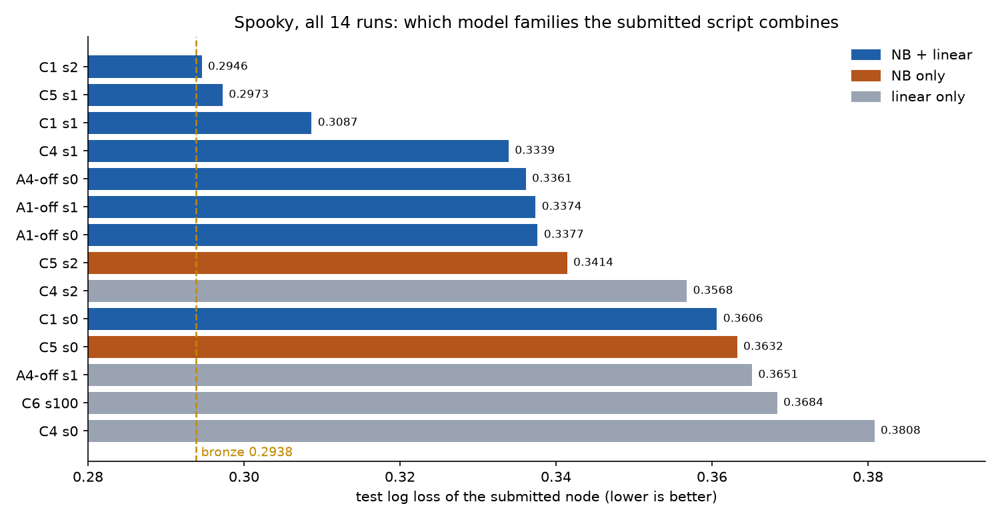
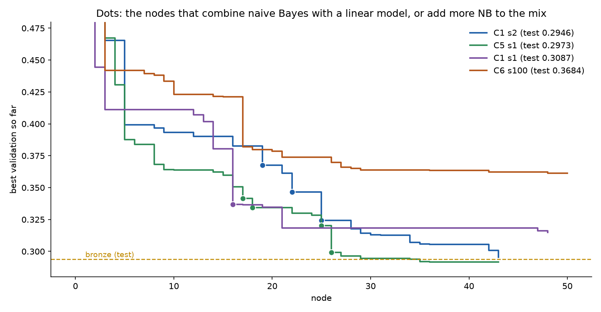

# Spooky: where the big drops come from

Why did C1 seed 2 get within 0.0008 of bronze, while C6 stalled at 0.368? This compares the path to the submitted node in all 14 spooky runs: the 13 grid runs and the C6 session.

Spooky is multiclass log loss, so **lower is better**. Bronze is 0.2938.

## The answer in one line

**Every run that got below 0.34 submitted a model that combines naive Bayes (NB) with a linear model. Every run that didn't stayed at 0.34 or above.** In the three best runs, the biggest drops came at the nodes that built that combination.

| Run | Test | Submitted model combines |
|---|---|---|
| C1 seed 2 | **0.2946** | logistic regression (word+char TF-IDF) + ComplementNB + MultinomialNB |
| C5 seed 1 | **0.2973** | LinearSVC + ComplementNB + BernoulliNB + MultinomialNB, stacked out-of-fold |
| C1 seed 1 | **0.3087** | ComplementNB + SGD (word+char TF-IDF), soft voting |
| C4 seed 1 | 0.3339 | ComplementNB + logistic regression |
| A4-off seed 0 | 0.3361 | MultinomialNB + ComplementNB + logistic regression |
| A1-off seed 1 | 0.3374 | NB + logistic regression + SGD (with the stacking leak) |
| A1-off seed 0 | 0.3377 | ComplementNB + logistic regression |
| C5 seed 2 | 0.3414 | BernoulliNB only |
| C4 seed 2 | 0.3568 | LinearSVC only |
| C1 seed 0 | 0.3606 | ComplementNB + logistic regression (only 25 nodes; see below) |
| C5 seed 0 | 0.3632 | ComplementNB only |
| A4-off seed 1 | 0.3651 | SGD only |
| **C6 seed 100** | 0.3684 | SGD only |
| C4 seed 0 | 0.3808 | logistic regression only |

The model families come from the submitted script of each run (`workspace/<node>.py`).

## The drops, node by node

**C1 seed 2 (0.2946).** Linear first, then NB.

| Node | Change | Validation | Step |
|---|---|---|---|
| n5 | temperature scaling on the word+char logistic regression | 0.3993 | −0.066 |
| n16 | (after small tuning and a leak fix) | 0.3827 | |
| **n19** | **add ComplementNB to the ensemble** | 0.3677 | **−0.015** |
| **n22** | **add MultinomialNB on word counts** | 0.3467 | **−0.015** |
| **n25** | **grid-search the NB smoothing (alpha) and the ensemble together** | 0.3243 | **−0.022** |
| n34, n42, n43 | stylometric features, punctuation n-grams, denser grids | 0.3071 → 0.2954 | about −0.006 each |

From n16 to n25, building the NB + linear ensemble took validation from 0.383 to 0.324 (−0.058) in four improvements. The rest, from 0.324 to 0.295, came from smaller feature additions on top of it.

**C5 seed 1 (0.2973).** Also linear first, then NB, stacked.

- A calibrated LinearSVC on word+char TF-IDF reached 0.3506 (n16).
- Then it added ComplementNB (n17), BernoulliNB (n18) and MultinomialNB (n25) to an out-of-fold stack, and a second MultinomialNB with small smoothing, alpha 0.1 (**n26: −0.021**).
- Validation went from 0.351 to 0.299 (−0.051).

**C1 seed 1 (0.3087).** NB first, then linear.

- ComplementNB alone, tuned down to alpha 0.1, reached 0.3805 (n14).
- **n16** added a second pipeline, SGD on word+char TF-IDF, with the two averaged: **−0.044 in one step**, to 0.3368.

**C6 (0.3684).** Linear only.

- SGD on character TF-IDF, then calibration, seed averaging and more TF-IDF views.
- Its one big drop was n17 (−0.039): adding word features to the character features.
- After that it improved by a few thousandths per node and plateaued at about 0.361 on validation. It never had an NB component.

So there are two kinds of big drop:
1. **Better features:** word and character n-grams together (C6 n17, C1 s2 n3, C5 s1 n5).
2. **Combining model families:** NB on top of a linear model, or the other way round.

The best runs got both. C6 got only the first.

## Why the combination helps (our reading)

- **The two families make different mistakes.** NB models count words and n-grams per author. With small smoothing they latch onto rare, author-specific words such as names and coinages. Logistic regression, SVM and SGD weigh all features against each other. Averaging or stacking two models that err differently lowers log loss more than tuning either one.
- **NB alone is not enough.** C5 seeds 0 and 2 used NB only (0.3632 and 0.3414). The gain comes from the mix.
- **The smoothing matters.** C1 seed 1 and C5 seed 1 each got a large gain from setting NB's alpha to 0.1 instead of the default 1.0 (n14 and n26). C1 seed 2 grid-searched it (n25).

This is the same family of idea as the competition's strong public approaches (NB features combined with linear models). The agent found it on its own in those runs.

## Why C6 never got there

C6 tried NB twice: the draft n1, and n51, the last node, which the budget killed after 1 second.

**The agent's own finding steered it away.** From checkpoint 5 to checkpoint 49, its prompt contained finding `f-5f0d824851`:

> Word-level TF-IDF with logistic regression (n0) outperformed CountVectorizer with MultinomialNB (n1) and feature hashing (n2), so prefer explicit TF-IDF features over hashing and NB for this task.

- **As a comparison of two drafts, it was correct.** On test, n0 beat n1 (0.609 against 0.635), and the probe's reversal was noise.
- **The conclusion was wrong for what mattered later.** NB is weak alone but strong in a mix.
- **The timing fits.** The finding dropped out of the prompt after n43 (the agent keeps at most 10 findings). The first NB attempt since the drafts came at n51, with too little time left.

This is one run, so it's suggestive, not proof. Other C6 factors may matter too: C6 started from character-only SGD, and its seed's drafts differed.

**What it means for the monitors:**
- **Findings can be true and still harmful.** A finding that compares two single models can be right and still steer the search away from a combination that would win. C5's rule checks whether a finding's evidence replicates on the probe. It would not catch this, since the evidence did replicate on test.
- **A monitor needs to know what is missing, not just what is wrong.** The participant noticed this finding at 11:16 and chose not to act, on probe evidence that turned out to be noise. What would have helped is knowing that "prefer X over NB" closes off a direction. That's expertise, which the session's rules (oversight only) kept out.

## C1 seed 0, the exception

C1 seed 0 combined ComplementNB and logistic regression but scored 0.3606. It was the shortest run (25 nodes) and its path to the pick had only 9 nodes. It found the combination but had little time to tune it. The NB + linear combination appears necessary for a score below 0.34, but not sufficient.

## The check: C6's pick with a ComplementNB added

To test the reading above directly, we took C6's submitted script (n49) and added one ComplementNB component, changing nothing else:
- word 1–2-gram counts, blended with n49's SGD ensemble;
- three settings chosen on n49's own internal 10% split, the way n49 chose its own: NB's smoothing (alpha), its temperature and the blend weight;
- nothing tuned on validation, probe or test.

Both scripts ran locally (about 40 s each) and were scored by a copy of C6's frozen harness. The script is [`spooky-drops/c6_n49_with_cnb.py`](spooky-drops/c6_n49_with_cnb.py).

| | Validation | Probe | **Test** |
|---|---|---|---|
| n49 as submitted (rerun) | 0.3611 | 0.3731 | **0.3683** |
| n49 + ComplementNB | 0.3348 | 0.3413 | **0.3357** |
| Change | −0.026 | −0.032 | **−0.033** |

- **The rerun reproduces the real run:** test 0.3683, against 0.3684 graded.
- **The internal split chose:** alpha 0.1, the same value as the NB gains in C1 seed 1 and C5 seed 1, and a blend of 65% SGD and 35% NB. On that split, the blend scored 0.3452 against 0.3748 for SGD alone.
- **One added component** takes C6 from 0.368, among the worst spooky runs, to 0.336, in line with the middle group of runs that mixed the two families (0.334 to 0.338). All three splits agree on the gain.
- **What it doesn't close:** the gap to the best runs (0.29 to 0.31). Those also tuned the mix over many nodes, with several NB variants, stacking and NB-specific features.

So the missing NB component accounts for about 0.03 of C6's deficit. That's about as large as anything a condition did in these runs, and about as large as the seed noise.

## Limits

- 14 runs, one task. Which family a run ends up in also depends on its seed's drafts.
- The model families are read from the submitted script with a simple text search, not by running it.
- The "why" section is our interpretation of the paths. The check above is a single ablation, on one run.
