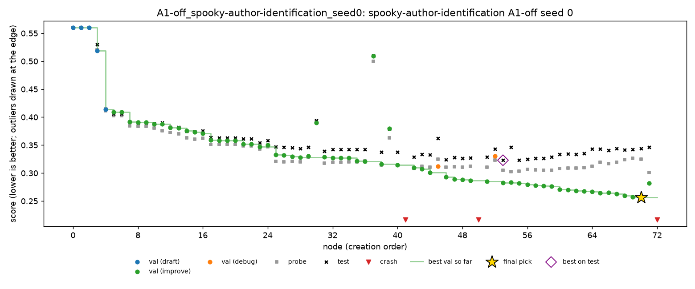

# Spooky, seed 0 extended to 4 hours

Night of 29 to 30 Oct 2026, Nabil's Mac. This is the first step from the half plan towards the full plan. The five seed 0 runs ([`spooky-seed0.md`](spooky-seed0.md)) were each given 2 more hours, to the full plan's 4-hour budget. Each run resumed from its last checkpoint with its tree, findings and random state, and made its final pick again at the new end.

Spooky is multiclass log loss, so **lower is better**. MLE-bench thresholds: median 0.4188, bronze 0.2938.

## Setup

- **The same as the grid runs:** DeepSeek V4 Flash 0731 (fp8), A1, Docker with Colima at 2 CPUs and 4 GB, on the same MacBook Pro M1.
- **Command:**

  ```bash
  python scripts/launch_grid.py --only spooky --seed 0 --budget-hours 4
  ```

  The launcher treats a finished run with a smaller budget as unfinished, and the controller raises its budget (`raise_budget`) before continuing.
- **Times (SGT):** 22:43 to 08:42, about 2 hours per run, in the order C1, C4, C5, A1-off, A4-off.
- **Health:** no restarts, 0 failed LLM calls (377 calls over the five runs, including their first 2 hours).
- **Cost:** about $0.37 for the night.
- **The 2-hour state** of each run was copied to `runs/grid_2h_backup/` before the night (on Nabil's Mac only), so both versions can be compared.
- **Code versions differ.** Seed 0's first 2 hours ran before the PR #7 fix for `OUTPUT_DIR` statements, and the extension ran with it.

## Results

| Run | Nodes (2 h → 4 h) | Test at 2 h | **Test at 4 h** | Change | 4 h pick: validation / probe | C2 (oracle) at 4 h | C3 (top 3) at 4 h |
|---|---|---|---|---|---|---|---|
| C1 | 25 → 51 | 0.3606 | **0.3198** | **−0.041** | n45: 0.3070 / 0.3170 | 0.3186 | 0.3186 |
| C4 | 28 → 46 | 0.3808 | **0.3808** | 0 | n26: 0.3690 / 0.3759 | 0.3785 | 0.3785 |
| C5 | 52 → 116 | 0.3632 | **0.3360** | −0.027 | n104: 0.3216 / 0.3128 | 0.3358 | 0.3358 |
| A1-off | 42 → 73 | 0.3377 | **0.3440** | **+0.006** | n70: 0.2563 / 0.3252 | 0.3230 | 0.3418 |
| A4-off | 38 → 56 | 0.3361 | **0.3215** | −0.015 | n54: 0.3127 / 0.3224 | 0.3215 | 0.3215 |

- **All five are above the median at 4 hours, and none medalled.** The best is C1 at 0.3198.
- **The extra 2 hours helped three runs,** by 0.015 to 0.041. They didn't change C4, and made A1-off slightly worse.
- **C4 submitted the same node as at 2 hours.** It made 18 more nodes, but none beat n26 on validation.
- **With A1 on, the final pick still barely matters.** For C1, C4, C5 and A4-off, the oracle is within 0.002 of the agent's pick.

## Findings

### 1. Without A1, the extra time went into overfitting validation

In the A1-off run, validation kept falling for the whole extension, while the probe and test went the other way:

| Node | Validation | Probe | Test |
|---|---|---|---|
| n53 (best on test) | 0.2824 | 0.3052 | 0.3230 |
| n65 | 0.2642 | 0.3189 | 0.3434 |
| n70 (submitted at 4 h) | 0.2563 | 0.3252 | 0.3440 |

From about n55, the agent kept adding base models to a stacking ensemble ("logit-space ensemble" in its plans). Each new model improved its own validation and made test worse. This is the same pattern as seed 1's leak ([`spooky-seed1.md`](spooky-seed1.md)), arriving later and smaller. At 2 hours, seed 0's gap between validation and test was 0.023; at 4 hours it is 0.088.



### 2. The C4 rule fires on it, but wouldn't have helped this time

Replayed over the extended A1-off run (`scripts/replay_policy.py`), the C4 rule fires after n65: validation +6.3% and probe −5.0% since n55, over 10 nodes. It prunes 16 nodes, and the pick becomes n71, at test **0.3465**. That's 0.0025 *worse* than the 0.3440 actually submitted, because n71, on another branch, happens to be weaker on test.

On seed 1 the same rule improved test by 0.023. So the rule spots the divergence correctly both times, but whether pruning helps depends on what is left to pick.

### 3. C5 fired once during the extension

C5 deleted finding `f-5e4493eeb6`, which cited n51, a node that crashed. It's the same kind of firing as on nomad, and it didn't change the pick.

## Trajectories

| Run | Chart | Timeline |
|---|---|---|
| C1 | [C1.png](spooky-seed0-4h/trajectories/C1.png) | [C1.md](spooky-seed0-4h/trajectories/C1.md) |
| C4 | [C4.png](spooky-seed0-4h/trajectories/C4.png) | [C4.md](spooky-seed0-4h/trajectories/C4.md) |
| C5 | [C5.png](spooky-seed0-4h/trajectories/C5.png) | [C5.md](spooky-seed0-4h/trajectories/C5.md) |
| A1-off | [A1-off.png](spooky-seed0-4h/trajectories/A1-off.png) | [A1-off.md](spooky-seed0-4h/trajectories/A1-off.md) |
| A4-off | [A4-off.png](spooky-seed0-4h/trajectories/A4-off.png) | [A4-off.md](spooky-seed0-4h/trajectories/A4-off.md) |

## Files

- **`spooky-seed0-4h/grades/`:** MLE-bench's grade of each run at 4 hours.
- **`spooky-seed0-4h/trajectories/`:** the chart and timeline of each run, including both halves.
- **On Nabil's Mac only:**
  - the run folders (`runs/grid/*_seed0/`), now at 4 hours;
  - their 2-hour copies (`runs/grid_2h_backup/`);
  - the log (`runs/grid_spooky_seed0_4h.log`).

## Next

The rest of the full plan for spooky:
- extend seeds 1 and 2 to 4 hours, which is 8 runs and about 16 hours;
- add seeds 3 and 4 of C1, C4 and C5, and seed 2 of the ablations, which is 8 runs at 4 hours, about 32 hours. `configs/schedule.yaml` needs those seeds added first.
