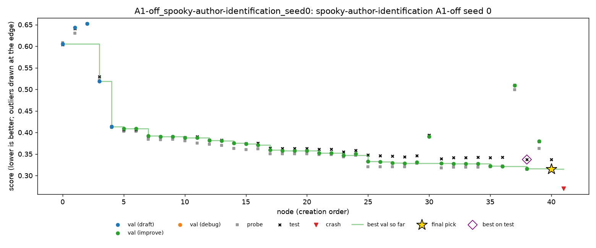
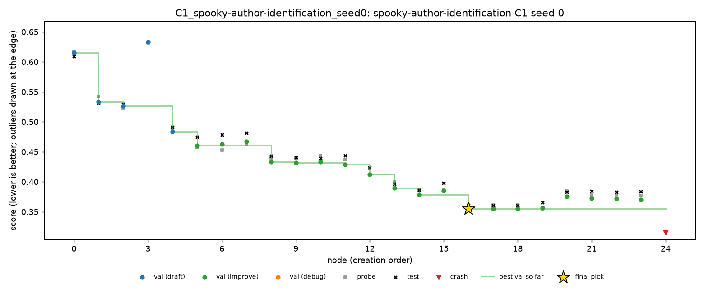
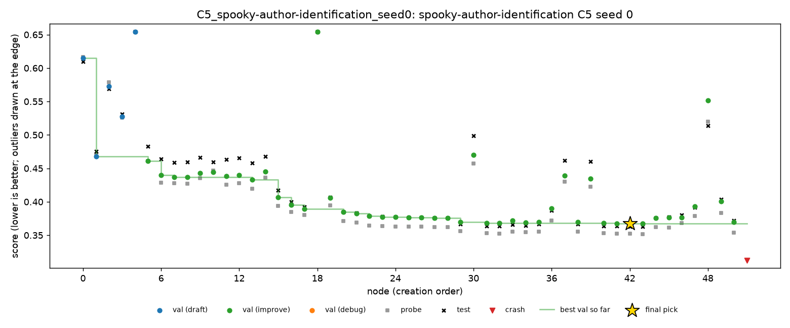

# Spooky, seed 0: first night of the half plan

Night of 25 to 26 Oct 2026, Nabil's Mac. The first five grid runs of the half plan (`docs/experiments.md`): seed 0 of every condition on `spooky-author-identification`.

Spooky is multiclass log loss, so **lower is better**. MLE-bench thresholds: median 0.4188, bronze 0.2938.

## Setup

- **Command:** `python scripts/launch_grid.py --only spooky --seed 0`, detached with `nohup` under `caffeinate -i -s -m`, with Colima at 2 CPUs and 4 GB.
- **Model:** DeepSeek V4 Flash 0731 through OpenRouter, fp8, at the cheapest provider (Baidu).
- **Evaluator:** A1, Docker sandbox, a 2-hour budget per run.
- **Order and times (SGT):**

  | Run | Start | End |
  |---|---|---|
  | C1 | 22:30 | 00:30 |
  | C4 | 00:30 | 02:30 |
  | C5 | 02:30 | 04:31 |
  | A1-off | 04:31 | 06:31 |
  | A4-off | 06:31 | 08:32 |

  Colima then stopped itself.
- **Health:** no crashes, no restarts by `cloud_run.py`, 0 failed LLM calls out of 205.
- **Cost:** $0.294 for the night, about $0.04 to $0.08 per run.

## Results

Graded with `scripts/grade.py` (MLE-bench's grader). Validation and probe are for the final pick.

| Run | Nodes | Working | LLM calls | Cost | Final pick | Validation | Probe | **Test** | Pick's test rank in run |
|---|---|---|---|---|---|---|---|---|---|
| C1 | 25 | 96% | 29 | $0.041 | n16 | 0.3547 | 0.3610 | **0.3606** | 1st of 24 |
| C4 | 28 | 96% | 32 | $0.047 | n26 | 0.3690 | 0.3759 | **0.3808** | 1st of 27 |
| C5 | 52 | 98% | 58 | $0.068 | n42 | 0.3676 | 0.3520 | **0.3632** | 1st of 51 |
| A1-off | 42 | 98% | 47 | $0.076 | n40 | 0.3149 | 0.3140 | **0.3377** | 2nd of 41 |
| A4-off | 38 | 92% | 39 | $0.062 | n36 | 0.3214 | 0.3345 | **0.3361** | 2nd of 35 |

- All five submissions are valid and above the median. None reached bronze.
- **C2 (oracle) and C3 (top 3)** both equal C1, at 0.3606: C1's pick was already the best node on test.

## Findings

### 1. C4 and C5 never intervened, because on spooky there was nothing to fix

Neither run wrote a `queue.jsonl`. Replaying both rules over every saved checkpoint of all five runs (`scripts/replay_policy.py`, and `finding_correction.decide` per checkpoint) shows neither would have fired anywhere.

- **C4 (prune on divergence)** needs validation to improve while probe gets worse. Spooky's probe split is large (about 1,760 rows), and validation and probe moved together all night, within about 0.01.
- **C5 (delete findings that do not replicate)** checked the nodes cited by its 15 findings. 28 checks passed, 0 failed, and 5 could not be checked (no parent to compare with). The other runs' findings also all passed (C1: 23 passed, 0 failed).

So on spooky with seed 0, C4 and C5 behaved as C1 with a different random path. Their test scores differ from C1's only by seed noise. Interventions only have something to act on when the agent's own signal misleads it, and on spooky it did not. Leaf (pilot showed validation overfitting) and nomad (small probe split) are where C4 and C5 should actually fire.

### 2. Seed noise on spooky is about ±0.02 per run

With no intervention in any run, the five test scores still span 0.336 to 0.381. `trajectory.py --pairs` compares each run with its C1 twin, giving -0.023 (A1-off), -0.025 (A4-off), +0.020 (C4) and +0.003 (C5).

Its "helped" and "hurt" labels are meaningless here, since nothing intervened. On spooky, a single-seed difference must be clearly larger than about 0.02 to count for anything; the 3-seed means are what to compare.

### 3. Without A1, the agent's validation is optimistic

A1-off had the best validation (0.3149) but a gap of 0.023 to test (0.3377). On the trajectory chart, test sits about 0.02 above validation for the whole run, not just at the end. The runs with A1 were much closer:

| Run | Validation-to-test gap |
|---|---|
| C1 | +0.006 |
| C4 | +0.012 |
| C5 | -0.004 |
| A4-off | +0.015 |

This is what A1 exists to prevent: A1-off scores itself on a split and metric the agent wrote. It is one seed, but the direction is the expected one.



A1-off still had the second-best test score. On spooky the optimistic validation did not lead the search astray; it only overstated the result.

### 4. Final-node selection is not the problem on spooky

Every final pick was first or second on test among its run's nodes, and the selection regret was at most 0.0009. When the agent misses a medal here, it is because the search never found a better model, not because it chose the wrong node. Gains have to come from the search: more nodes, or stronger model families.

### 5. Nodes per run vary a lot, and with them the score

Node counts ranged from 25 (C1) to 52 (C5) in the same 2 hours. DeepSeek runs at `effort: high`, so each call reasons for longer than MiniMax or Nemotron did. More nodes did not always mean a better score: C5 had the most nodes but plateaued from about n30, with 7 improve chains exhausted.

### 6. Compared with the earlier pilots

| Run | Model | Nodes at 2 h | Test at 2 h |
|---|---|---|---|
| MiniMax pilot (C1, stand-in evaluator, older code) | MiniMax-M3.1-Flash | 58 | 0.3256 |
| Nemotron test, every agent on (seed 101) | Nemotron 3 Ultra | 61 | 0.3416 |
| Nemotron test, A1-off (seed 102) | Nemotron 3 Ultra | 83 | 0.3554 |
| Tonight, C1 | DeepSeek V4 Flash | 25 | 0.3606 |
| Tonight, best (A4-off) | DeepSeek V4 Flash | 38 | 0.3361 |

DeepSeek is in the same range, slightly behind, mostly because it makes fewer nodes. The MiniMax pilot kept improving after 2 hours: 0.3256 at 2 h, 0.3038 at 3 h, 0.2981 at 4 h, nearly bronze. The 2-hour budget leaves some score on the table, but equally for every condition. Lowering `effort` to `medium` would likely give more nodes per run, but changing it now would split the grid into two setups, so it stays as it is for the half plan.

### 7. Smaller observations

- **Every run ends with a "crash" node.** It is the last script, killed when the budget ran out (`timeout: killed after Ns`), not a bug. It counts as buggy in the node counts above.
- **A4-off had two real crashes early:** n2 wrote `./predictions.csv` (a read-only folder), and n6 read `OUTPUT_DIR` from the environment. The debug step fixed n2's crash in two attempts. Both are mistakes A3 makes, and the sandbox caught them as intended.
- **C1, C4 and C5 started with the same first draft** (n0 at validation 0.6149), since they share the seed. They diverged from the second node onwards.
- **A "y_prob values do not sum to one" warning** comes from scikit-learn 1.9 when it scores predictions saved with rounded decimals. The rows miss summing to 1 by about a millionth, so the effect on the log loss is negligible.

## Problems on the machine side

- **Battery and lid.** `caffeinate -s` only works on AC power, and closing the lid sleeps the Mac anyway. The laptop was plugged in at 22:29 and stayed so.
- **Automatic macOS updates** were on all night. They can install and restart overnight. Nothing happened this time, but turn them off before the next nights.
- **Grading** needs MLE-bench's own interpreter: `scripts/grade.py runs/grid --mlebench-python ~/Documents/GitHub/mle-bench/.venv/bin/python`, or set `MLEBENCH_PYTHON` in `.env`.

## Trajectories

Each chart shows every node's validation (dots), probe (grey squares) and test (black crosses) scores, the best validation so far (line), and the final pick (star). The matching event list for each run is in `spooky-seed0/trajectories/<run>.md`.

| Run | Chart | Timeline |
|---|---|---|
| C1 | [C1.png](spooky-seed0/trajectories/C1.png) | [C1.md](spooky-seed0/trajectories/C1.md) |
| C4 | [C4.png](spooky-seed0/trajectories/C4.png) | [C4.md](spooky-seed0/trajectories/C4.md) |
| C5 | [C5.png](spooky-seed0/trajectories/C5.png) | [C5.md](spooky-seed0/trajectories/C5.md) |
| A1-off | [A1-off.png](spooky-seed0/trajectories/A1-off.png) | [A1-off.md](spooky-seed0/trajectories/A1-off.md) |
| A4-off | [A4-off.png](spooky-seed0/trajectories/A4-off.png) | [A4-off.md](spooky-seed0/trajectories/A4-off.md) |





## Files

In this folder (`docs/results/spooky-seed0/`), copied from the run folders:

- **`grades/<run>.json`:** MLE-bench's grade of each run's final submission.
- **`outcomes/`:** the output of `scripts/outcomes.py runs/grid --out`, with `runs.csv` (one row per run, plus C2 and C3), `conditions.csv`, `tasks.csv` and `summary.md`.
- **`trajectories/`:** the chart and timeline of each run, from `scripts/trajectory.py`. The "Annotations" section of each timeline is still empty.

On Nabil's Mac only (`runs/` is not in git):

- **Run folders:** `runs/grid/<condition>_spooky-author-identification_seed0/`.
- **Launcher log:** `runs/grid_spooky_seed0.log`.

## Next

- **Seed 1 of all five conditions:**

  ```bash
  python scripts/launch_grid.py --only spooky --seed 1
  ```

  This takes about 10 hours, then seed 2 of C1, C4 and C5 takes about 6 hours.
- **The C6 session on spooky** (seed 100), between grid runs.
- **What to check after seed 1:** whether C4 and C5 stay silent on spooky, and whether A1-off's optimistic validation repeats.
