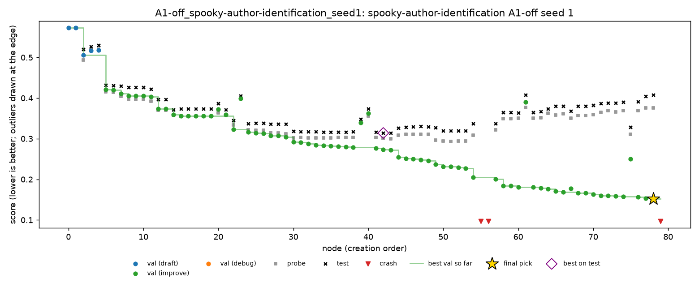

# Spooky, seed 1 extended to 4 hours

Night of 30 to 31 Oct 2026, Nabil's Mac. This is the second step towards the full plan. The five seed 1 runs ([`spooky-seed1.md`](spooky-seed1.md)) were each given 2 more hours, to 4 hours, the same way as seed 0 the night before ([`spooky-seed0-4h.md`](spooky-seed0-4h.md)).

Spooky is multiclass log loss, so **lower is better**. MLE-bench thresholds: median 0.4188, bronze 0.2938.

## Setup

- **The same as the seed 0 extension:**
  - DeepSeek V4 Flash 0731 (fp8), A1, Docker with Colima at 2 CPUs and 4 GB, on the MacBook Pro M1;
  - run with `launch_grid.py --only spooky --seed 1 --budget-hours 4`.
- **Times (SGT):** 22:24 to 08:17, about 2 hours per run, in the order C1, C4, C5, A1-off, A4-off.
- **Health:** no restarts, 0 failed LLM calls.
- **Cost:** about $0.43 for the night.
- **Backup:** the 2-hour state of each run was copied to `runs/grid_2h_backup/` beforehand (on Nabil's Mac only).
- **Code:** seed 1 already had the PR #7 fix, so both halves of each run used the same code.
- **Providers changed.** The routing sends each call to the cheapest fp8 provider under the price cap. On earlier nights that was almost always Baidu. This night most calls went to StreamLake, with some to Baidu, DeepInfra, BaseTen and CoreWeave. It's the same model, but not the same serving stack for every call.

## Results

| Run | Nodes (2 h → 4 h) | Test at 2 h | **Test at 4 h** | Change | 4 h pick: validation / probe | C2 (oracle) at 4 h | C3 (top 3) at 4 h |
|---|---|---|---|---|---|---|---|
| C1 | 50 → 67 | 0.3087 | **0.3029** | −0.006 | n54: 0.3041 / 0.2945 | 0.3010 | 0.3029 |
| C4 | 38 → 49 | 0.3339 | **0.3131** | −0.021 | n46: 0.3017 / 0.3023 | 0.3131 | 0.3131 |
| C5 | 45 → 68 | 0.2973 | **0.2816 (bronze)** | −0.016 | n66: 0.2755 / 0.2898 | 0.2810 | 0.2814 |
| A1-off | 56 → 80 | 0.3374 | **0.4078** | **+0.070** | n78: 0.1518 / 0.3758 | 0.3140 | 0.3915 |
| A4-off | 57 → 82 | 0.3651 | **0.3584** | −0.007 | n78: 0.3594 / 0.3604 | 0.3568 | 0.3568 |

- **C5 seed 1 is the first spooky run to medal:** bronze at 0.2816. Its last improvement, n66, changed how 20 fold-wise calibration matrices were averaged before the final calibrator.
- **All four runs with A1 improved,** by 0.006 to 0.021. With A1, the final pick still barely matters: the oracle is within 0.002 of every pick.
- **A1-off got much worse** (finding 1).
- **No live interventions:** neither C4 nor C5 fired during the extension.

## Findings

### 1. Without A1, the leak kept going for 4 hours

Seed 1's A1-off run was already fooling itself at 2 hours: it stacked models with a learner fitted on its own validation split ([`spooky-seed1.md`](spooky-seed1.md)). In the extension it kept going, adding more base models and meta-features to the same stack:

| Node | Validation | Probe | Test |
|---|---|---|---|
| n42 (best on test, first 2 hours) | 0.2731 | 0.3012 | **0.3140** |
| n54 (the 2-hour pick) | 0.2051 | 0.3089 | 0.3374 |
| n60 | 0.1811 | 0.3501 | 0.3639 |
| n70 | 0.1632 | 0.3596 | 0.3821 |
| n78 (the 4-hour pick) | **0.1518** | 0.3758 | **0.4078** |

- **The gap between validation and test grew** from 0.13 at 2 hours to **0.26** at 4 hours.
- **The pick is now barely above the median** (0.419).
- **Every node after n54 was worse on test,** while looking better to the agent.

### 2. The C4 rule, replayed, would now gain 0.094

Replayed over the extended run (`scripts/replay_policy.py`), the C4 rule fires at n45, as it did at 2 hours, and prunes the leaking branch: 35 nodes by 4 hours. The pick becomes n43, at test **0.3144** instead of 0.4078.
- **At 2 hours the same prune was worth 0.023.** At 4 hours it's worth **0.094**.
- **The longer the agent fools itself, the more an early prune is worth.**

Replayed on C5, the rule also fires once, at n55. That would make the pick slightly worse (0.2851 against 0.2816): a small false alarm on a healthy run. On the other three runs it doesn't fire.

### 3. Seeds 0 and 1 together

With both seeds at 4 hours:
- **with A1, the extra time never hurt.** All 8 runs scored the same or better, by up to 0.041;
- **without A1, both runs got worse:** seed 0 by 0.006, seed 1 by 0.070.

## Trajectories

| Run | Chart | Timeline |
|---|---|---|
| C1 | [C1.png](spooky-seed1-4h/trajectories/C1.png) | [C1.md](spooky-seed1-4h/trajectories/C1.md) |
| C4 | [C4.png](spooky-seed1-4h/trajectories/C4.png) | [C4.md](spooky-seed1-4h/trajectories/C4.md) |
| C5 | [C5.png](spooky-seed1-4h/trajectories/C5.png) | [C5.md](spooky-seed1-4h/trajectories/C5.md) |
| A1-off | [A1-off.png](spooky-seed1-4h/trajectories/A1-off.png) | [A1-off.md](spooky-seed1-4h/trajectories/A1-off.md) |
| A4-off | [A4-off.png](spooky-seed1-4h/trajectories/A4-off.png) | [A4-off.md](spooky-seed1-4h/trajectories/A4-off.md) |

## Files

- **`spooky-seed1-4h/grades/`:** MLE-bench's grade of each run at 4 hours.
- **`spooky-seed1-4h/trajectories/`:** the chart and timeline of each run, including both halves.
- **On Nabil's Mac only:**
  - the run folders (`runs/grid/*_seed1/`), now at 4 hours;
  - their 2-hour copies (`runs/grid_2h_backup/`);
  - the log (`runs/grid_spooky_seed1_4h.log`).

## Next

The rest of the full plan for spooky:
- extend seed 2 of C1, C4 and C5 to 4 hours, which is 3 runs and about 6 hours;
- add seeds 3 and 4 of C1, C4 and C5, and seed 2 of the ablations, which is 8 runs at 4 hours, about 32 hours. `configs/schedule.yaml` needs those seeds added first.
