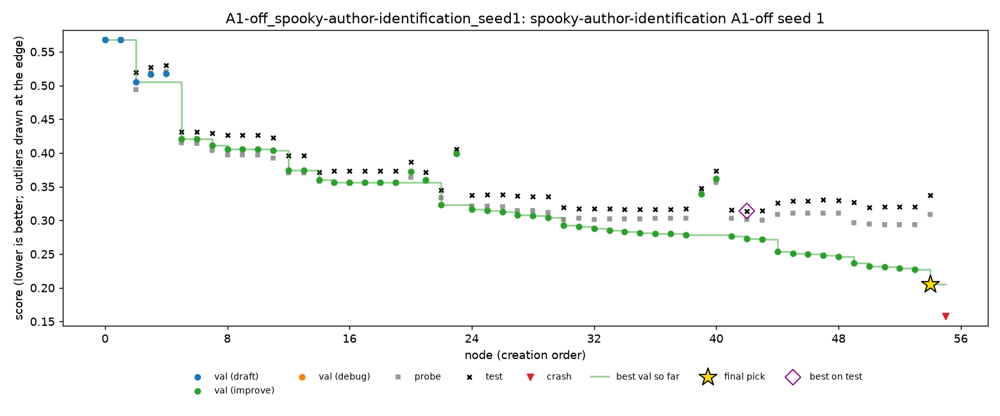
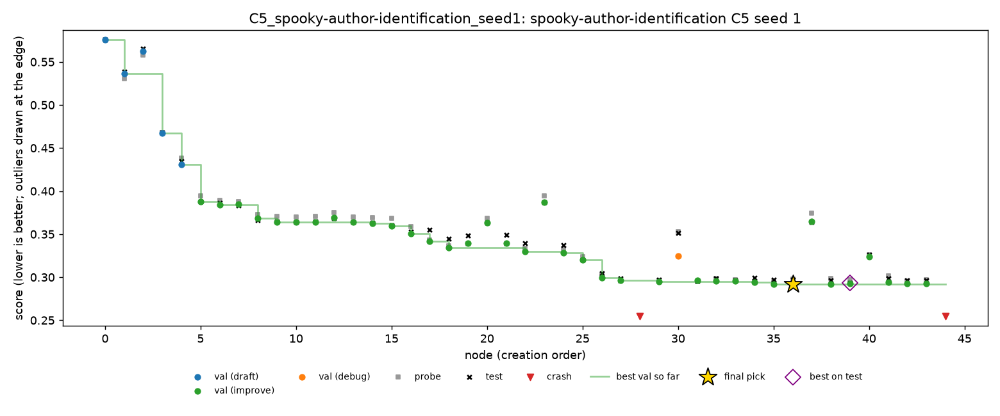

# Spooky, seed 1: second night of the half plan

Night of 26 to 27 Oct 2026, Nabil's Mac. Seed 1 of every condition on `spooky-author-identification`, run from the `result-spooky` branch. Seed 0 is in [`spooky-seed0.md`](spooky-seed0.md).

Spooky is multiclass log loss, so **lower is better**. MLE-bench thresholds: median 0.4188, bronze 0.2938.

## Setup

- **Same as seed 0** (DeepSeek V4 Flash 0731, fp8, A1, Docker, 2 hours per run), with one fix: PR #7. Scripts that write `import os; OUTPUT_DIR = ...` on one line no longer crash. That form crashed two nodes in seed 0's A4-off run. It occurred once tonight and ran normally, and no node crashed on `OUTPUT_DIR`.
- **Times (SGT):** 22:55 to 09:04, in the order C1, C4, C5, A1-off, A4-off.
- **Health:** no restarts, 0 failed LLM calls out of 272.
- **Cost:** $0.446 for the night, against $0.294 for seed 0. The runs made more nodes (38 to 57, against 25 to 52), so more calls.

## Results

| Run | Nodes | LLM calls | Cost | Final pick | Validation | Probe | **Test** | Pick's test rank in run | Best test in run |
|---|---|---|---|---|---|---|---|---|---|
| C1 | 50 | 56 | $0.089 | n48 | 0.3148 | 0.3004 | **0.3087** | 1st of 47 | 0.3087 |
| C4 | 38 | 43 | $0.056 | n35 | 0.3200 | 0.3262 | **0.3339** | 1st of 36 | 0.3339 |
| C5 | 45 | 51 | $0.065 | n36 | 0.2917 | 0.2978 | **0.2973** | 8th of 43 | 0.2934 (bronze) |
| A1-off | 56 | 63 | $0.094 | n54 | **0.2051** | 0.3089 | **0.3374** | **27th of 55** | 0.3140 |
| A4-off | 57 | 59 | $0.143 | n55 | 0.3712 | 0.3699 | **0.3651** | 2nd of 56 | 0.3645 |

- All five are valid and above the median. None reached bronze.
- **C5 came within 0.0035 of bronze.** It made a bronze-level node, n39 at 0.2934, but submitted n36 at 0.2973. On validation they were only 0.0007 apart (0.2917 and 0.2924), so n39 ranked 5th.

### Both seeds so far

| Condition | Seed 0 | Seed 1 | Mean |
|---|---|---|---|
| C1 | 0.3606 | 0.3087 | 0.3347 |
| C4 | 0.3808 | 0.3339 | 0.3574 |
| C5 | 0.3632 | 0.2973 | 0.3302 |
| A1-off | 0.3377 | 0.3374 | 0.3375 |
| A4-off | 0.3361 | 0.3651 | 0.3506 |

### C2 and C3

C2 (oracle) submits the node with the best test score. C3 (top-3 hedge) submits the best on test among the top 3 by validation. Both are computed after the run, from its tree.

| | Seed 0 | Seed 1 | Mean |
|---|---|---|---|
| C1 (agent's pick) | 0.3606 | 0.3087 | 0.3347 |
| C2 (oracle, from C1) | 0.3606 | 0.3087 | 0.3347 |
| C3 (top 3, from C1) | 0.3606 | 0.3087 | 0.3347 |

In the proposal, C2 and C3 come from C1 runs only. On both seeds they equal C1, since C1's pick was its best node on test.

The same calculation on every run shows where selection would have mattered:

| Run | Seed | Agent's pick | C2 (oracle) | C3 (top 3) |
|---|---|---|---|---|
| C4 | 0 | 0.3808 | 0.3808 | 0.3808 |
| C4 | 1 | 0.3339 | 0.3339 | 0.3339 |
| C5 | 0 | 0.3632 | 0.3632 | 0.3632 |
| C5 | 1 | 0.2973 | **0.2934** (n39, bronze) | 0.2962 (n38) |
| A1-off | 0 | 0.3377 | 0.3372 | 0.3372 |
| A1-off | 1 | 0.3374 | **0.3140** (n42) | 0.3198 (n52) |
| A4-off | 0 | 0.3361 | 0.3352 | 0.3352 |
| A4-off | 1 | 0.3651 | 0.3645 | 0.3645 |

- Final-node selection matters in two runs out of ten.
- **A1-off seed 1:** the oracle gains 0.023, and the top 3 recover 0.018 of it. Its top 3 by validation were the last three nodes (n52 to n54), all inflated by the leak, so a hedge over them only partly helps.
- **C5 seed 1:** the oracle would have medalled.
- **Elsewhere:** selection loses at most 0.001.

## Findings

### 1. Without A1, the agent fooled itself: validation 0.205, test 0.337

This is the main result of the night. From n22 onwards, A1-off's script stacked its base models with a logistic regression fitted on its own validation split. It then scored the stack on that same split:

```python
stack_lr.fit(X_stack_val, y_val)                    # n54, line 584
val_score = float(log_loss(y_val, val_proba, ...))  # line 597
```

Each further "improvement" fitted the stacker more closely to those labels, so validation kept falling while probe and test stalled, then got worse:

| Node | Validation | Probe | Test | Validation-to-test gap |
|---|---|---|---|---|
| n22 (stacking starts) | 0.3232 | 0.3339 | 0.3445 | 0.021 |
| n43 | 0.2721 | 0.3003 | 0.3144 | 0.042 |
| n54 (submitted) | 0.2051 | 0.3089 | 0.3374 | 0.132 |

The agent submitted its worst-generalising late node: 27th of 55 on test. The best node in the run, n42 at 0.3140, came about 12 nodes earlier.



This is exactly what A1 is for. With A1, scores come from a frozen harness with labels the agent never sees, so fitting to them is impossible. The A1 runs stayed honest tonight: their validation-to-test gaps were -0.006 (C1), +0.014 (C4) and +0.006 (C5). In seed 0, A1-off's gap was a milder 0.023. The leakage is seed-dependent, but when it happens it is large.

### 2. In this run, C4's rule would have fired, and helped

Replaying the C4 rule over the A1-off run (`scripts/replay_policy.py`):
- it fires at **n45**, once validation has gained while probe lost for long enough;
- it prunes the 12 nodes after that;
- the pick becomes **n43**, at test **0.3144** instead of 0.3374, a gain of **0.023**, larger than seed 0's noise level of about ±0.02.

Replaying C5's rule, it would have deleted the finding about n44's stacker change (n44: validation +0.018, probe -0.008). It would have fired at 13 checkpoints, from step 45 onwards. Deleting a finding does not change the pick directly.

These are post-hoc replays: the A1-off condition runs without the scripted policies. They show the research question's answer taking shape. **The action intervention (C4) helps exactly when the agent's own signal is broken**, and stays silent when it is not. Across the other nine runs, eight of them with A1, neither rule fired once. A clean test of this would be a condition that combines A1-off with C4, which is not in the grid.

### 3. C5 picked among near-ties and missed bronze

C5's top five nodes on validation were within 0.0007 of each other (0.2917 to 0.2924), and their test scores ranged from 0.2934 to 0.2974. The pick, n36, was first on validation, at test 0.2973. n39 was fifth on validation, at test 0.2934, under the bronze line (0.2938). Validation could not separate them, and the medal came down to which near-tie was chosen. A top-3 hedge (C3, computed for C1 runs only) would not have reached n39 either: its best would be n38 at 0.2962.

### 4. Seed noise is larger than seed 0 suggested

C1 went from 0.3606 (seed 0) to 0.3087 (seed 1): 0.05 apart for the same condition. C5 moved by 0.066. With two seeds, no condition is clearly better than another. The two closest to a pattern:

- C4 is worst on both seeds (0.3808 and 0.3339), but it never intervened, so this is the same agent with different random paths. It is not an effect of pruning.
- A1-off has the most stable test (0.3377 and 0.3374), but its validation is the least trustworthy (finding 1).

Seed 2 (C1, C4, C5 only) adds a third point.

### 5. Crashes

Each run ends with a node killed by the budget, as in seed 0. The real crashes were:

| Run | Node | Error | Cause |
|---|---|---|---|
| C1 | n4 | `CalibratedClassifierCV` given `random_state` | an older scikit-learn API, the kind of mistake the prompt's scikit-learn notes target |
| C1 | n44 | `NotFittedError` on a Pipeline | used before fitting |
| C4 | n9 | `re.PatternError: nothing to repeat` | a bad regular expression |
| C5 | n28 | `re.PatternError: missing )` | a bad regular expression |

None of them is a sandbox or `OUTPUT_DIR` problem.

## Trajectories

| Run | Chart | Timeline |
|---|---|---|
| C1 | [C1.png](spooky-seed1/trajectories/C1.png) | [C1.md](spooky-seed1/trajectories/C1.md) |
| C4 | [C4.png](spooky-seed1/trajectories/C4.png) | [C4.md](spooky-seed1/trajectories/C4.md) |
| C5 | [C5.png](spooky-seed1/trajectories/C5.png) | [C5.md](spooky-seed1/trajectories/C5.md) |
| A1-off | [A1-off.png](spooky-seed1/trajectories/A1-off.png) | [A1-off.md](spooky-seed1/trajectories/A1-off.md) |
| A4-off | [A4-off.png](spooky-seed1/trajectories/A4-off.png) | [A4-off.md](spooky-seed1/trajectories/A4-off.md) |



## Files

- **`spooky-seed1/grades/`:** MLE-bench's grade of each run.
- **`spooky-seed1/outcomes/`:** `scripts/outcomes.py` over both seeds (ten runs).
- **`spooky-seed1/trajectories/`:** the chart and timeline of each run.
- **On Nabil's Mac only:** the run folders (`runs/grid/*_seed1/`) and the launcher log (`runs/grid_spooky_seed1.log`).

## Next

- **Seed 2 of C1, C4 and C5:**

  ```bash
  python scripts/launch_grid.py --only spooky --seed 2
  ```

  About 6 hours. This completes spooky's 13 runs.
- **The C6 session on spooky** (seed 100).
- **For the slides:** finding 1 and finding 2 together are the strongest story so far.
  - Without A1, the agent's validation drifted 0.13 from test.
  - The probe split showed it.
  - The C4 rule, replayed, would have caught it and recovered 0.023.
