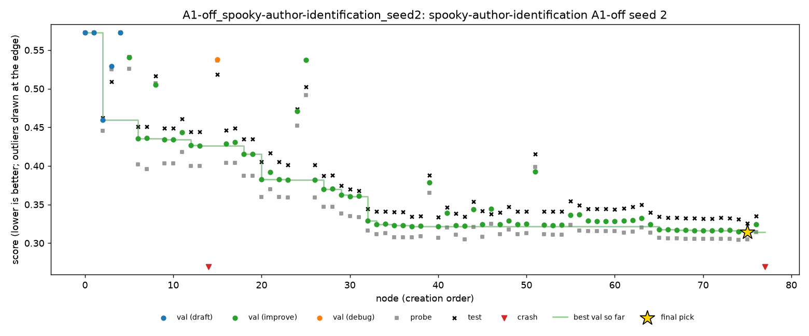

# Spooky, seed 2 extended to 4 hours, and A1-off seed 2

Night of 31 Oct to 1 Nov 2026, Nabil's Mac. This is the third step towards the full plan. The three seed 2 runs ([`spooky-seed2.md`](spooky-seed2.md)) were each given 2 more hours, to 4 hours, the same way as seeds 0 and 1 ([`spooky-seed0-4h.md`](spooky-seed0-4h.md), [`spooky-seed1-4h.md`](spooky-seed1-4h.md)). A1-off seed 2, new in the full plan, ran 4 hours in one go.

Spooky is multiclass log loss, so **lower is better**. MLE-bench thresholds: median 0.4188, bronze 0.2938.

## Setup

- **The same as the seed 0 and seed 1 extensions:**
  - DeepSeek V4 Flash 0731 (fp8), A1, Docker with Colima at 2 CPUs and 4 GB, on the MacBook Pro M1;
  - C1, C4 and C5 run with `launch_grid.py --only spooky --seed 2 --budget-hours 4`.
- **A1-off seed 2** was started with `cloud_run.py` directly, since `configs/schedule.yaml` still lists only seeds 0 and 1 for the ablations:
  ```
  python scripts/cloud_run.py --config configs/conditions/ablation_a1_off.yaml --task spooky-author-identification \
      --seed 2 --budget-hours 4.0 --sandbox docker --runs-root runs/grid --evaluator a1
  ```
- **Times (SGT):** C1 22:37 to 00:37, C4 to 02:42, C5 to 04:42, A1-off to 08:42.
- **Health:** no restarts, no API errors.
- **Cost:** about $0.55 for the night ($0.27 for the three extensions, $0.28 for A1-off).
- **Backup:** the 2-hour state of C1, C4 and C5 was copied to `runs/grid_2h_backup/` beforehand (on Nabil's Mac only).
- **Code:** seed 2 already had the PR #7 fix, so both halves of each run used the same code.
- **One difference from seeds 0 and 1:** A1-off seed 2 has no 2-hour half. Its seeds 0 and 1 ran 2 hours, then resumed for 2 more. Its final pick is made only once, at 4 hours.

## Results

| Run | Nodes (2 h → 4 h) | Test at 2 h | **Test at 4 h** | Change | 4 h pick: validation / probe | C2 (oracle) at 4 h | C3 (top 3) at 4 h |
|---|---|---|---|---|---|---|---|
| C1 | 45 → 59 | 0.2946 | **0.2944** | −0.0002 | n46: 0.2953 / 0.2914 | 0.2944 | 0.2944 |
| C4 | 39 → 59 | 0.3568 | **0.3336** | **−0.023** | n56: 0.3269 / 0.3378 | 0.3247 | 0.3247 |
| C5 | 43 → 58 | 0.3414 | **0.3352** | −0.006 | n55: 0.3415 / 0.3315 | 0.3352 | 0.3352 |
| A1-off | – → 78 | – | **0.3257** | – | n75: 0.3145 / 0.3049 | 0.3257 | 0.3257 |

- **None medalled.** C1 is again just short of bronze, by 0.0006. Its only gain in the extension was the first new node, n46 (an ExtraTrees model on the stylometric features). The other 12 working nodes didn't beat it on validation.
- **All three runs with A1 improved,** by 0.0002 to 0.023.
- **C4's pick missed by 0.009,** the most of any run with A1 so far. n56 (adding ComplementNB) beat n53 on validation and probe but not on test. Until now the oracle was within 0.002 of every pick with A1 on.
- **A1-off seed 2 didn't leak** (finding 1).
- **No live interventions:** neither C4 nor C5 fired during the extension. C5's one correction is still the one from the first 2 hours.

## Findings

### 1. Without A1, a leak only happens if the agent starts stacking

A1-off seeds 0 and 1 both got worse with more time, because they stacked models with a learner fitted on their own validation split ([`spooky-seed1-4h.md`](spooky-seed1-4h.md)). Seed 2 never stacked or blended. It stayed with one TF-IDF and logistic regression pipeline for all 78 nodes, adding features to it:

| | Seed 0 | Seed 1 | Seed 2 |
|---|---|---|---|
| Test at 4 h | 0.3440 | 0.4078 | **0.3257** |
| Validation of the pick | 0.2563 | 0.1518 | 0.3145 |
| Gap, test minus validation | 0.088 | 0.256 | **0.011** |
| Pick vs oracle | +0.021 | +0.094 | **0** |

- **Validation, probe and test moved together** all night. The largest gap on any node was 0.025.
- **So A1-off's danger depends on the path, not on time alone.** Without A1, nothing stops the leak once the agent tries stacking. If it never tries, the run looks like a run with A1.
- **The C4 rule, replayed (`scripts/replay_policy.py`), doesn't fire** on this run, nor on C1 or C5. That's right: there was nothing to prune.

### 2. Some calls ran into the 64k output cap

7 of tonight's 146 calls returned no code: each used all 64,000 output tokens on reasoning and was cut off. Each took 9 to 12 minutes, about **71 minutes** in all, or 12% of the night.
- **All of them were served by StreamLake.** Since the seed 1 extension (30 Oct), StreamLake served 221 calls and 11 were cut off this way: 4 in the seed 1 extension, 7 tonight. Baidu and DeepInfra served 36, and none were.
- **Before 30 Oct, most calls went to Baidu.** Only 1 of 792 calls was cut off, served by CoreWeave.
- **This costs search time, not money:** the agent just drafts again. But it differs between nights, so the routing could pin a provider, or exclude StreamLake, for the rest of the full plan.

### 3. All three seeds at 4 hours

| Condition | Seed 0 | Seed 1 | Seed 2 | Mean |
|---|---|---|---|---|
| C1 | 0.3198 | 0.3029 | 0.2944 | **0.3057** |
| C4 | 0.3808 | 0.3131 | 0.3336 | 0.3425 |
| C5 | 0.3360 | 0.2816 (bronze) | 0.3352 | 0.3176 |
| A1-off | 0.3440 | 0.4078 | 0.3257 | 0.3592 |
| A4-off | 0.3215 | 0.3584 | to run | 0.3400 |

- **With A1, the extra time never hurt.** All 11 extended runs scored the same or better.
- **C1 has the best mean,** then C5. C4 has the worst mean among runs with A1.
- **A1-off has the worst mean and the widest spread,** from 0.3257 to 0.4078.

## Trajectories

| Run | Chart | Timeline |
|---|---|---|
| C1 | [C1.png](spooky-seed2-4h/trajectories/C1.png) | [C1.md](spooky-seed2-4h/trajectories/C1.md) |
| C4 | [C4.png](spooky-seed2-4h/trajectories/C4.png) | [C4.md](spooky-seed2-4h/trajectories/C4.md) |
| C5 | [C5.png](spooky-seed2-4h/trajectories/C5.png) | [C5.md](spooky-seed2-4h/trajectories/C5.md) |
| A1-off | [A1-off.png](spooky-seed2-4h/trajectories/A1-off.png) | [A1-off.md](spooky-seed2-4h/trajectories/A1-off.md) |



## Files

- **`spooky-seed2-4h/grades/`:** MLE-bench's grade of each run at 4 hours.
- **`spooky-seed2-4h/trajectories/`:** the chart and timeline of each run, including both halves.
- **On Nabil's Mac only:**
  - the run folders (`runs/grid/*_seed2/`), now at 4 hours;
  - the 2-hour copies of C1, C4 and C5 (`runs/grid_2h_backup/`);
  - the log (`runs/grid_spooky_seed2_4h.log`).

## Next

The rest of the full plan for spooky is 7 runs at 4 hours, about 28 hours:
- A4-off seed 2;
- seeds 3 and 4 of C1, C4 and C5. `configs/schedule.yaml` needs those seeds added first.
