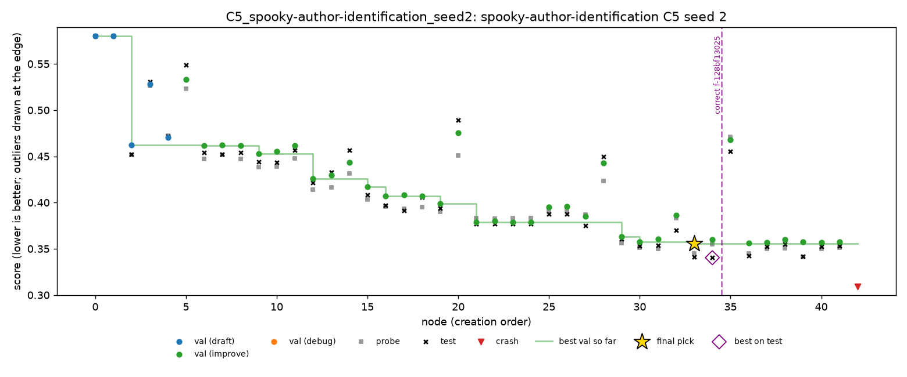

# Spooky, seed 2: third night of the half plan

Night of 27 to 28 Oct 2026, Nabil's Mac. Seed 2 of C1, C4 and C5 on `spooky-author-identification`, run from the `result-spooky` branch. A1-off and A4-off have two seeds in the half plan, so this night completes spooky's 13 runs. Seed 0 is in [`spooky-seed0.md`](spooky-seed0.md), seed 1 in [`spooky-seed1.md`](spooky-seed1.md).

Spooky is multiclass log loss, so **lower is better**. MLE-bench thresholds: median 0.4188, bronze 0.2938.

## Setup

- **Same as seed 1:** DeepSeek V4 Flash 0731 (fp8), A1, Docker, 2 hours per run, with the PR #7 `OUTPUT_DIR` fix.
- **Times (SGT):** 01:31 to 07:31, in the order C1, C4, C5.
- **Health:** no restarts, 0 failed LLM calls out of 143.
- **Cost:** $0.256 for the night.

## Results

| Run | Nodes | LLM calls | Cost | Final pick | Validation | Probe | **Test** | Pick's test rank in run | Best test in run |
|---|---|---|---|---|---|---|---|---|---|
| C1 | 45 | 51 | $0.094 | n43 | 0.2954 | 0.2916 | **0.2946** | 1st of 42 | 0.2946 |
| C4 | 39 | 44 | $0.064 | n37 | 0.3574 | 0.3623 | **0.3568** | 3rd of 36 | 0.3559 |
| C5 | 43 | 48 | $0.098 | n33 | 0.3555 | 0.3451 | **0.3414** | 2nd of 42 | 0.3404 |

- All three are valid and above the median. None reached bronze.
- **C1 came within 0.0008 of bronze** (0.2946 against 0.2938). It is the best spooky run so far, and its pick was its best node on test.
- **C5 fired in a live run for the first time** (finding 1).
- C4 did not fire, as on seeds 0 and 1.

### All three seeds

| Condition | Seed 0 | Seed 1 | Seed 2 | Mean |
|---|---|---|---|---|
| C1 | 0.3606 | 0.3087 | 0.2946 | 0.3213 |
| C4 | 0.3808 | 0.3339 | 0.3568 | 0.3572 |
| C5 | 0.3632 | 0.2973 | 0.3414 | 0.3340 |
| A1-off | 0.3377 | 0.3374 | n/a | 0.3375 |
| A4-off | 0.3361 | 0.3651 | n/a | 0.3506 |

### C2 and C3

C2 (oracle) submits the node with the best test score. C3 (top-3 hedge) submits the best on test among the top 3 by validation. Both are computed after the run, from its tree.

| | Seed 0 | Seed 1 | Seed 2 | Mean |
|---|---|---|---|---|
| C1 (agent's pick) | 0.3606 | 0.3087 | 0.2946 | 0.3213 |
| C2 (oracle, from C1) | 0.3606 | 0.3087 | 0.2946 | 0.3213 |
| C3 (top 3, from C1) | 0.3606 | 0.3087 | 0.2946 | 0.3213 |

On all three seeds C1 picked its best node on test, so C2 and C3 equal C1.

The same calculation on tonight's other runs:

| Run | Seed | Agent's pick | C2 (oracle) | C3 (top 3) |
|---|---|---|---|---|
| C4 | 2 | 0.3568 (n37) | 0.3559 (n36) | 0.3559 (n36) |
| C5 | 2 | 0.3414 (n33) | 0.3404 (n34) | 0.3414 (n33) |

Selection loses at most 0.001 here. n37 and n35 tied on validation in C4 (0.3574), and n36 was 3rd.

## Findings

### 1. C5 fired, but on a finding that the probe confirmed

At safe point 35 (06:52, after n34), C5 deleted finding `f-128bf13025`:

> Adding a character n-gram CountVectorizer via FeatureUnion to the tuned word-level pipeline hurt validation badly (n28 0.44294 vs n27 0.3849), so mixing char n-grams into this CNB setup is not beneficial.

The rule's note: "1 of 2 cited nodes failed to replicate: n28 val -0.05805, probe -0.03604 vs n27".

The probe agrees that the change hurts. n28 is 0.058 worse than n27 on validation and 0.036 worse on the probe. For a finding that says a change hurts, the rule's check (`src/imle/policies/finding_correction.py`) is `probe gain - validation gain > max_gap`: -0.036 - (-0.058) = 0.022, just over `max_gap` = 0.02. The other cited node, n27, passed, so 1 of 2 checked nodes failed, which meets `min_fail_fraction` = 0.5.

So the finding was right about the direction and overstated the size. The rule deleted it because the harm on the probe was smaller than on validation. For a "hurts" finding, a smaller harm on the probe still confirms it. This firing reads as a false positive of the rule's design rather than a caught mistake.

**It changed nothing.** After the deletion the agent made 8 more nodes, n35 to n42. None of them tried character n-grams again, and none beat n33, the pick made before the deletion.

**For the report:** C5's check on "hurts" findings could require the probe to disagree in sign, or to show no harm, rather than a smaller harm. That is a change for after the half plan, since changing it now would make seed 2 differ from seeds 0 and 1.

### 2. Seed noise is still larger than the effects

C1 has now ranged over 0.066 (0.3606 to 0.2946). C4 is worst on all three seeds, with a mean 0.036 above C1. C4 never intervened, though, so its runs are C1's agent on different random paths, and this gap is noise, not pruning. With three seeds and no interventions, it shows how far apart two identical conditions can land.

C5 sits between them (mean 0.3340), and its one intervention made no difference (finding 1), so C5 against C1 is also noise for now.

### 3. Crashes

Each run ends with a node killed by the budget, as before. The other failures:

| Run | Node | Error | Cause |
|---|---|---|---|
| C1 | n15 | leakage check R3 | evaluated a model on validation rows it was fitted on; debug fixed it in n16 |
| C1 | n38 | leakage check R3 | the same, for a final logistic regression; debug fixed it in n40 |
| C4 | n17 | timeout after 1200 s | a slow calibration; debug fixed it in n20 |
| C4 | n21 | timeout after 1200 s | the same; debug fixed it in n24 |

The leakage check caught two leaks before they could inflate validation, in a run with A1. None of the failures is a sandbox or `OUTPUT_DIR` problem.

## Trajectories

| Run | Chart | Timeline |
|---|---|---|
| C1 | [C1.png](spooky-seed2/trajectories/C1.png) | [C1.md](spooky-seed2/trajectories/C1.md) |
| C4 | [C4.png](spooky-seed2/trajectories/C4.png) | [C4.md](spooky-seed2/trajectories/C4.md) |
| C5 | [C5.png](spooky-seed2/trajectories/C5.png) | [C5.md](spooky-seed2/trajectories/C5.md) |

## Files

- **`spooky-seed2/grades/`:** MLE-bench's grade of each run.
- **`spooky-seed2/outcomes/`:** `scripts/outcomes.py` over all three seeds (13 runs).
- **`spooky-seed2/trajectories/`:** the chart and timeline of each run.
- **On Nabil's Mac only:** the run folders (`runs/grid/*_seed2/`) and the launcher log (`runs/grid_spooky_seed2.log`).

## Next

- **The C6 session on spooky** (seed 100).
- **For the slides:** the results table's spooky column is complete. Slide 11's "0 of 9" needs updating: C5 has now fired once in a run with A1, and it did not change the outcome.
